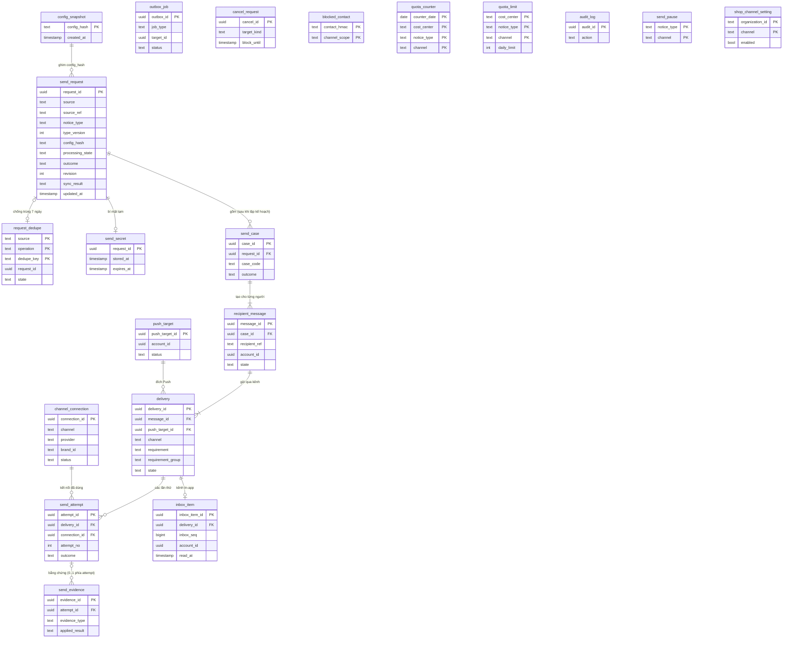

# Notitek - MÔ HÌNH DỮ LIỆU LOGIC VÀ TỪ ĐIỂN DỮ LIỆU

**Phiên bản:** 0.8. **Ngày:** 13/10/2026. **Chủ trì:** PO Notification. **Trạng thái:** Bản nháp PO để Tech Lead review. Tech Lead hoàn thiện thành Physical DB (kiểu dữ liệu, index, partition, khóa lạc quan, migration) sau khi chốt các điểm ở mục 9.

Bản 0.8 so với 0.7: áp dụng 6 quyết định PO DB01–DB06 đã được người yêu cầu xác nhận ngày 13/10/2026 (mục 9.1; DEC v1.9 mục 2.16). Chốt cửa sổ metadata 180 ngày đến 180 ngày + 1 tháng; metadata inbox theo accepted_at của request, nội dung 90 ngày; TTL liên hệ tạm tối đa 24 giờ; R1 chỉ polling và tách quyền vận hành. Vẫn có 20 bảng/193 trường và đủ showcase.

Bản 0.7 so với 0.6: rà soát **20 bảng, 193 trường**; mỗi bảng có tình huống chứng minh nhu cầu tách bảng, mỗi trường có giá trị mẫu và quy tắc/truy vấn cần nó. Tách toàn bộ dòng gộp; chuẩn hóa tên ngắn, sát nghiệp vụ theo snake_case và có ánh xạ API/code ở mục 7. Bổ sung sync_result bất biến, updated_at cấp request và stored_at của gói bí mật; sửa ví dụ nhóm ZNS/SMS và quy tắc hoàn quota qua nửa đêm. Phần chưa có quyết định thống nhất giữ ở mục 9, không coi là đã nghiệm thu.

**Phạm vi đặt tên:** tên ở ERD/từ điển là baseline database v0.8 cho thiết kế vật lý. API v1 và code hiện hành giữ tên hợp đồng của chúng; adapter persistence/API ánh xạ theo mục 7. Repo hiện chỉ có migration tạo schema notification, chưa có bảng nghiệp vụ để đổi tên bằng migration. Các đoạn lịch sử v0.3–0.6 và báo cáo review cũ giữ tên tại thời điểm viết.

Bản 0.6 so với 0.5: đối chiếu với [báo cáo đánh giá](<Notitek - ĐÁNH GIÁ LOGICAL DATABASE VÀ DATA DICTIONARY.md>) (15 điểm C01 đến C15, viết trên bản 0.3) và đóng nốt các phần còn hở mà không cần chờ provider: `push_subscription` giữ dòng đã thu hồi để chống hồi sinh và để delivery còn tham chiếu (C05), `brand_id` có điều kiện bắt buộc (C14), đơn vị đếm và nguồn báo cáo theo provider của `quota_counter` (C06), thời gian lưu của `contact_blocklist` (C09). Phần còn hoãn có chủ đích ghi ở Q10.

Bản 0.5 so với 0.4: đổi tên trường và trạng thái theo [OpenAPI v1](api/openapi.json), [API README](api/README.md) và code hiện có (`internal/notification/domain`); thêm ma trận chuyển trạng thái R1 (ADR-04) theo quyết định A và B ngày 12/10/2026; đồng bộ với cơ chế hủy, outbox và transaction của worker trong [CẤU TRÚC MÃ NGUỒN](<Notitek - CẤU TRÚC MÃ NGUỒN.md>) §11; thêm dữ liệu cần để tiếp tục gửi sau `accepted`; thêm ràng buộc duy nhất cho các bảng con; sửa ERD cho khớp từ điển.

Căn cứ: [SRS](<Notitek - ĐẶC TẢ YÊU CẦU PHẦN MỀM (SRS).md>) mục 4 và 8, [quyết định PO](<Notitek - QUYẾT ĐỊNH PO CHO CÁC DEC.md>) v1.8, [đề xuất công nghệ](<Notitek - ĐỀ XUẤT CÔNG NGHỆ SỬ DỤNG CHO DỰ ÁN.md>) (PostgreSQL, partition theo tháng cho lịch sử). Kiểu dữ liệu ở đây là kiểu logic, không phải kiểu PostgreSQL.

## 1 Nguyên tắc thiết kế dữ liệu

**Quy ước tên:** bảng dùng danh từ nghiệp vụ số ít (send_request, delivery, push_target); trường dùng chữ thường và dấu gạch dưới. Các tên hiện tại dài tối đa 20 ký tự; đây là kết quả rút gọn, không phải giới hạn cứng buộc viết tắt. Giữ account_id, organization_id, application_id vì đúng đối tượng hệ thống nguồn; không đổi organization thành shop hay account thành user. ID kết thúc bằng _id, reference ngoài bằng _ref, thời điểm sự kiện bằng _at, hạn hiệu lực bằng _until hoặc expires_at, số đếm bằng _count. Không dùng chữ viết tắt khó đoán. notice_type/template_data thay type/data để nói rõ dữ liệu gì; state/outcome được giữ vì bảng đã xác định đối tượng.

| # | Nguyên tắc | Căn cứ |
|---|---|---|
| 0 | **Mỗi trường phải trả lời được: yêu cầu, truy vấn hoặc quy tắc nào cần nó, và có suy ra được từ chỗ khác không.** Trường không trả lời được thì không đưa vào. | PO |
| 1 | **Không có bảng nào chứa OTP/token nguyên văn.** OTP đồng bộ chỉ nằm trong bộ nhớ. Bí mật của yêu cầu bất đồng bộ (link lời mời, kích hoạt) chỉ được giữ mã hóa trong `send_secret` với TTL ≤ 10 phút. Dấu chống trùng dùng HMAC. | DEC-05, DEC-09 |
| 2 | **Chia nơi lưu theo tính chất thay đổi.** Chính sách đổi chậm, cần người duyệt (loại thông báo, mẫu, tiêu chí đạt, mục đích, cost center theo brand, kênh được phép) nằm ở registry YAML trong repo; DB ghim `config_hash` (hash cả registry) vào từng yêu cầu, bản chụp đã resolve lưu bất biến ở `config_snapshot`. **Dữ liệu vận hành đổi lúc chạy nằm trong DB và đổi qua API có quyền và audit, không cần deploy**: kết nối kênh, kill-switch, hạn mức ngày, bật/tắt Push của Shop. | DEC-07, DEC-08, DEC-12, SRS-F15 |
| 3 | **Tên trạng thái và kết quả theo OpenAPI v1.** Chi tiết hơn (bounce, từ chối chắc chắn, hết retry) nằm ở `reason_code` (danh sách đóng, mục 4.5) và ở bằng chứng, không thêm trạng thái ngoài OpenAPI. | OpenAPI, code |
| 4 | **Bằng chứng chỉ thêm, không sửa nội dung.** Chỉ hai cột đối chiếu của bằng chứng (`attempt_id`, `applied_result`) được cập nhật khi khớp muộn. | SRS-F09.06 |
| 5 | **Mọi yêu cầu có ngữ cảnh rõ**: `ACCOUNT` (không có organization) hoặc `WORKSPACE` (bắt buộc `organization_id`). | DEC-03, API §4 |
| 6 | **Dữ liệu có thời gian lưu khác nhau thì ở bảng khác nhau**, hoặc là cột có job làm rỗng riêng và được ghi rõ ở mục 6. | DEC-09 |
| 7 | **Liên hệ nguyên văn chỉ ở delivery**, ngoại lệ recipients_spec trước PLAN: xóa khi PLAN xong hoặc request đóng, và luôn trước min(accepted_at + 24 giờ, send_deadline). rendered_text/title/preview không chứa liên hệ đầy đủ. | DEC-09, DB04 |
| 8 | **Không có cột môi trường.** Mỗi môi trường là một triển khai và DB riêng; "môi trường" trong khóa chống trùng là hằng số của triển khai, không phải cột. | PO, 09/10/2026 |
| 9 | **Giá trị danh mục mở rộng được (kênh, provider, loại bằng chứng, mã lý do) lưu dạng văn bản, không dùng enum hoặc CHECK ở DB**; tính hợp lệ do code và cấu hình kiểm tra. Thêm kênh mới chỉ cần thêm Adapter, không phải migration. | PO |
| 10 | Notification không sở hữu User, Organization, Order, thiết bị tin cậy. Các cột `account_id`, `organization_id`, `subject_ref` là tham chiếu, không có khóa ngoại sang module khác. | Thiết kế sơ bộ mục 6 |
| 11 | **Không lưu giá trị suy ra được** (số lần thử, loại đích, mức đạt từng người). Ngoại lệ phải có ghi chú lý do. | PO |
| 12 | **Ranh giới `accepted` phải đủ dữ liệu để gửi tiếp sau crash**: một transaction ghi khóa chống trùng, yêu cầu, biến không bí mật, bí mật mã hóa, selector người nhận và `outbox_job`. | CẤU TRÚC §11.1 |
| 13 | **Metadata của request và bản con xóa cùng lúc**, tính tuổi từ accepted_at, trong khoảng 180 ngày đến 180 ngày + 1 tháng. Inbox giữ nội dung/hiển thị 90 ngày từ created_at rồi làm NULL title/preview. Không để bản con mồ côi; không dùng partition để kéo TTL dữ liệu nhạy cảm. | DEC-09, DB01–DB03 |

## 2 Phân loại độ nhạy cảm

| Mức | Tên | Ví dụ | Quy tắc |
|---|---|---|---|
| P0 | Công khai nội bộ | Mã loại thông báo, tên kênh | Không giới hạn |
| P1 | Vận hành | ID, thời điểm, trạng thái, mã lỗi | Vận hành xem được theo quyền `notification.delivery.view` |
| P2 | Dữ liệu cá nhân | SĐT, email, nội dung đã dựng, biến mẫu | Mặc định hiển thị đã che; xem gốc cần `notification.delivery.view_sensitive`, nhập lý do, có audit |
| P3 | Bí mật | OTP, link có token, token FCM, credential kết nối | Không lưu nguyên văn, không vào log/trace/audit/dead-letter/backup chưa mã hóa |

## 3 Mô hình quan hệ (ERD)

ERD giữ khóa và các trường chính để đọc quan hệ; danh sách đầy đủ 193 trường và showcase nằm ở mục 5. Tên bảng trong sơ đồ dùng snake_case như từ điển.



Các quan hệ đáng chú ý:

- `request_dedupe` chỉ tồn tại 7 ngày, còn yêu cầu 180 ngày, nên phía record là 0..1 trong toàn vòng đời.
- `send_case` chỉ có sau bước lập kế hoạch người nhận (CẤU TRÚC §11.2). Yêu cầu đã `accepted` nhưng chưa lập kế hoạch thì chưa có bản con.
- `send_evidence` có thể chưa khớp lần thử (`attempt_id` rỗng), nên phía attempt là 0..1.
- `outbox_job` không vẽ quan hệ vì trỏ qua `target_id` đa hình (yêu cầu cho `PLAN`, delivery cho `SEND`), không có khóa ngoại cứng.
- `cancel_request`, `blocked_contact`, `quota_counter`, `quota_limit`, `audit_log`, `send_pause`, `shop_channel_setting` tra theo khóa tự nhiên nên không cần khóa ngoại. `audit_log` phải sống lâu hơn dữ liệu gốc.

### 3.1 Chuỗi đối tượng và ví dụ

Một sự việc `order.delivery_failed` cho Shop A và người nhận hàng:

```
send_request   notice_type=order.delivery_failed v1, source_ref=<order_id>:order.delivery_failed:<id lần thất bại>
 ├─ send_case SHOP_ALERT            (In-app bắt buộc; Push tùy chọn)
 │   ├─ recipient_message  shop-u1 ── delivery IN_APP  (REQUIRED, nhóm g1) ── inbox_item
 │   │                                └─ delivery PUSH    (OPTIONAL, nhóm g1) ── send_attempt ── send_evidence
 │   └─ recipient_message  shop-u2 ── ...
 └─ send_case CONSIGNEE_NOTICE      (ZNS chính; SMS dự phòng; cả hai cùng tiêu chí ALTERNATIVE)
     └─ recipient_message  cons-1 (không có account_id)
          ├─ delivery ZNS  (ALTERNATIVE)    ┐ cùng requirement_group g3
          └─ delivery SMS  (ALTERNATIVE) ┘ chỉ chạy khi ZNS bị từ chối chắc chắn
```

## 4 Vòng đời trạng thái (ADR-04, R1)

### 4.1 Yêu cầu: `processing_state` và `outcome`

`processing_state` theo OpenAPI: `PENDING` → `PROCESSING` → `CLOSED`.

- `PENDING`: đã `accepted` (lưu bền vững), chưa có việc đang chạy. `planned_at` rỗng nghĩa là chưa lập kế hoạch người nhận.
- `PROCESSING`: có delivery đang gửi, chờ retry hoặc chờ đối chiếu `UNKNOWN`.
- `CLOSED`: không còn chủ động gửi. Callback đến muộn vẫn có thể cập nhật bằng chứng, **không mở lại việc gửi**. `close_reason`: `COMPLETED`, `CANCELLED`, `EXPIRED`, `RECONCILE_TIMEOUT`.

`outcome` theo OpenAPI, tính bởi `AggregateOutcome` (code): `PENDING`, `ACHIEVED`, `PARTIAL`, `FAILED`, `UNKNOWN`, `CANCELLED`, `EXPIRED`, `SUPPRESSED`.

**Quy tắc B (PO chốt 12/10/2026): `outcome` chỉ là kết quả chốt khi `processing_state = CLOSED`.** Khi chưa `CLOSED`, `PARTIAL` nghĩa là "đã đạt một phần, phần còn lại đang chạy". Consumer xét `processing_state` trước (xem API README §8).

Đầu vào bị từ chối (`STALE_REQUEST`, sai schema, xung đột khóa) **không tạo** `send_request`.

### 4.2 `recipient_message.state`

`PENDING` → `COMPLETED`, hoặc dừng: `CANCELLED`, `EXPIRED`, `SUPPRESSED`. Kèm `reason_code` (mục 4.5). Không phải thành công. Mức đạt riêng từng người suy ra từ các delivery của bản tin và tiêu chí đã ghim, không lưu.

### 4.3 `delivery.state`

Giá trị theo OpenAPI/code: `PENDING`, `PROCESSING`, `AVAILABLE`, `PROVIDER_ACCEPTED`, `DELIVERED`, `FAILED`, `UNKNOWN`, `CANCELLED`, `EXPIRED`, `SUPPRESSED`.

- `AVAILABLE` chỉ cho `IN_APP` (đã lưu và người nhận truy cập được).
- **Chờ retry không phải trạng thái riêng:** delivery ở `PROCESSING` với `next_attempt_at` có giá trị (API suy ra `RETRYING`).
- Thứ tự mức bằng chứng: `PROVIDER_ACCEPTED` < `DELIVERED`. Chỉ tăng, trừ ngoại lệ ở ma trận dòng 15 (bounce sau `PROVIDER_ACCEPTED`).

### 4.4 Ma trận chuyển trạng thái của `delivery`

Mọi chuyển trạng thái là câu `UPDATE` có điều kiện trên trạng thái hiện tại (CẤU TRÚC §11). Tăng `revision` và cập nhật send_request.updated_at trong cùng transaction của **mọi thay đổi API quan sát được**, kể cả thay đổi số lần thử hoặc next_attempt_at mà state giữ nguyên. Tính lại `outcome` khi đầu vào kết quả đổi. Các nhánh callback sớm/retry chưa kín giữ ở Q11 (R05).

| # | Từ | Sự kiện | Điều kiện | Sang | Ghi chú |
|---|---|---|---|---|---|
| 1 | `PENDING` | Worker claim (Tx1) | Còn hạn, trong khung giờ, không bị hủy/kill-switch/chặn, còn hạn mức | `PROCESSING` | Tạo attempt `STARTED`, tăng bộ đếm hạn mức, commit **trước** khi gọi provider |
| 2 | `PENDING` | Kiểm tra Tx1 không thỏa | Kill-switch, liên hệ bị chặn, hết hạn mức, giới hạn bảo vệ admission/provider theo hợp đồng, kênh không được phép | `SUPPRESSED` | `reason_code` tương ứng |
| 3 | `PENDING`, `PROCESSING` (chờ retry) | Hủy thắng race | Chưa có attempt đang `STARTED` | `CANCELLED` | |
| 4 | `PENDING`, `PROCESSING` (chờ retry) | Quá `deadline_at` | | `EXPIRED` | `DEADLINE_PASSED`; không bắt đầu lần mới |
| 5 | `PENDING` | In-app ghi bản tin thành công | Kênh `IN_APP` | `AVAILABLE` | Không có attempt provider; idempotent theo `delivery_id` |
| 6 | `PROCESSING` | Attempt `ACCEPTED` | | `PROVIDER_ACCEPTED` | SMS, Email, ZNS, Push |
| 7 | `PROCESSING` | Attempt `TRANSIENT_NOT_SENT` | Còn lần retry theo chính sách và còn hạn | `PROCESSING` | Đặt `next_attempt_at`; hoàn 1 đơn vị hạn mức (chắc chắn chưa gửi) |
| 8 | `PROCESSING` | Attempt `TRANSIENT_NOT_SENT` | Hết retry hoặc hết hạn | `FAILED` | `RETRY_EXHAUSTED`; hoàn hạn mức |
| 9 | `PROCESSING` | Attempt `REJECTED_DEFINITE` | | `FAILED` | `PROVIDER_REJECTED`, `INVALID_DESTINATION` hoặc `TEMPLATE_REJECTED`. **Chỉ trường hợp này mới kích hoạt delivery dự phòng chưa chạy theo policy đã ghim**, trong cùng nhóm `ALTERNATIVE` (ZNS lỗi chắc chắn → SMS); không kích hoạt tất cả kênh thay thế. Hoàn hạn mức |
| 10 | `PROCESSING` | Attempt `UNKNOWN` (timeout sau khi yêu cầu đã rời đi) hoặc attempt `STARTED` quá `lease_until` | | `UNKNOWN` | Đặt `reconcile_until` = thời điểm kết thúc attempt + 24 giờ, **cố định**. Không retry, không fallback, **không hoàn hạn mức** |
| 11 | `UNKNOWN` | Callback/tra cứu `ACCEPTED` | | `PROVIDER_ACCEPTED` | Cũng áp dụng sau khi yêu cầu đã `CLOSED` |
| 12 | `UNKNOWN` | Callback `DELIVERED` | | `DELIVERED` | |
| 13 | `UNKNOWN` | Callback thất bại, bounce cứng, hoặc tra cứu cho thấy chưa gửi | | `FAILED` | Reason tương ứng; **không** tự kích hoạt `ALTERNATIVE` (không còn là "từ chối chắc chắn trước khi gửi") |
| 14 | `PROVIDER_ACCEPTED` | Delivery report `DELIVERED` | | `DELIVERED` | |
| 15 | `PROVIDER_ACCEPTED` | **Bounce cứng hoặc báo giao thất bại** | | `FAILED` | **Quyết định A (PO 12/10/2026).** Reason `BOUNCE_HARD` hoặc `DELIVERY_FAILED`; `revision` tăng; `outcome` được tính lại (có thể từ `ACHIEVED` xuống `FAILED`). Đây là sự kiện tiêu cực cuối cùng, không phải bằng chứng yếu hơn. Bằng chứng `PROVIDER_ACCEPTED` vẫn giữ trong lịch sử |
| 16 | `DELIVERED` | Bounce/thất bại đến sau | | `DELIVERED` | Giữ nguyên; bằng chứng được đánh `CONFLICT` để vận hành đối chiếu |
| 17 | Bất kỳ trạng thái đã có bằng chứng | Bằng chứng yếu hơn mức hiện có (ví dụ `PROVIDER_ACCEPTED` đến sau `DELIVERED`) | | Giữ nguyên | Bằng chứng đánh `SUPERSEDED` |
| 18 | `UNKNOWN` quá `reconcile_until` | Scheduler đóng | | `UNKNOWN` | Vẫn `UNKNOWN`, không tự đổi; yêu cầu có thể `CLOSED` với `RECONCILE_TIMEOUT`. Callback sau đó vẫn áp dụng theo dòng 11 đến 13 |
| 19 | `FAILED`, `CANCELLED`, `EXPIRED`, `SUPPRESSED` | Callback nhận được | | Giữ nguyên | Lưu làm bằng chứng; ngoại lệ là dòng 13 |
| 20 | `PENDING` (delivery dự phòng chưa từng chạy, nhóm `ALTERNATIVE` gửi tuần tự) | Delivery trước trong nhóm đã dừng **không** do từ chối chắc chắn: được nhận, `UNKNOWN`, hết retry, hết hạn, bị chặn | | `SUPPRESSED` | **Thêm 16/10/2026 (DEC 2.17).** Reason `FALLBACK_NOT_NEEDED`; `revision` tăng. Không còn delivery treo ở `PENDING` nên yêu cầu đóng được. Hủy không đi dòng này: lệnh hủy tự hủy các delivery cùng yêu cầu (dòng 3). Nhóm gửi song song không áp dụng |

Hệ quả cho Email lời mời: bounce cứng (dòng 15) làm outcome xuống `FAILED`, nên User biết lời mời chưa tới và có thể cấp lại link.

Hệ quả cho người nhận hàng (ZNS chính, SMS dự phòng): ZNS được nhận thì SMS thành `SUPPRESSED`/`FALLBACK_NOT_NEEDED` và outcome `ACHIEVED`; ZNS `UNKNOWN` thì SMS cũng đóng như vậy và outcome `UNKNOWN`, không gửi SMS vì có thể trùng.

**Làm rõ khi hiện thực trong code** (`internal/notification/domain/transition.go`, test từng dòng ở `transition_test.go`):

- "Chờ retry" là `PROCESSING` không có attempt `STARTED`. Dòng 1 đến 4 áp dụng cho cả trạng thái này, nên lần retry cũng được claim và kiểm tra kill-switch, chặn liên hệ, hạn mức như lần đầu.
- Dòng 19: bằng chứng tiêu cực đến delivery đã dừng đánh `SUPERSEDED` (lặp điều đã biết); bằng chứng tích cực (`ACCEPTED`, `DELIVERED`) đánh `CONFLICT` để vận hành đối chiếu.
- Dòng 15 chỉ nhận `BOUNCE_HARD` hoặc `DELIVERY_FAILED`; Adapter ánh xạ thất bại sau khi provider nhận về một trong hai mã này.
- Bằng chứng đến delivery `PENDING`/`PROCESSING` hoặc kênh `IN_APP`, và mọi sự kiện attempt trên `IN_APP`, bị từ chối: không có attempt đã kết thúc để khớp.

### 4.5 Danh sách đóng `reason_code`

Lưu dạng văn bản (nguyên tắc 9); danh sách này chuyển thành enum trong OpenAPI khi triển khai.

| Trạng thái | Mã |
|---|---|
| `SUPPRESSED` | `CONTACT_BLOCKED`, `RECIPIENT_UNRESOLVED`, `RECIPIENT_LIMIT_EXCEEDED`, `NO_VALID_RECIPIENT`, `BLOCKED_QUOTA`, `RATE_LIMITED`, `KILL_SWITCH`, `CHANNEL_NOT_ALLOWED`, `FALLBACK_NOT_NEEDED` (chỉ dòng 20, không phải kết quả kiểm tra gửi) |
| `FAILED` | `PROVIDER_REJECTED`, `INVALID_DESTINATION`, `TEMPLATE_REJECTED`, `RETRY_EXHAUSTED`, `BOUNCE_HARD`, `DELIVERY_FAILED` |
| `EXPIRED` | `DEADLINE_PASSED` |
| `UNKNOWN` | `PROVIDER_TIMEOUT`, `WORKER_LOST` |
| `CANCELLED` | Mã do nguồn cấp trong lệnh hủy (`reason_code` của lệnh) |

### 4.6 Kết quả theo trường hợp gửi (C, hoãn)

R1 **không** lộ kết quả theo từng trường hợp gửi ra API. Quyết định PO 12/10/2026: thêm trường tùy chọn `case_code` vào `Delivery` để consumer gom nhóm; bảng `send_case` vẫn giữ nội bộ (có `outcome`) để khi cần chỉ phải lộ thêm `cases[]` mà không đổi dữ liệu. API `case_code` suy ra từ `send_case` qua `recipient_message`, không lưu ở delivery.

## 5 Từ điển dữ liệu

Mỗi dòng dưới đây là **một trường**, có kiểu logic, điều kiện rỗng, độ nhạy cảm và showcase riêng. **Y** = bắt buộc; **N** = có thể rỗng; **C** = bắt buộc theo điều kiện trong mô tả. Cột showcase gồm giá trị mẫu và truy vấn/quy tắc cần giá trị đó; không chỉ lặp lại tên trường.

Các ví dụ là **dữ liệu giả để giải thích nhu cầu tồn tại**, không phải bản ghi production hoặc bằng chứng migration đã chạy. N1 là cảnh báo giao thất bại, N2 là lời mời, N3 là OTP; C/M/D/A/E/I/S/K/J/L/X là nhãn rút gọn cho các ID, không phải định dạng ID vật lý đã chốt. Mốc thời gian dùng offset +07:00. H1/H2 là nhãn cho hash cấu hình; HMAC1–3 là nhãn cho kết quả HMAC; ENC1–3 là nhãn cho gói mã hóa, không phải dữ liệu có thể dùng để gửi thật. Mã provider, sender, category/action chưa có danh mục chốt được ghi rõ là minh họa. Ví dụ ở từng trường có thể dùng nhánh khác nhau của cùng tình huống (như D1 In-app, D3 ZNS); không ghép tất cả giá trị thành một dòng DB duy nhất.

### 5.1 `send_request` — Yêu cầu gửi

**Ý nghĩa:** một lần nguồn đề nghị thông báo. **Lưu:** 180 ngày đến 180 ngày + 1 tháng từ accepted_at (mục 6, DB01). **Phân vùng gợi ý:** theo tháng `accepted_at`.

**Showcase vì sao cần bảng:** Order báo đơn ord_42 giao thất bại lần fail_7, Notitek nhận request N1. N1 là gốc chung để tra cứu, chống dùng lại reference và tổng hợp kết quả của Shop/người nhận hàng; nếu chỉ có các dòng gửi kênh thì không biết chúng cùng một yêu cầu hay request đã accepted nhưng chưa PLAN.

| Trường | Kiểu logic | Bắt buộc | Mức | Ý nghĩa và giá trị hợp lệ | Nguồn | Showcase: giá trị → dùng để làm gì |
|---|---|---|---|---|---|---|
| `request_id` | Định danh | Y | P1 | Khóa chính của yêu cầu gửi; ID trả cho nguồn ở Notification.notification_id. | Hệ thống | `N1` → Order tra cứu đúng yêu cầu đã được nhận; cùng một sự việc có nhiều người và nhiều kênh nhưng dùng chung N1. |
| `source` | Văn bản | Y | P1 | Nguồn ổn định ánh xạ từ client OAuth2 trong registry, ví dụ `user`, `order`. Không lấy từ payload. | Token | `order` → N1 và yêu cầu của User có thể dùng cùng reference; nguồn từ OAuth2 giúp tách không gian khóa và kiểm tra quyền. |
| `source_ref` | Văn bản | Y | P1 | Reference ổn định của một ý định/sự việc (bằng header `Idempotency-Key`). Không chứa OTP, email, SĐT, token. | Nguồn | `ord_42:delivery_failed:fail_7` → Order phát lại lỗi giao lần 7 vẫn nhận N1; lỗi giao lần 8 dùng reference khác. |
| `subject_ref` | Văn bản | C | P1 | Đối tượng nghiệp vụ mà thông báo nói về; bắt buộc với `order.*` và bằng `order_id`. Dùng để liệt kê và tra cứu, không phải khóa chống trùng, không chứa PII. | Nguồn | `ord_42` → Vận hành liệt kê toàn bộ thông báo của đơn 42, dù đơn có nhiều sự việc và source_ref khác nhau. |
| `notice_type` | Văn bản | Y | P0 | Loại thông báo đã đăng ký, ví dụ `order.delivery_failed`, `user.otp`. Mục đích, chế độ `sync`/`async`, cost center suy ra từ registry đã ghim. | Nguồn | `order.delivery_failed` → Worker chọn chính sách thông báo giao thất bại, khác chính sách xác nhận giao thành công. |
| `type_version` | Số nguyên | Y | P0 | Phiên bản schema của loại thông báo, từ 1. | Nguồn | `1` → Payload giao thất bại được kiểm theo schema v1; bản v2 có thể yêu cầu biến khác. |
| `config_hash` | Văn bản | Y | P0 | Hash toàn bộ registry YAML ghim lúc tạo. Trỏ `config_snapshot` (mục 5.20). | Hệ thống | `H1` → Deploy cấu hình H2 khi N1 đang chờ; worker vẫn dùng mẫu và tiêu chí của H1 đã ghim. |
| `context_type` | Mã | Y | P0 | `ACCOUNT` hoặc `WORKSPACE`. | Nguồn | `WORKSPACE` → Thông báo đơn hàng thuộc hộp tin công việc; cảnh báo đăng nhập ACCOUNT thuộc hộp tin cá nhân. |
| `application_id` | Mã | Y | P1 | Application/Client đích (API §4). | Nguồn | `business-web` → Thông báo được điều phối trong ứng dụng Shop; không lấy cấu hình của ứng dụng vận hành khác. |
| `organization_id` | Định danh ngoài | C | P1 | Bắt buộc khi `WORKSPACE` (Shop là Organization loại SHOP); rỗng khi `ACCOUNT`. | Nguồn | `shop_17` → N1 chỉ liên quan Shop 17; không cho Shop 18 đọc hay hủy cùng nhóm. |
| `brand_id` | Mã | C | P0 | Để chọn kết nối gửi và cost center; phải được xác minh. **Bắt buộc khi loại thông báo trong registry đã ghim khai báo cần brand** (ví dụ OTP, ZNS, SMS); thiếu thì `INVALID_REQUEST`, **không có brand mặc định ngầm**. Loại không cần brand thì có thể rỗng. | Nguồn | `supership` → ZNS/SMS chọn kết nối đúng thương hiệu và cost center; thiếu brand bắt buộc thì từ chối đầu vào. |
| `correlation_id` | Văn bản | N | P1 | Từ header `X-Correlation-Id`; không tham gia chống trùng. | Nguồn | `corr_order_42` → Đội vận hành nối log gọi từ Order với log Notification khi tra sự cố; giá trị này không chống trùng. |
| `cancel_group` | Văn bản | N | P1 | Nhóm hủy ổn định, namespace theo nguồn, context đầy đủ. | Nguồn | `ord_42:delivery_alert` → Order hủy nhóm cảnh báo của đơn 42; những request khác source_ref nhưng cùng nhóm đều được xét. |
| `occurred_at` | Thời điểm | Y | P1 | Thời điểm sự việc ở nguồn, có offset. Cũ hơn 7 ngày bị từ chối `STALE_REQUEST`. Không dùng thời gian nhận thay thế. | Nguồn | `2026-10-13T08:59:58+07:00` → Sự việc xảy ra trước lúc nhận 2 giây; kiểm tra stale dựa trên thời điểm nguồn, không dựa giờ API nhận. |
| `accepted_at` | Thời điểm | Y | P1 | Lúc đã lưu bền vững (ranh giới `accepted`, RPO = 0). Mốc đo độ trễ, phân vùng và tuổi metadata theo DB01. | Hệ thống | `2026-10-13T09:00:00+07:00` → N1 đã commit bền vững lúc 09:00; đây là mốc đo độ trễ và tuổi lịch sử của yêu cầu. |
| `send_deadline` | Thời điểm | Y | P1 | Hạn muộn nhất được bắt đầu gửi. OTP: ≤ `accepted_at` + 5s. | Nguồn | `2026-10-13T18:00:00+07:00` → Worker phục hồi lúc 18:01 phải dừng; chưa được bắt đầu gửi dù sự việc vẫn có thể còn ý nghĩa. |
| `expires_at` | Thời điểm | C | P1 | Hạn nghiệp vụ của mã/lời mời/cảnh báo, bắt buộc với OTP, lời mời, cảnh báo thiết bị. | Nguồn | `2026-10-14T09:00:00+07:00` → Ở yêu cầu lời mời N2, User khai báo lời mời hết hiệu lực ngày mai; khác hạn được bắt đầu gửi. |
| `template_data` | Tập khóa-giá trị | N | P2 | Biến mẫu không bí mật theo schema đã ghim; mỗi biến ≤ 2 KiB, tổng body ≤ 64 KiB. Cần cho worker sau accepted; làm rỗng sau 90 ngày. Không đặt OTP/token/link có token hoặc liên hệ đầy đủ ở đây; dữ liệu liên hệ theo recipients_spec/contact_value. | Nguồn | `{"order_id":"ord_42","order_code":"SS000042","order_status":"SPF-0001","delivery_failure_id":"fail_7","reason_code":"RECEIVER_UNAVAILABLE"}` → Worker sau crash vẫn có biến để dựng mẫu. Mã trạng thái chỉ minh họa hình thức; trạng thái thực tế do Order cấp. |
| `recipients_spec` | Dữ liệu có cấu trúc | C | **P2** | Selector ACCOUNT/CONTACT/AUDIENCE, tối đa 100; bắt buộc khi còn cần lập kế hoạch và chưa hết hạn giữ. Xóa SĐT/email ngay khi planned_at được ghi hoặc request CLOSED, đồng thời không giữ quá min(accepted_at + 24 giờ, send_deadline). Có thể giữ recipient_ref/selector không liên hệ sau khi dọn. TTL chạy độc lập với worker PLAN; không dùng dữ liệu liên hệ đã hết hạn để lập kế hoạch mới. | Nguồn | `[{"kind":"CONTACT","recipient_ref":"consignee_42","phone":"+84900000042"}]` → PLAN chuyển phone sang delivery rồi xóa ở đây; nếu PLAN kẹt thì vẫn xóa trước hạn gửi hoặc 24 giờ từ accepted, tùy mốc nào sớm hơn. |
| `processing_state` | Mã | Y | P1 | `PENDING`, `PROCESSING`, `CLOSED` (mục 4.1). | Hệ thống | `PROCESSING` → In-app đã có nhưng SMS còn chạy; consumer biết outcome hiện tại chưa phải kết quả chốt. |
| `planned_at` | Thời điểm | N | P1 | Lúc lập kế hoạch người nhận xong (đã tạo delivery). Rỗng nghĩa là chưa lập. | Hệ thống | `2026-10-13T09:00:01+07:00` → Đã tạo case/message/delivery; job PLAN phát lại tra mốc này để không lập kế hoạch lần nữa. |
| `send_started_at` | Thời điểm | N | P1 | Chỉ yêu cầu `sync`: ghi và commit **trước** khi gọi provider. Có giá trị thì khi phục hồi coi là `UNKNOWN`; rỗng thì chứng minh được chưa gọi, coi là `FAILED` (CẤU TRÚC §11.1). | Hệ thống | `2026-10-13T09:00:00.200+07:00` → Ở OTP N3, tiến trình chết sau mốc này thì không thể khẳng định chưa gọi provider; phục hồi theo UNKNOWN. |
| `outcome` | Mã | Y | P1 | Kết quả tổng hợp cấp request theo mục 4.1, tính lại cùng transaction khi đầu vào đổi. Lưu bản tổng hợp để API polling không cần dựng lại toàn bộ cây delivery; ngoại lệ có chủ đích của nguyên tắc 11. Chỉ là kết quả chốt khi CLOSED. | Hệ thống | `ACHIEVED` → In-app bắt buộc và một kênh thay thế đã đạt; Push tùy chọn thất bại không làm kết quả chung thất bại. |
| `revision` | Số nguyên | Y | P1 | Tăng 1 mỗi thay đổi quan sát được, từ 1. Dùng cho polling và consumer. | Hệ thống | `4` → Consumer đã đọc revision 3; lần polling thấy 4 biết có thay đổi quan sát được cần tải lại. |
| `closed_at` | Thời điểm | C | P1 | Lúc request chuyển CLOSED; bắt buộc khi CLOSED, rỗng trước đó. | Hệ thống | `2026-10-13T09:00:06+07:00` → Không còn việc chủ động gửi từ 09:00:06; callback muộn vẫn có thể bổ sung bằng chứng. |
| `close_reason` | Mã | C | P1 | Lý do đóng: COMPLETED, CANCELLED, EXPIRED hoặc RECONCILE_TIMEOUT; bắt buộc khi CLOSED. | Hệ thống | `COMPLETED` → Phân biệt kết thúc vì gửi xong với CANCELLED/EXPIRED/RECONCILE_TIMEOUT khi giải thích cho nguồn. |
| `sync_result` | Mã | C | P1 | Kết quả đồng bộ đầu tiên: PROVIDER_ACCEPTED, FAILED hoặc UNKNOWN. Bắt buộc khi xử lý sync đã có kết quả; rỗng với async. Ghim một lần trong transaction kết thúc đồng bộ; callback không sửa. Phục hồi request sync dang dở phải chốt theo quy tắc gửi đã bắt đầu. | Hệ thống | `UNKNOWN` → OTP N3 trả timeout cho User; callback đến sau làm outcome ACHIEVED nhưng phản hồi đồng bộ ban đầu vẫn UNKNOWN. |
| `updated_at` | Thời điểm | Y | P1 | Khởi tạo bằng accepted_at; cập nhật cùng revision trong transaction của mọi thay đổi API quan sát được, kể cả lịch retry/số attempt thay đổi mà trạng thái giữ nguyên. | Hệ thống | `2026-10-13T09:00:06+07:00` → API trả mốc đổi gần nhất cùng revision; đổi lịch retry cũng cập nhật dù processing_state vẫn PROCESSING. |

**Ràng buộc:** `WORKSPACE` thì `organization_id` không rỗng; `ACCOUNT` thì rỗng. Duy nhất `(source, source_ref)` được bảo đảm qua `request_dedupe` trong 7 ngày.

**Ánh xạ resource API:** created_at = accepted_at; config_version = config_hash; type = notice_type; data đầu vào → template_data. idempotency_expires_at suy ra từ accepted_at + 7 ngày, không thêm cột. reason_code cấp yêu cầu suy theo close_reason/kết quả các delivery và quy tắc tổng hợp; quy tắc chọn lý do khi nhiều kênh khác nhau cần đồng bộ hợp đồng. sync_result không được suy từ outcome hiện tại.

### 5.2 `request_dedupe` — Dấu chống trùng lệnh

**Ý nghĩa:** nhận ra lần gửi lại, cho cả lệnh gửi và lệnh hủy (namespace riêng). **Lưu:** 7 ngày (SRS-P07).

**Showcase vì sao cần bảng:** Order POST cùng khóa hai lần vì mất response. Dòng (order, SEND, ord_42:delivery_failed:fail_7) trả lại N1; đổi payload nhận xung đột. Tách bảng vì dấu HMAC chỉ giữ 7 ngày, còn lịch sử gửi giữ 180 ngày; lệnh CANCEL cũng cần không gian chống trùng riêng.

| Trường | Kiểu logic | Bắt buộc | Mức | Ý nghĩa và giá trị hợp lệ | Showcase: giá trị → dùng để làm gì |
|---|---|---|---|---|---|
| `source` | Văn bản | Y | P1 | Từ token. Cùng hai cột dưới tạo **khóa chính tổ hợp**. | `order` → Khóa của Order không va vào cùng dedupe_key do User sử dụng. |
| `operation` | Mã | Y | P0 | `SEND` hoặc `CANCEL`. Hai không gian khóa tách nhau (API §9). | `SEND` → Order gửi và hủy có thể cùng khóa K1 nhưng là hai lệnh khác nhau; tách SEND/CANCEL. |
| `dedupe_key` | Văn bản | Y | P1 | `source_ref` với `SEND`; khóa riêng của lệnh với `CANCEL`. | `ord_42:delivery_failed:fail_7` → POST bị mất response rồi gửi lại vẫn tìm ra request N1. |
| `payload_hmac` | Chuỗi băm | Y | P1 | HMAC của toàn bộ body đã chuẩn hóa JCS, gồm cả bí mật, nhưng không lưu nội dung. Cùng khóa, cùng HMAC là replay; khác HMAC là `IDEMPOTENCY_CONFLICT`. | `HMAC1` → Cùng khóa nhưng đổi phone người nhận tạo HMAC khác và nhận IDEMPOTENCY_CONFLICT; không giữ body bí mật để so. |
| `hmac_key_id` | Mã | Y | P1 | Khóa HMAC đã dùng, so được bằng khóa cũ trong cửa sổ 7 ngày. | `hmac_2026_10` → Replay sau đợt xoay khóa vẫn phải so bằng khóa đã dùng cho HMAC1 trong cửa sổ 7 ngày. |
| `request_id` | Định danh | C | P1 | Yêu cầu đã tạo (`SEND`). | `N1` → Replay SEND trả đúng ID đã tạo thay vì gửi một lần mới. |
| `cancel_id` | Định danh | C | P1 | Lệnh hủy đã tạo (`CANCEL`). | `X1` → Dòng operation=CANCEL trỏ X1 để trả lại biên nhận hủy gốc; request_id rỗng ở dòng này. |
| `state` | Mã | Y | P1 | `IN_PROGRESS` hoặc `COMPLETED`. Yêu cầu đồng bộ song song nhận `IDEMPOTENCY_IN_PROGRESS`. | `IN_PROGRESS` → Hai POST OTP đồng thời: lần thứ hai nhận IDEMPOTENCY_IN_PROGRESS, không gọi provider thêm. |
| `expires_at` | Thời điểm | Y | P1 | SEND: accepted_at của request + 7 ngày; CANCEL: created_at của lệnh hủy + 7 ngày. Job xóa theo cột này, không lấy thời điểm replay để gia hạn. | `2026-10-20T09:00:00+07:00` → Job xóa dấu chống trùng sau 7 ngày; metadata N1 còn giữ để xử lý reference cũ theo hợp đồng. |

### 5.3 `cancel_request` — Lệnh hủy, biên nhận và dấu chặn nhóm

**Ý nghĩa:** ghi nhận một lệnh hủy và biên nhận của nó. Với hủy theo **nhóm**, dòng này đồng thời là **dấu hủy (tombstone)** có hiệu lực 72 giờ, kể cả khi chưa có yêu cầu nào khớp, để sự việc đến muộn không khởi tạo lại phần đã hủy (SRS-F06.06). Hủy theo `request_id` chưa tồn tại trả 404 nên không cần dấu hủy. **Lưu:** 7 ngày (đủ cho phát lại lệnh theo khóa chống trùng); hiệu lực chặn chỉ đến `block_until`.

**Showcase vì sao cần bảng:** Order hủy nhóm ord_42:delivery_alert của Shop 17 trước khi một sự việc trễ đến. X1 giữ biên nhận 2 request khớp, 3 delivery hủy, 1 không thu hồi được, 1 chưa rõ; dấu nhóm có hiệu lực 72 giờ. Chỉ đổi state trên request hiện có sẽ không chặn sự việc chưa tới và không trả lại được biên nhận gốc.

| Trường | Kiểu logic | Bắt buộc | Mức | Ý nghĩa và giá trị hợp lệ | Showcase: giá trị → dùng để làm gì |
|---|---|---|---|---|---|
| `cancel_id` | Định danh | Y | P1 | Trả cho nguồn trong biên nhận. | `X1` → Order dùng biên nhận X1 để biết lệnh hủy nào đã áp dụng, kể cả khi phát lại cùng khóa. |
| `source` | Văn bản | Y | P1 | Một lệnh từ User không được hủy nhóm của Order chỉ vì cancel_group giống nhau. | `order` → Một lệnh từ User không được hủy nhóm của Order chỉ vì cancel_group giống nhau. |
| `target_kind` | Mã | Y | P0 | `NOTIFICATION` hoặc `GROUP`. Tách hai loại định danh, không gộp. | `GROUP` → X1 hủy nhóm; lệnh X2 dùng NOTIFICATION chỉ hủy request N1. |
| `request_id` | Định danh | C | P1 | Với `NOTIFICATION`. | `N1` → Ở X2/NOTIFICATION, xác định đúng yêu cầu cần hủy; rỗng ở X1/GROUP. |
| `cancel_group` | Văn bản | C | P1 | Với `GROUP`. | `ord_42:delivery_alert` → X1 chặn các cảnh báo cùng nhóm, kể cả sự việc Order chuyển sang Notification trễ. |
| `application_id` | Mã | C | P1 | App của phạm vi hủy; bắt buộc khi GROUP. Cùng source, organization_id và cancel_group xác định phạm vi, không xuyên app. | `business-web` → Nhóm có cùng mã trong app khác không bị hủy theo X1. |
| `organization_id` | Định danh ngoài | C | P1 | Organization của nhóm trong ngữ cảnh WORKSPACE; rỗng trong ACCOUNT. So cả giá trị rỗng khi tra nhóm để không hủy xuyên ngữ cảnh. | `shop_17` → Nhóm của Shop 18 không bị hủy khi X1 chỉ nhắm Shop 17. |
| `reason_code` | Văn bản | Y | P1 | Mã do nguồn cấp. | `ORDER_RESOLVED` → Vận hành biết nguồn dừng cảnh báo vì đơn đã được xử lý; Notification không tự suy nghiệp vụ Order. |
| `matched_count` | Số nguyên | Y | P1 | Biên nhận tại thời điểm áp dụng. | `2` → X1 khớp hai request trong nhóm tại thời điểm áp dụng; replay giữ số 2 dù về sau có sự việc đến muộn. |
| `cancelled_count` | Số nguyên | Y | P1 | Số delivery được chuyển CANCELLED tại lần áp dụng; bất biến trong biên nhận. Không chồng với unrecallable_count/unknown_count. | `3` → Có ba delivery chưa gửi bị hủy; số này không bao gồm delivery đã giao provider hoặc chưa rõ kết quả. |
| `unrecallable_count` | Số nguyên | Y | P1 | Số delivery đã gửi hoặc không thể thu hồi chắc chắn, theo hợp đồng hủy. Không báo các dòng này thành CANCELLED. | `1` → Một delivery đã được provider chấp nhận nên không thu hồi được; tránh báo nguồn rằng mọi tin đều đã hủy. |
| `unknown_count` | Số nguyên | Y | P1 | Số delivery chưa xác định đã gửi hay chưa; thống kê riêng, không chồng với hai số trên. | `1` → Một delivery timeout chưa rõ đã gửi; trả riêng để không coi là đã hủy hoặc chắc chắn đã gửi. |
| `block_until` | Thời điểm | C | P1 | Với `GROUP`: lúc tạo + 72 giờ. | `2026-10-16T09:00:00+07:00` → Sự việc cùng nhóm đến sau X1 vẫn bị chặn trong 72 giờ; phát lại X1 không kéo dài mốc. |
| `created_at` | Thời điểm | Y | P1 | Biên nhận phản ánh đúng lần áp dụng gốc; dùng để tính tuổi lưu 7 ngày và hiệu lực nhóm. | `2026-10-13T09:00:00+07:00` → Biên nhận phản ánh đúng lần áp dụng gốc; dùng để tính tuổi lưu 7 ngày và hiệu lực nhóm. |

**Quy tắc:** phát lại lệnh với cùng khóa chống trùng trả biên nhận ban đầu, **không** kéo dài `block_until` và không hủy rộng hơn. Khi yêu cầu mới đến, tra dấu còn hiệu lực theo `(source, application_id, organization_id, cancel_group)` trong cùng khóa advisory với việc tạo yêu cầu (CẤU TRÚC §11.1) để hai bên không lọt qua nhau.

### 5.4 `send_secret` — Gói bí mật tạm để gửi

**Ý nghĩa:** giữ biến bí mật (link lời mời, link kích hoạt) mã hóa để worker dựng và gửi sau `accepted`. Không lưu OTP (đồng bộ). **Lưu:** TTL ≤ 10 phút (DEC-09, S5).

**Showcase vì sao cần bảng:** User gửi lời mời N2 có invitation_url chứa token, API accepted rồi process dừng. Worker lấy gói ENC1 để gửi tiếp. Tách khỏi request vì gói phải mã hóa và xóa sau tối đa 10 phút, trong khi metadata N2 cần giữ lâu hơn; OTP đồng bộ không có dòng ở bảng này.

| Trường | Kiểu logic | Bắt buộc | Mức | Ý nghĩa và giá trị hợp lệ | Showcase: giá trị → dùng để làm gì |
|---|---|---|---|---|---|
| `request_id` | Định danh | Y | P1 | **Khóa chính**; mỗi yêu cầu một dòng. | `N2` → Chỉ worker của lời mời N2 được lấy bộ biến bí mật tương ứng; mỗi request một gói. |
| `ciphertext` | Dữ liệu mã hóa | Y | **P3** | Biến bí mật mã hóa envelope. Chỉ giải mã trong tiến trình gửi, không vào log/trace/audit/dead-letter. | `ENC1` → Worker giải mã link lời mời ngay trước gửi; DB/log không giữ link có token nguyên văn. |
| `key_id` | Mã | Y | P1 | Khóa mã hóa đã dùng. | `enc_2026_10` → Sau khi khóa hiện hành đổi, vẫn biết khóa nào dùng để giải mã ENC1 còn trong TTL. |
| `expires_at` | Thời điểm | Y | P1 | Hạn của gói hiện tại, ≤ stored_at + 10 phút và không vượt expires_at nghiệp vụ nếu có. Không gia hạn gói cũ; khi nhận bí mật mới từ nguồn thì thay gói và đặt lại stored_at/expires_at trong transaction. | `2026-10-13T09:10:00+07:00` → Gói link nhận lúc 09:00 chỉ dùng đến 09:10; gói mới được nguồn cấp lúc 09:15 có TTL riêng. |
| `stored_at` | Thời điểm | Y | P1 | Lúc Notification lưu gói bí mật hiện tại, gồm lần đầu và lần nhận gói mới theo hợp đồng cấp lại. Mốc TTL của gói, không phải tuổi request. | `2026-10-13T09:00:00+07:00` → Phân biệt lúc lưu gói bí mật hiện tại với accepted_at của N2; cấp lại link không thể dùng mốc nhận request cũ. |

**Quy tắc phục hồi:** nếu gói hiện tại quá TTL và vẫn cần gửi, không gia hạn hay dùng lại gói cũ. Worker chỉ gọi API cấp lại của User đã được thỏa thuận (CF-10, B1), rồi thay gói mã hóa và stored_at/expires_at trong một transaction. TTL ≤ 10 phút tính từ lúc lưu gói mới, đồng thời không vượt hạn nghiệp vụ nguồn cấp. User sở hữu việc lời mời còn hợp lệ và có cho cấp lại hay không; Notification ánh xạ kết quả theo hợp đồng, không tự thiết kế nghiệp vụ cấp link. Chưa có kết quả hợp lệ thì không gửi nội dung thiếu link.

**Giới hạn:** key_id là khóa mã hóa của gói; việc xoay/thu hồi khóa chi tiết vẫn cần ADR-03. Không thêm bảng link hay bảng OTP ở Notification.

### 5.5 `send_case` — Trường hợp gửi theo nghiệp vụ

**Ý nghĩa:** nhóm người nhận và tiêu chí đạt riêng, ví dụ `SHOP_ALERT`, `CONSIGNEE_NOTICE`. Chỉ có sau khi lập kế hoạch. **Lưu:** 180 ngày đến 180 ngày + 1 tháng theo request (mục 6, DB01).

**Showcase vì sao cần bảng:** N1 tạo C1/SHOP_ALERT và C2/CONSIGNEE_NOTICE. C1 đạt khi In-app cho thành viên Shop đạt; C2 đạt khi một kênh ZNS hoặc SMS đạt. Tách case để không dùng tiêu chí của người nhận hàng áp cho Shop và để giữ mã nhóm nghiệp vụ ổn định khi PLAN phát lại.

| Trường | Kiểu logic | Bắt buộc | Mức | Ý nghĩa và giá trị hợp lệ | Showcase: giá trị → dùng để làm gì |
|---|---|---|---|---|---|
| `case_id` | Định danh | Y | P1 | Khóa chính của trường hợp gửi. | `C1` → Các message gửi cho thành viên Shop gắn C1; người nhận hàng thuộc case C2 khác. |
| `request_id` | Định danh | Y | P1 | Khóa ngoại tới send_request; case thuộc đúng một yêu cầu. | `N1` → C1 và C2 cùng phát sinh từ sự việc N1 để tổng hợp kết quả cấp yêu cầu. |
| `case_code` | Mã | Y | P0 | Mã trường hợp trong registry đã ghim. **Duy nhất theo `(request_id, case_code)`.** | `SHOP_ALERT` → Registry H1 chọn tiêu chí riêng cho Shop; CONSIGNEE_NOTICE dùng tiêu chí người nhận hàng. |
| `outcome` | Mã | Y | P1 | Kết quả tổng hợp của riêng case theo mục 4.1. Giữ như bản tổng hợp nội bộ để tra nhanh kết quả Shop/người nhận hàng; ngoại lệ của nguyên tắc 11, phải cập nhật cùng request/delivery và không là nguồn tính độc lập. | `ACHIEVED` → C1 đạt nhờ In-app, trong khi C2 vẫn UNKNOWN; cần kết quả từng case để tổng hợp và giải thích. |

Tiêu chí đạt lấy từ registry ở `config_hash` đã ghim, không copy vào bảng. Không lộ ra API ở R1 (mục 4.6).

### 5.6 `recipient_message` — Bản thông báo của một người nhận

**Ý nghĩa:** một **người nhận** trong một trường hợp gửi. **Lưu:** 180 ngày đến 180 ngày + 1 tháng theo request (mục 6, DB01).

**Showcase vì sao cần bảng:** C1 resolve U1 và U2 thành M1 và M2; C2 tạo M3 cho người nhận hàng chưa có account_id. Tách message để trạng thái, quyền và các kênh gửi của mỗi người được theo dõi riêng, không gộp mọi người vào một dòng case.

| Trường | Kiểu logic | Bắt buộc | Mức | Ý nghĩa và giá trị hợp lệ | Nguồn | Showcase: giá trị → dùng để làm gì |
|---|---|---|---|---|---|---|
| `message_id` | Định danh | Y | P1 | Khóa chính của bản thông báo dành cho một người nhận trong một case. | Hệ thống | `M1` → Một bản cho U1 gồm In-app và Push; U2 có M2 để trạng thái không bị gộp. |
| `case_id` | Định danh | Y | P1 | Khóa ngoại tới send_case; không gộp người nhận của case khác. | Hệ thống | `C1` → M1 góp vào kết quả SHOP_ALERT; M3 của người nhận hàng góp vào C2. |
| `recipient_ref` | Văn bản | Y | P1 | Định danh người/vai trò do nguồn cấp, hiện ra trong `Delivery.recipient_ref` của API. **Duy nhất theo `(case_id, recipient_ref)`.** | Nguồn | `shop_u1` → PLAN phát lại cùng C1/shop_u1 không tạo thêm message; đây là khóa đối chiếu người nhận trong case. |
| `account_id` | Định danh ngoài | C | P1 | Có khi người nhận là tài khoản User. **Rỗng khi là liên hệ không có tài khoản**: người nhận hàng, và cả người được mời chưa có tài khoản. Không suy từ số/email. | User/Authorization | `U1` → Kiểm tra quyền nhận và tạo inbox cho U1; M3 liên hệ người nhận hàng chưa có tài khoản thì NULL. |
| `state` | Mã | Y | P1 | Mục 4.2. | Hệ thống | `COMPLETED` → Việc xử lý M1 đã xong; kết quả đạt hay không vẫn tính từ delivery, không suy thành công chỉ từ COMPLETED. |
| `reason_code` | Mã | C | P1 | Bắt buộc khi `SUPPRESSED`, `CANCELLED`, `EXPIRED`. | Hệ thống | `RECIPIENT_UNRESOLVED` → Ở message bị SUPPRESSED, ghi rõ không xác định được người nhận thay vì lỗi gửi của provider. |
| `resolved_at` | Thời điểm | C | P1 | Lúc xác định người nhận từ User/Authorization. Quá 5 phút không dùng lại (DEC-03). | Hệ thống | `2026-10-13T09:00:01+07:00` → Gửi lại lúc 09:06 phải kiểm tra lại quyền U1 vì kết quả resolve cũ quá 5 phút. |

### 5.7 `delivery` — Gửi qua một kênh đến một đích

**Ý nghĩa:** một bản tin trên **một kênh và một đích**. **Lưu:** 180 ngày; `contact_value` che sau 30 ngày; `rendered_text` rỗng sau 90 ngày.

**Showcase vì sao cần bảng:** M1 có D1/IN_APP và D2/PUSH đến S1; M3 có D3/ZNS và D4/SMS cùng nhóm ALTERNATIVE. D1 đạt vẫn có thể đi cùng D2 thất bại. Tách delivery để mỗi kênh/đích có hạn gửi, trạng thái và lịch retry riêng; hai đích Push phải là hai dòng khác nhau.

| Trường | Kiểu logic | Bắt buộc | Mức | Ý nghĩa và giá trị hợp lệ | Showcase: giá trị → dùng để làm gì |
|---|---|---|---|---|---|
| `delivery_id` | Định danh | Y | P1 | Khóa chính của một đích gửi trên một kênh. | `D1` → D1 là In-app của M1; D2 là Push cùng message. Kết quả và retry theo từng delivery riêng. |
| `message_id` | Định danh | Y | P1 | Khóa ngoại tới recipient_message; delivery thuộc bản của đúng một người. | `M1` → Nối trạng thái D1 với người U1 và case C1 để tổng hợp đúng. |
| `channel` | Văn bản | Y | P0 | `SMS`, `EMAIL`, `ZNS`, `PUSH`, `IN_APP` (nguyên tắc 9). | `IN_APP` → Worker ghi inbox cho D1; delivery kênh SMS phải gọi adapter SMS. |
| `requirement` | Mã | Y | P0 | `REQUIRED`, `OPTIONAL`, `ALTERNATIVE` (OpenAPI). Push luôn `OPTIONAL` (DEC-01). | `REQUIRED` → D1 bắt buộc phải đạt; D2/PUSH là OPTIONAL nên lỗi Push không chặn mục tiêu Shop. |
| `requirement_group` | Văn bản | Y | P0 | Nhóm tiêu chí. `REQUIRED`: mọi delivery của nhóm đạt; `ALTERNATIVE`: một delivery đạt là đủ. Một nhóm không trộn hai loại (code từ chối). | `shop_inbox` → Mọi In-app bắt buộc trong nhóm phải đạt; nhóm consignee_contact dùng ALTERNATIVE cho cả ZNS và SMS. |
| `contact_value` | Văn bản | C | **P2** | SĐT/email nguyên văn, sau 30 ngày chỉ giữ 3 ký tự cuối. Rỗng với `IN_APP` và `PUSH`. | `+84900000042` → D3/ZNS cần số người nhận hàng để gửi; D1/In-app và D2/Push để NULL, không sao chép số sang attempt. |
| `push_target_id` | Định danh | C | P1 | Bắt buộc khi `PUSH`. | `S1` → D2 gửi đến đăng ký Push S1 của U1; S2 tạo delivery riêng, không ghi token trực tiếp vào delivery. |
| `template_code` | Mã | Y | P0 | Mẫu của riêng kênh này. Version mẫu suy ra từ `config_hash`. | `shop_delivery_failed` → D1 chọn mẫu In-app của cảnh báo giao thất bại trong config H1; mẫu SMS có mã riêng. |
| `rendered_text` | Văn bản | N | P2 | Nội dung đã dựng, ghi khi worker render. **Biến bí mật bị che**, liên hệ đầy đủ không được xuất hiện (nguyên tắc 7). Với OTP chỉ lưu mẫu và biến đã che. Rỗng sau 90 ngày. | `Đơn SS000042 giao chưa thành công.` → Vận hành xem nội dung đã dựng; với link/OTP chỉ lưu dạng che, không giữ nội dung bí mật đã gửi. |
| `deadline_at` | Thời điểm | Y | P1 | Hạn gửi tính cho kênh theo DEC-06 và `send_deadline`. Quá hạn thì `EXPIRED`. | `2026-10-13T18:00:00+07:00` → D3 chưa bắt đầu gửi tới 18:01 thì EXPIRED; hạn của kênh có thể chặt hơn send_deadline. |
| `state` | Mã | Y | P1 | Mục 4.3. | `AVAILABLE` → D1 đã có inbox truy cập được nên đạt ngưỡng In-app; PROVIDER_ACCEPTED chỉ áp dụng kênh ngoài. |
| `reason_code` | Mã | C | P1 | Mục 4.5; bắt buộc ở mọi trạng thái dừng, lỗi và `UNKNOWN`. | `PROVIDER_TIMEOUT` → D3/UNKNOWN cho biết timeout sau khi gửi ra ngoài; không tự retry như trường hợp chắc chắn chưa gửi. |
| `next_attempt_at` | Thời điểm | N | P1 | Lần thử kế tiếp, kể cả giữ đến 07:00 cho ZNS/SMS người nhận hàng. Có giá trị khi chờ retry. Scheduler quét cột này. | `2026-10-13T09:05:00+07:00` → D4/PROCESSING chờ retry đến 09:05; scheduler không gửi ngay lúc 09:01. |
| `reconcile_until` | Thời điểm | C | P1 | Điền **một lần** khi vào `UNKNOWN`: kết thúc attempt + 24 giờ. Mốc cố định cho cửa sổ đối chiếu (DEC-10); không đổi khi có callback khác. | `2026-10-14T09:00:05+07:00` → D3 timeout kết thúc lúc 09:00:05 có cửa sổ 24 giờ; callback khác không đẩy mốc ra sau. |
| `updated_at` | Thời điểm | Y | P1 | Lần đổi trạng thái gần nhất, để phát hiện tồn đọng. Không dùng để tính cửa sổ đối chiếu. | `2026-10-13T09:00:02+07:00` → Vận hành phát hiện delivery kẹt bằng tuổi lần thay đổi gần nhất; mốc này không thay reconcile_until. |

**Ràng buộc duy nhất:** `(message_id, channel, push_target_id)`, trong đó `push_target_id` rỗng với kênh khác Push. Replay job không tạo delivery trùng, và hai đích Push hợp lệ của cùng người vẫn tồn tại. Số lần thử (`attempt_count` của API) đếm từ `send_attempt`, không lưu.

### 5.8 `send_attempt` — Một lần thử gửi ra provider

**Ý nghĩa:** một lần giao yêu cầu cho nhà cung cấp. Thử lại không là sự việc nguồn mới. **Lưu:** 180 ngày đến 180 ngày + 1 tháng theo request (mục 6, DB01).

**Showcase vì sao cần bảng:** D3 gọi provider lần 1 thành A1; nếu adapter xác nhận chắc chắn chưa gửi và policy cho retry, lần 2 là A2. Cùng một delivery có thể dùng kết nối khác khi policy cho phép. Tách attempt để giữ lịch sử từng lần gọi, cấp/hoàn suất đúng một lần và khớp callback về đúng lần gửi.

| Trường | Kiểu logic | Bắt buộc | Mức | Ý nghĩa và giá trị hợp lệ | Showcase: giá trị → dùng để làm gì |
|---|---|---|---|---|---|
| `attempt_id` | Định danh | Y | P1 | Khóa chính của một lần thử giao yêu cầu ra provider. | `A1` → Một lần gọi provider có ID riêng để gắn callback; lần retry tiếp theo là A2. |
| `delivery_id` | Định danh | Y | P1 | Khóa ngoại tới delivery; nhiều attempt có thể thuộc một delivery. | `D3` → A1/A2 thuộc cùng ZNS delivery D3; retry không tạo request hay delivery mới. |
| `attempt_no` | Số nguyên | Y | P1 | Từ 1. **Duy nhất theo `(delivery_id, attempt_no)`**: worker nhận lại message không tạo lần thử thứ hai. | `1` → Job giao lại số 1 không được tạo hai lần gửi; retry hợp lệ dùng số 2 trong cùng D3. |
| `provider` | Văn bản | Y | P0 | `VIETGUYS`, `INCOM`, `FCM`, `ZALO_ZNS`... Giữ riêng để thống kê theo provider. | `ZALO_ZNS` → Thống kê lần gọi thực tế theo provider vẫn đúng dù kết nối hiện hành sau đó đổi. |
| `connection_id` | Định danh | Y | P1 | Kết nối thực tế đã dùng (SRS-F15.05), trỏ `channel_connection`. | `K1` → A1 đã dùng kết nối OA K1; callback và vận hành cần biết kết nối thực tế, không chỉ tên provider. |
| `connection_version` | Số nguyên | Y | P1 | Version kết nối lúc gửi, để truy vết sau khi đổi credential hoặc sender. | `3` → K1 đổi sang v4 sau khi A1 gửi; lịch sử A1 vẫn ghi v3, không nhận nhầm là dùng credential mới. |
| `send_started_at` | Thời điểm | Y | P1 | Ghi và commit **trước** khi gọi provider. | `2026-10-13T09:00:02+07:00` → Được commit trước gọi; đồng thời xác định ngày hạn mức đã cấp cho A1 khi hoàn suất qua nửa đêm. |
| `lease_until` | Thời điểm | C | P1 | Có khi `outcome = STARTED`. Quá lease thì scheduler chuyển `UNKNOWN` (worker chết giữa chừng) và không tự gửi lại. | `2026-10-13T09:00:32+07:00` → Worker chết khi A1 STARTED; hết lease thì chuyển xử lý UNKNOWN thay vì tự gọi lại và có thể gửi đôi. |
| `ended_at` | Thời điểm | N | P1 | Rỗng khi chưa có phản hồi. | `2026-10-13T09:00:05+07:00` → Có phản hồi sau 3 giây; là mốc kết thúc lần gọi và anchor đối chiếu trong nhánh timeout có kết thúc. |
| `outcome` | Mã | Y | P1 | `STARTED`, `ACCEPTED`, `REJECTED_DEFINITE`, `TRANSIENT_NOT_SENT`, `UNKNOWN` (khớp `channel.Class`). Timeout sau khi yêu cầu đã rời đi là `UNKNOWN`, không phải thất bại. | `UNKNOWN` → A1 timeout sau khi request đã rời tiến trình; khác TRANSIENT_NOT_SENT nên không retry/hoàn suất. |
| `provider_message_id` | Văn bản | C | P1 | Có khi `ACCEPTED`; khóa để khớp callback. | `zns_msg_701` → Khi callback báo giao xong cho zns_msg_701, đối chiếu về đúng A1. |
| `provider_error_code` | Văn bản | N | P1 | Mã lỗi nguyên văn (SRS-F19.04). | `ERR_TEMP_01` → Giữ mã do adapter nhận để vận hành tra provider; đây là mã giả, không khẳng định mã của Zalo. |
| `reason_code` | Mã | N | P1 | Lý do đã ánh xạ, an toàn để hiển thị. | `PROVIDER_TIMEOUT` → Hiển thị lý do thống nhất với API; không phải đưa mã riêng của từng provider ra cho nguồn hiểu. |

Không lưu thân request/response thô của provider.

### 5.9 `send_evidence` — Bằng chứng nhận từ provider

**Ý nghĩa:** callback đã **xác thực chữ ký** và kết quả tra cứu. Callback sai chữ ký bị từ chối, chỉ ghi log bảo mật, không vào bảng này. Nội dung bất biến; chỉ `attempt_id` và `applied_result` được cập nhật khi khớp muộn (nguyên tắc 4). **Lưu:** metadata 180 ngày đến 180 ngày + 1 tháng theo accepted_at của request đã khớp; UNMATCHED chưa có cha dùng received_at làm mốc. **Phân vùng:** theo tháng `received_at`.

**Showcase vì sao cần bảng:** Callback báo zns_msg_701 đã giao đến trước lúc response provider được ghi. E1 được lưu UNMATCHED rồi nối A1 khi khớp; callback yếu hơn đến sau vẫn giữ lịch sử. Không chỉ ghi đè state của delivery, vì sẽ mất bằng chứng, thứ tự nhận và kết quả xử lý xung đột.

| Trường | Kiểu logic | Bắt buộc | Mức | Ý nghĩa và giá trị hợp lệ | Showcase: giá trị → dùng để làm gì |
|---|---|---|---|---|---|
| `evidence_id` | Định danh | Y | P1 | Khóa chính của một bản ghi bằng chứng. | `E1` → Vận hành đối chiếu đúng bản ghi callback đã nhận; bằng chứng tiếp theo có ID E2 riêng. |
| `attempt_id` | Định danh | N | P1 | Rỗng khi chưa khớp được lần thử (`UNMATCHED`). | `A1` → Khớp E1 về lần gửi A1; callback đến trước khi có provider_message_id thì để NULL và khớp sau. |
| `provider` | Văn bản | Y | P0 | Cần riêng vì `UNMATCHED` không có `attempt_id`. | `ZALO_ZNS` → E1 chưa khớp A1 vẫn biết phải dùng quy tắc ID và đối chiếu của provider nào. |
| `provider_message_id` | Văn bản | C | P1 | Khóa khớp lần thử. | `zns_msg_701` → Callback mang mã tin của lần gửi; matcher tìm A1 bằng mã này theo scope provider/kết nối đã thỏa thuận. |
| `provider_event_id` | Văn bản | C | P1 | Có khi provider cấp. Cùng `(provider, provider_event_id)` chỉ ghi một lần: chống callback trùng. | `zns_evt_901` → Provider phát lại cùng sự kiện thì không ghi/áp hai lần; phạm vi duy nhất của ID cần chốt theo provider. |
| `evidence_type` | Văn bản | Y | P0 | `PROVIDER_ACCEPTED`, `DELIVERED`, `BOUNCE_HARD`, `COMPLAINT`, `REJECTED`, `LOOKUP_RESULT`. | `DELIVERED` → Phân biệt báo giao thành công với chỉ chấp nhận gửi, bounce hoặc kết quả tra cứu. |
| `provider_event_at` | Thời điểm | N | P1 | Thời gian theo provider; có thể đến trễ hoặc sai thứ tự. | `2026-10-13T09:00:06+07:00` → Tin được giao lúc 09:00:06 nhưng callback tới 09:00:10; không coi thời gian nhận là thời gian giao. |
| `received_at` | Thời điểm | Y | P1 | Lúc Notification nhận bằng chứng đã xác thực; khác thời điểm provider báo sự kiện. | `2026-10-13T09:00:10+07:00` → Đo callback chậm 4 giây; nếu chưa khớp request, mốc này dùng để tính tuổi lưu bằng chứng. |
| `applied_result` | Mã | Y | P1 | `APPLIED` (đã đổi trạng thái), `SUPERSEDED` (yếu hơn mức hiện có, dòng 17), `CONFLICT` (trái nhau sau `DELIVERED`, dòng 16), `UNMATCHED` (không khớp lần thử). | `APPLIED` → E1 đã nâng D3 lên DELIVERED; E2/PROVIDER_ACCEPTED đến sau ghi SUPERSEDED và không hạ trạng thái. |
| `reason_code` | Mã | N | P1 | Mã lý do an toàn đã ánh xạ từ bằng chứng, có thể rỗng nếu bằng chứng không có lý do. | `BOUNCE_HARD` → Ở bằng chứng Email bounce, lưu mã lý do an toàn để giải thích vì sao trạng thái bị đổi thành FAILED. |

### 5.10 `inbox_item` — Tin trong hộp tin của một tài khoản

**Ý nghĩa:** tin trong hộp tin của **một người**. Mỗi `inbox_item` ứng với đúng một `delivery` kênh `IN_APP`. Backend là nguồn sự thật của trạng thái đọc (SRS-F08.05). **Lưu (DB02/DB03 đã chốt):** hiển thị và giữ title/preview tối đa 90 ngày từ created_at của inbox, sau đó làm NULL. Metadata/ID/trạng thái đọc xóa cùng request, tính từ accepted_at của request trong khoảng 180 ngày đến 180 ngày + 1 tháng; inbox không có mốc xóa cuối riêng.

**Showcase vì sao cần bảng:** U1 có I1 gắn D1, U2 có I2 gắn delivery riêng. U1 đọc I1 không đổi trạng thái đọc của U2. Tách inbox để có nội dung hiển thị, thứ tự SSE và trạng thái đọc từng người; đã đọc không đồng nghĩa xử lý xong sự việc Order.

| Trường | Kiểu logic | Bắt buộc | Mức | Ý nghĩa và giá trị hợp lệ | Showcase: giá trị → dùng để làm gì |
|---|---|---|---|---|---|
| `inbox_item_id` | Định danh | Y | P1 | Định danh bản In-app của một người, lộ ra API. | `I1` → U1 đánh dấu đọc đúng tin I1; U2 nhận I2 và trạng thái đọc riêng. |
| `inbox_seq` | Số nguyên tăng đơn điệu | Y | P1 | `Last-Event-ID` cho SSE và khóa phân xử khi cùng thời điểm tạo. | `105` → SSE nối lại sau Last-Event-ID=104 lấy tin 105; phân trang vẫn ổn khi hai tin cùng created_at. |
| `delivery_id` | Định danh | Y | P1 | Delivery `IN_APP` tương ứng. **Duy nhất** (ghi lại idempotent khi retry). | `D1` → Job ghi In-app chạy lại D1 trả I1 hiện có thay vì tạo tin thứ hai. |
| `account_id` | Định danh ngoài | Y | P1 | Chủ hộp tin. | `U1` → Mọi truy vấn inbox/đếm chưa đọc chỉ lấy tin thuộc U1, không lấy tin của U2. |
| `context_type` | Mã | Y | P1 | ACCOUNT hoặc WORKSPACE. Mọi truy vấn danh sách/đếm chưa đọc phải lọc đúng ngữ cảnh. | `WORKSPACE` → I1 hiện trong hộp tin công việc; cảnh báo tài khoản ACCOUNT hiện trong hộp cá nhân. |
| `organization_id` | Định danh ngoài | C | P1 | Bắt buộc khi WORKSPACE; NULL khi ACCOUNT. Lọc theo Organization và kiểm quyền hiện hành, không chỉ theo account_id. | `shop_17` → U1 làm ở hai Shop vẫn chỉ thấy I1 khi chọn Shop 17; ACCOUNT thì cột này NULL. |
| `source_key` | Văn bản | C | P1 | Bắt buộc với loại tin cần chống phát lại sự việc nguồn. Khóa đối chiếu ổn định, **có namespace**: `<source>:<id nguồn>` (ví dụ `user:device-alert-42` khác `order:42`). **Duy nhất theo `(account_id, source_key)`**: phát lại không tạo bản kép (SRS-F10.02). | `order:ord_42:delivery_failed:fail_7:shop_u1` → Cùng người nhận/sự việc phát lại không tạo bản kép; lỗi giao lần 8 phải dùng khóa khác, không chỉ order:ord_42. |
| `category` | Mã | Y | P0 | `ORDER_ALERT`, `DEVICE_ALERT`... Registry quyết định app nào hiển thị loại này. | `ORDER_ALERT` → Ứng dụng lọc nhóm cảnh báo đơn; category không phải trạng thái đơn hàng. |
| `title` | Văn bản | C | P2 | Tiêu đề hiển thị; bắt buộc trong 90 ngày từ created_at khi tin còn hiển thị. Sau mốc này làm NULL, không phục hồi từ rendered_text/template_data. Không chứa liên hệ đầy đủ hoặc bí mật. | `Giao hàng chưa thành công` → U1 đọc tiêu đề trong danh sách trước ngày 90; sau ngày 90 title=NULL, ID và trạng thái đọc vẫn còn để đối chiếu. |
| `preview` | Văn bản | C | P2 | Tóm tắt hiển thị; bắt buộc trong 90 ngày từ created_at khi tin còn hiển thị. Sau mốc này làm NULL, metadata giữ đến lúc xóa cùng request. Không chứa liên hệ đầy đủ hoặc bí mật. | `Đơn SS000042 cần kiểm tra lại.` → Trước ngày 90 hiển thị tóm tắt; sau ngày 90 preview=NULL dù I1 chưa bị xóa. |
| `action_type` | Mã | N | P1 | Loại thao tác mở đích. Rỗng khi tin không có thao tác; nếu có thì action_ref đi kèm và phải kiểm quyền khi mở. | `ORDER_DETAIL` → Frontend biết thao tác mở chi tiết đơn thay vì mở trang lời mời hoặc thiết bị. |
| `action_ref` | Văn bản | N | P1 | Reference nghiệp vụ cần mở theo action_type; không lưu URL chứa token. Rỗng cùng action_type khi không có thao tác. | `ord_42` → Khi U1 bấm, mở đúng đơn 42 và kiểm tra quyền hiện hành; không suy reference từ văn bản tiêu đề. |
| `event_at` | Thời điểm | N | P1 | Thời điểm sự việc nguồn. | `2026-10-13T08:59:58+07:00` → Màn hình trình bày thời điểm sự việc ở Order, khác lúc tin được ghi vào inbox. |
| `created_at` | Thời điểm | Y | P1 | Lúc ghi tin vào hộp tin; phục vụ sắp xếp, hiển thị và tuổi tin, khác event_at ở nguồn. | `2026-10-13T09:00:02+07:00` → Tin hiện sau accepted 2 giây; dùng sắp xếp và mốc hiển thị 90 ngày. Mốc xóa metadata theo accepted_at của request (DB02), không theo thời điểm tạo inbox. |
| `read_at` | Thời điểm | N | P1 | Rỗng = chưa đọc. Đánh dấu đọc lặp lại cho cùng kết quả. Đọc **không** đổi kết quả gửi hay nghiệp vụ. | `NULL → 2026-10-13T09:02:00+07:00` → U1 đọc I1 làm số chưa đọc giảm; I2 của U2 vẫn chưa đọc, kết quả gửi và trạng thái đơn không đổi. |

Trạng thái nghiệp vụ nguồn (đã chấp nhận, đã từ chối) **không lưu**: lấy từ User khi tải.

### 5.11 `push_target` — Đích nhận Push

**Ý nghĩa:** đích Web Push (FCM) do Notification giữ (DEC-01). Khác "thiết bị tin cậy" của User. **Lưu:** `ACTIVE` đến khi hủy hoặc 60 ngày không hoạt động. Khi thu hồi **chỉ xóa `token_cipher`**, giữ dòng ít nhất 180 ngày từ revoked_at và chỉ xóa khi không còn delivery cần giữ tham chiếu, vì `delivery` còn tham chiếu và để làm dấu chống hồi sinh (xem quy tắc dưới bảng).

**Showcase vì sao cần bảng:** U1 đăng ký hai trình duyệt S1/S2. Đăng xuất S1 thì xóa token_cipher của S1, còn S2 vẫn dùng được và lịch sử D2 vẫn tham chiếu S1. Tách đích Push khỏi tin gửi để quản lý chủ token, thu hồi và chống đăng ký cũ hồi sinh độc lập từng thông báo.

| Trường | Kiểu logic | Bắt buộc | Mức | Ý nghĩa và giá trị hợp lệ | Showcase: giá trị → dùng để làm gì |
|---|---|---|---|---|---|
| `push_target_id` | Định danh | Y | P1 | Khóa chính của một đích nhận Push; giữ ID sau thu hồi để lịch sử còn tham chiếu. | `S1` → U1 có trình duyệt S1 và S2; lỗi token của S1 không làm mất đích S2. |
| `account_id` | Định danh ngoài | Y | P1 | Từ Access Context, không từ payload. | `U1` → Xác định chủ hiện hành từ Access Context; payload không được tự khai chủ U2. |
| `application_id` | Mã | Y | P1 | Ví dụ Shop `business-web`. | `business-web` → Token của Shop web chỉ phục vụ app đó; không nhầm đăng ký của ứng dụng khác. |
| `token_cipher` | Dữ liệu mã hóa | C | **P3** | Token FCM mã hóa, cần giải mã để gửi. **Bắt buộc khi `ACTIVE`; xóa khi `REVOKED`.** | `ENC2` → Giải mã token FCM để gửi D2; thu hồi S1 xóa giá trị này để đích không còn dùng gửi được. |
| `token_hmac` | Chuỗi băm | Y | P1 | Để tìm và kiểm tra trùng mà không giải mã. **Duy nhất trong tập `ACTIVE`**: một token một chủ hiện hành. Giữ cả ở dòng `REVOKED` (không phải bí mật dùng lại được). | `HMAC2` → Tra token trùng mà không giải mã; giữ dấu thu hồi để đối chiếu đăng ký cũ cùng token. |
| `registration_version` | Số nguyên | Y | P1 | Bản đăng ký cũ hơn không hồi sinh token đã thu hồi (SRS-F16.02). | `8` → S1/version 8 đã thu hồi; replay version 7 hoặc 8 bị loại, không hồi sinh token trong cửa sổ giữ dấu. |
| `status` | Mã | Y | P1 | `ACTIVE`, `REVOKED`. | `REVOKED` → S1 không được gửi nữa dù dòng còn tồn tại để delivery lịch sử tham chiếu. |
| `revoke_reason` | Mã | C | P1 | `LOGOUT`, `INACTIVE_60D`, `FCM_UNREGISTERED`, `FCM_INVALID_ARGUMENT`, `OWNER_CHANGED`. | `LOGOUT` → Vận hành phân biệt thu hồi do đăng xuất với FCM_UNREGISTERED hay chuyển chủ. |
| `registered_at` | Thời điểm | Y | P1 | Lúc đăng ký dòng đích Push; không thay bằng lần heartbeat gần nhất. | `2026-10-01T09:00:00+07:00` → Biết thời điểm đăng ký S1 ban đầu; heartbeat mới không được thay tuổi đăng ký. |
| `last_active_at` | Thời điểm | Y | P1 | Lần hoạt động hợp lệ gần nhất; dùng mốc 60 ngày không hoạt động. | `2026-10-13T08:50:00+07:00` → S1 còn hoạt động sáng nay; mốc thu hồi vì không hoạt động 60 ngày tính từ đây. |
| `revoked_at` | Thời điểm | C | P1 | Đo yêu cầu hủy có hiệu lực ≤ 1 phút (SRS-P11). | `2026-10-13T09:03:00+07:00` → Biết thu hồi có hiệu lực lúc nào và tính cửa sổ giữ dấu 180 ngày; chỉ xóa dòng khi không còn tham chiếu. |

Một người có nhiều đích sinh nhiều `delivery`, nên token lỗi không che token khác.

**Chống hồi sinh (C05):** yêu cầu đăng ký có `token_hmac` trùng một dòng `REVOKED` còn trong 180 ngày và `registration_version` nhỏ hơn hoặc bằng bản đã thu hồi thì bị từ chối; chỉ bản lớn hơn mới tạo dòng `ACTIVE` mới (dòng cũ không đổi chủ). Dòng `REVOKED` không bao giờ được gửi vì không còn token. Sau tối thiểu 180 ngày từ revoked_at và khi không còn delivery cần giữ tham chiếu, dòng mới được xóa; sau khi xóa chỉ còn bảo vệ của nguồn cấp version (giới hạn đã chấp nhận). Nguồn cấp và ý nghĩa `registration_version` chốt cùng hợp đồng Push (M2).

### 5.12 `blocked_contact` — Liên hệ bị chặn nhận

**Ý nghĩa:** SĐT/email đã yêu cầu ngừng nhận. Áp dụng cho mọi mục đích **trừ SECURITY** (DEC-04). Ai thêm/gỡ ghi ở `audit_log`; gỡ chặn là xóa dòng.

**Showcase vì sao cần bảng:** Người nhận yêu cầu dừng SMS cho số kết thúc 042. Trước lần gửi tiếp, Notification tra HMAC3/SMS và chặn mục đích không phải SECURITY. Tách bảng theo liên hệ/kênh để một yêu cầu ngừng nhận áp dụng nhiều request; ai thêm/gỡ tra audit, không giữ SĐT nguyên văn tại đây.

| Trường | Kiểu logic | Bắt buộc | Mức | Ý nghĩa và giá trị hợp lệ | Showcase: giá trị → dùng để làm gì |
|---|---|---|---|---|---|
| `contact_hmac` | Chuỗi băm | Y | P1 | HMAC liên hệ chuẩn hóa. Cùng cột dưới tạo **khóa chính tổ hợp**. | `HMAC3` → Tính HMAC của liên hệ sắp gửi rồi tìm dấu chặn; không phải lưu SĐT/email gốc ở danh sách chặn. |
| `channel_scope` | Mã | Y | P0 | `ALL` hoặc một kênh. | `SMS` → Liên hệ chặn SMS nhưng có thể chưa chặn Email; ALL nghĩa là chặn mọi kênh áp dụng chính sách. |
| `masked_contact` | Văn bản | Y | P2 | Dạng che để vận hành nhận ra. | `*******042` → Vận hành nhận biết liên hệ để đối chiếu yêu cầu gỡ chặn mà không nhìn SĐT nguyên văn. |
| `reason` | Mã | Y | P1 | Mã lý do chặn liên hệ, như yêu cầu ngừng nhận; không phải lý do thất bại gửi. | `OPT_OUT` → Dấu chặn có căn cứ người nhận yêu cầu ngừng nhận; tránh hiểu là lỗi đích gửi. |
| `created_at` | Thời điểm | Y | P1 | Lúc thêm dòng chặn. Lịch sử chủ thể thêm/gỡ nằm ở audit_log. | `2026-10-13T08:00:00+07:00` → Biết dấu chặn được thêm trước lần gửi D3; ai thêm/gỡ và lý do thao tác tra audit. |

### 5.13 `quota_counter` — Số suất đã dùng ròng theo ngày

**Ý nghĩa:** bộ đếm theo cặp loại thông báo × kênh có phí (SMS, ZNS, Email) cho từng cost center (DEC-08). Notification **không giữ sổ tài chính**. Hạn mức nằm ở `quota_limit` (5.19); cảnh báo 80% do giám sát. **Lưu:** 180 ngày (đủ báo cáo tháng).

**Showcase vì sao cần bảng:** Ngày 13/10, bucket (shop_ops, order.delivery_failed, SMS) đã dùng ròng 99 suất, limit 100. Hai worker tranh suất cuối, chỉ một được cấp. Cần dòng đếm cập nhật nguyên tử ở transaction cấp suất; không đếm lại toàn bộ lịch sử attempt ở mỗi lần gửi.

| Trường | Kiểu logic | Bắt buộc | Mức | Ý nghĩa và giá trị hợp lệ | Showcase: giá trị → dùng để làm gì |
|---|---|---|---|---|---|
| `counter_date` | Ngày | Y | P1 | Theo `Asia/Ho_Chi_Minh`. | `2026-10-13` → A1 bắt đầu lúc 23:59 ngày 13 thì suất thuộc ngày 13 dù phản hồi/hoàn vào ngày 14. |
| `cost_center` | Mã | Y | P1 | Lấy từ registry theo `brand_id`. | `shop_ops` → SMS phục vụ Shop dùng ngân sách shop_ops; OTP có thể thuộc cost center khác theo registry. |
| `notice_type` | Mã | Y | P0 | Loại thông báo đã ghim; cùng counter_date/cost_center/channel tạo khóa chính. | `order.delivery_failed` → Đếm riêng cảnh báo giao thất bại với OTP để một luồng không dùng nhầm hạn mức luồng kia. |
| `channel` | Văn bản | Y | P0 | Bốn cột này tạo **khóa chính tổ hợp**. | `SMS` → Một SMS cấp một suất trong bucket SMS; không cộng nhầm vào bucket ZNS cùng loại thông báo. |
| `used_count` | Số nguyên | Y | P1 | Số suất đã cấp ở Tx1, **mỗi attempt một suất** (không phải số tin accepted hay số đơn vị có phí). Báo cáo theo provider lấy từ `send_attempt` (có `provider`, `connection_id`), vì bộ đếm không có chiều provider. | `99 → 100` → Hạn mức 100 còn một suất: hai worker tranh chỉ một được cấp. Nếu chắc chắn chưa gửi thì hoàn 100 → 99. |

**Quy tắc đếm (chống vượt hạn mức đồng thời và đếm đôi):**

1. **Cấp suất nguyên tử** ở Tx1 của worker: `UPDATE ... SET used_count = used_count + 1 WHERE used_count < daily_limit`. Hai worker cùng thấy còn một suất thì chỉ một thành công; bên kia nhận `BLOCKED_QUOTA`.
2. Việc cấp suất và việc tạo attempt (`attempt_no` duy nhất) nằm **cùng transaction**, nên message bị giao lại không cấp suất lần hai.
3. **Hoàn suất** (trừ 1) chỉ khi **chắc chắn chưa gửi** (`TRANSIENT_NOT_SENT`, `REJECTED_DEFINITE`; ma trận dòng 7 đến 9), bảo vệ bằng điều kiện `attempt.outcome = STARTED`. Hoàn đúng bucket đã cấp: counter_date = ngày của send_started_at theo Asia/Ho_Chi_Minh; cost_center và notice_type theo config_hash của request; channel từ delivery. Không dùng ngày callback hay cấu hình mới để hoàn.
4. **Không hoàn** khi `ACCEPTED` hoặc `UNKNOWN`: có thể đã bị tính phí.

**Tên used_count:** số suất cấp ròng chưa hoàn, không phải tổng số lần từng cấp, số request hay phí thực tế. Không thêm provider vào khóa đếm: thống kê theo provider lấy từ send_attempt. Ngưỡng cảnh báo 80% tính từ used_count/daily_limit, không lưu tỷ lệ.

### 5.14 `outbox_job` — Công việc chờ phát qua broker

**Ý nghĩa:** cầu nối giữa PostgreSQL và broker (không có transaction chung). R1 chỉ có **công việc nội bộ PLAN/SEND**: nguồn GET theo revision. Theo DB05 đã chốt, không ghi sẵn notification.result_changed.v1 vào outbox; sự kiện kết quả chỉ thiết kế khi làm phân kỳ broker. **Lưu:** xóa 7 ngày sau khi `PUBLISHED`.

**Showcase vì sao cần bảng:** N1 và PLAN job J1 commit cùng nhau, rồi API chết trước lúc đẩy RabbitMQ. Relay khác vẫn đọc J1 và phát lại. Tách công việc phát broker để tránh DB có request nhưng broker không có job; payload broker chỉ cần ID/thứ tự, không sao chép bí mật.

| Trường | Kiểu logic | Bắt buộc | Mức | Ý nghĩa và giá trị hợp lệ | Showcase: giá trị → dùng để làm gì |
|---|---|---|---|---|---|
| `outbox_id` | Định danh | Y | P1 | Khóa chính của công việc phát broker. | `J1` → Relay nhận diện đúng công việc đã commit; broker lỗi không làm mất việc PLAN cho N1. |
| `job_type` | Mã | Y | P0 | `PLAN` (lập kế hoạch người nhận) hoặc `SEND` (gửi một delivery). | `PLAN` → J1 lập kế hoạch N1; J2/SEND mới gửi một delivery. Consumer không đoán loại đối tượng từ ID. |
| `target_id` | Định danh | Y | P1 | `request_id` với `PLAN`, `delivery_id` với `SEND`. | `N1` → Với PLAN là request N1; với SEND là delivery D3. Job không phải lưu lại body/secret để gửi qua broker. |
| `attempt_no` | Số nguyên | C | P1 | Với `SEND`: số thứ tự lần thử dự kiến, để consumer idempotent. | `1` → J2/SEND chỉ dẫn lần thử 1; broker phát lại không được tạo attempt thứ hai cho cùng D3/số 1. |
| `status` | Mã | Y | P1 | `PENDING`, `PUBLISHED`. Chỉ đánh `PUBLISHED` sau khi broker xác nhận (publisher confirms). | `PENDING → PUBLISHED` → Chỉ đổi sau publisher confirm; nếu process chết trước confirm, relay phát lại và consumer chống trùng. |
| `available_at` | Thời điểm | Y | P1 | Không claim trước thời điểm này; dùng cho retry có trễ (không dựa TTL của RabbitMQ). | `2026-10-13T09:05:00+07:00` → J2 retry chỉ được claim từ 09:05; không phụ thuộc việc broker hỗ trợ delayed queue. |
| `claimed_by` | Văn bản | N | P1 | Định danh relay đang giữ lease. Có/không có cùng claim_until; chỉ relay giữ lease còn hiệu lực được phát job. | `relay_02` → Xác định tiến trình đang giữ job; relay_03 không xử lý song song khi lease còn hiệu lực. |
| `claim_until` | Thời điểm | N | P1 | Hạn lease của relay; hết hạn thì relay khác được claim. Rỗng khi không có claim. | `2026-10-13T09:05:30+07:00` → relay_02 chết thì sau mốc này relay khác được claim lại, không để job kẹt mãi. |
| `publish_count` | Số nguyên | Y | P1 | Số lần relay đã thử; theo dõi job kẹt. | `2` → Relay đã thử phát hai lần vì broker ngắt kết nối; đây không phải số lần gọi provider. |
| `headers` | Dữ liệu có cấu trúc | N | P1 | Trace context và correlation id. **Không chứa bí mật hay liên hệ.** | `{"correlation_id":"corr_order_42"}` → Theo dõi cùng chuỗi xử lý qua broker; không đưa phone, OTP hay link token vào headers. |
| `created_at` | Thời điểm | Y | P1 | Lúc ghi job cùng transaction tạo/đổi dữ liệu cần xử lý. | `2026-10-13T09:00:00+07:00` → J1 được ghi cùng transaction accepted N1; đo tuổi công việc chưa phát. |
| `published_at` | Thời điểm | C | P1 | Lúc broker xác nhận phát; bắt buộc khi PUBLISHED, rỗng khi PENDING. Mốc xóa sau 7 ngày. | `2026-10-13T09:00:00.500+07:00` → J1 được broker xác nhận sau 0,5 giây; mốc xóa 7 ngày tính từ đây, không từ created_at. |

### 5.15 `audit_log` — Lịch sử thao tác vận hành

**Ý nghĩa:** ai làm gì, lúc nào, lý do, thay đổi gì. **Lưu:** 2 năm (DEC-09). Không chứa OTP/token/credential.

**Showcase vì sao cần bảng:** ops_9 đổi limit 100 → 200 rồi ops_10 đổi 200 → 150. Dòng hạn mức hiện hành chỉ giữ 150; L1/L2 giữ ai đổi, khi nào, trước/sau và lý do trong 2 năm. Cần audit độc lập vì lịch sử và quyền bị từ chối không thể dựng lại từ giá trị hiện hành.

| Trường | Kiểu logic | Bắt buộc | Mức | Ý nghĩa và giá trị hợp lệ | Showcase: giá trị → dùng để làm gì |
|---|---|---|---|---|---|
| `audit_id` | Định danh | Y | P1 | Khóa chính của bản ghi audit bất biến. | `L1` → Có biên bản thao tác riêng để vận hành tham chiếu khi xem lịch sử hoặc điều tra. |
| `occurred_at` | Thời điểm | Y | P1 | Thời điểm thao tác hoặc lần bị từ chối được ghi nhận. | `2026-10-13T08:00:00+07:00` → Biết hạn mức đổi trước hay sau lần cấp suất A1. |
| `actor_type` | Mã | Y | P1 | USER, SERVICE hoặc SYSTEM; loại chủ thể thao tác. | `USER` → Thao tác vận hành do người thực hiện khác với job SYSTEM hay dịch vụ SERVICE. |
| `actor_id` | Văn bản | Y | P1 | Định danh chủ thể theo actor_type; lấy từ ngữ cảnh xác thực hoặc định danh job hệ thống. | `ops_9` → Xác định người vận hành đã tăng hạn mức; không thể suy actor từ request Order. |
| `action` | Mã | Y | P0 | Quyền DEC-12 (`notification.delivery.view_sensitive`, `.cancel`, `.resend`, `.connection.manage`, `.quota.manage`, `.pause.manage`, `.shop_channel.manage`, `.usage.export`) và hành động hệ thống (bật/tắt kill-switch, đổi hạn mức, đổi thiết lập Push của Shop, thêm/gỡ chặn liên hệ). `config.edit/approve` đi qua PR nên audit ở git. | `QUOTA_LIMIT_CHANGED` → Đọc lịch sử biết L1 đổi hạn mức, khác VIEW_SENSITIVE/CANCEL hay thao tác đổi kết nối; mã minh họa chờ allowlist. |
| `target_type` | Mã | N | P1 | Loại đối tượng bị tác động; cần cùng target_id với thao tác trên một đối tượng cụ thể. | `QUOTA_LIMIT` → target_id là khóa cấu hình hạn mức, không phải ID yêu cầu gửi có cùng chuỗi. |
| `target_id` | Văn bản | N | P1 | ID hoặc khóa tự nhiên đầy đủ của đối tượng; rỗng chỉ khi hành động không có đích cụ thể. | `shop_ops:order.delivery_failed:SMS` → Xác định chính xác dòng hạn mức bị thay đổi theo đủ ba chiều của khóa. |
| `scope` | Văn bản | N | P1 | Organization/application liên quan, **giữ để tra được sau khi đối tượng đích đã bị xóa** (yêu cầu xóa trong cửa sổ 180 ngày đến 180 ngày + 1 tháng, audit còn 2 năm). | `application=business-web;organization=shop_17` → Sau khi dữ liệu đích bị xóa, vẫn lọc lịch sử thao tác theo app/Shop liên quan; scope minh họa cần chuẩn hóa. |
| `changes` | Dữ liệu có cấu trúc | N | P1 | Giá trị **trước và sau** theo danh sách trường cho phép, không bí mật. Với đổi kết nối chỉ ghi các trường không phải credential. Để dựng lại chuỗi thay đổi (ví dụ hạn mức 100 → 200 → 150). | `{"daily_limit":{"before":100,"after":200}}` → Dựng lại chuỗi hạn mức 100 → 200 → 150; chỉ giữ trường cho phép, không credential/OTP. |
| `reason` | Văn bản | C | P1 | **Bắt buộc** với: xem dữ liệu gốc, hủy, gửi lại, đổi hoặc thu hồi kết nối, bật/tắt kill-switch, đổi hạn mức, thêm/gỡ chặn. | `Tăng hạn mức cho đợt xử lý đơn tồn.` → Giải thích vì sao thay đổi; thao tác bắt buộc lý do không được ghi bản ghi thiếu reason. |
| `trace_id` | Văn bản | N | P1 | Nối audit với trace lỗi API khi thao tác thay đổi cấu hình thất bại. | `4bf92f3577b34da6a3ce929d0e0e4736` → Nối audit với trace lỗi API khi thao tác thay đổi cấu hình thất bại. |
| `outcome` | Mã | Y | P1 | `ALLOWED`, `DENIED`, `FAILED`. Từ chối quyền cũng được ghi. | `ALLOWED` → L1 thực hiện thành công; DENIED ghi lần bị từ chối quyền, FAILED ghi lỗi xử lý. |

### 5.16 `channel_connection` — Kết nối gửi của kênh và thương hiệu

**Ý nghĩa:** cấu hình đủ để gửi thật qua một provider cho một brand/app: OA Zalo, sender SMS, domain Email, dự án FCM. **Quản lý lúc chạy** qua API nội bộ với quyền `notification.connection.manage`, mọi thay đổi vào `audit_log`; không cần sửa repo hay deploy (SRS-F15, DEC-07). **Lưu:** đến khi thu hồi. Khi thu hồi chỉ xóa credential, giữ dòng vì `send_attempt` trong 180 ngày còn tham chiếu.

**Showcase vì sao cần bảng:** K1 là OA ZNS của brand supership, đã gửi thử đạt, đang ACTIVE/version 3. Vận hành đổi credential thì chuyển DRAFT và phải thử lại; A1 vẫn ghi K1/version 3. Tách kết nối runtime khỏi registry để đổi tài khoản/sender có quyền và audit mà không deploy.

| Trường | Kiểu logic | Bắt buộc | Mức | Ý nghĩa và giá trị hợp lệ | Showcase: giá trị → dùng để làm gì |
|---|---|---|---|---|---|
| `connection_id` | Định danh | Y | P1 | Một OA hoặc tài khoản gửi cụ thể có ID để attempt tham chiếu; không đồng nhất với provider. | `K1` → Một OA hoặc tài khoản gửi cụ thể có ID để attempt tham chiếu; không đồng nhất với provider. |
| `channel` | Văn bản | Y | P0 | `SMS`, `EMAIL`, `ZNS`, `PUSH`... | `ZNS` → K1 chỉ dùng adapter ZNS; không được chọn làm kết nối SMS vì cùng brand. |
| `provider` | Văn bản | Y | P0 | Phải có Adapter tương ứng trong code. Thêm kết nối cho provider đã có thì không cần code. | `ZALO_ZNS` → Chọn adapter tương ứng; đổi tài khoản gửi của cùng provider không cần viết adapter mới. |
| `brand_id` | Mã | Y | P0 | Brand được dùng. Kết nối không tự chuyển sang brand hoặc pháp nhân khác (SRS-F15.06). | `supership` → K1 gửi cho thương hiệu SuperShip; không tự dùng credential này cho brand khác. |
| `application_id` | Mã | N | P1 | Thu hẹp thêm theo app nếu cần. | `business-web` → Nếu K1 giới hạn app thì app khác không được chọn; NULL nghĩa là không thu hẹp thêm theo app. |
| `sender_ref` | Văn bản | Y | P1 | Tên sender SMS, OA ID của ZNS, domain/địa chỉ gửi Email, project FCM. Không phải credential. | `oa_demo_17` → Biết OA nào đứng tên gửi ZNS; mã giả để minh họa. SMS dùng sender, Email dùng domain/địa chỉ gửi. |
| `priority` | Số nguyên | Y | P1 | 1 là chính; số lớn hơn là dự phòng cùng kênh và brand, chỉ dùng theo chính sách đã duyệt (ví dụ OTP thử một lần sang provider SMS khác, DEC-05). | `1` → K1 là kết nối chính; kết nối SMS khác cùng brand có priority 2 chỉ dùng theo chính sách dự phòng đã duyệt. |
| `credential_cipher` | Dữ liệu mã hóa | C | **P3** | Gói credential (API key, secret, khóa xác thực callback), mã hóa envelope; **bắt buộc trừ khi `REVOKED`**. Chỉ giải mã khi gửi và xác thực callback. API không trả lại. | `ENC3` → Tiến trình gửi/xác thực callback giải mã credential khi cần; API vận hành không trả credential gốc. |
| `credential_key_id` | Mã | C | P1 | Khóa mã hóa đã dùng; cùng điều kiện với cột trên. | `enc_2026_10` → Sau khi xoay khóa mã hóa, biết dùng khóa nào mở ENC3; không phải version tài khoản provider. |
| `status` | Mã | Y | P1 | `DRAFT`, `ACTIVE`, `DISABLED` (dừng tạm), `REVOKED` (thu hồi hẳn, đã xóa credential). Chỉ `ACTIVE` được gửi thật; `DRAFT` → `ACTIVE` chỉ khi `verified_at` có giá trị. | `ACTIVE` → Chỉ K1 đã ACTIVE được gửi thật; DISABLED dừng tạm, REVOKED đã xóa credential. |
| `verified_at` | Thời điểm | N | P1 | Lần gửi thử đạt gần nhất. Đổi credential hoặc `sender_ref` thì xóa giá trị, **kết nối `ACTIVE` bị đổi phải quay về `DRAFT` cho đến khi thử lại đạt**. Gửi thử dùng `notice_type = CONNECTION_TEST`, loại khỏi báo cáo. | `2026-10-12T16:00:00+07:00` → Gửi thử đạt hôm qua cho phép kích hoạt; đổi sender/credential phải xóa mốc và thử lại. |
| `version` | Số nguyên | Y | P1 | Tăng 1 mỗi lần đổi. | `3` → A1 ghim version 3; sửa K1 thành version 4 vẫn phân biệt được cấu hình đã dùng trong lịch sử. |
| `updated_at` | Thời điểm | Y | P1 | Để tiến trình gửi làm mới bản lưu tạm. | `2026-10-13T08:30:00+07:00` → Worker biết cache kết nối cũ cần làm mới; không dùng cached credential mãi sau khi vận hành đổi. |

**Ràng buộc:** với mỗi `(channel, brand_id, application_id, priority)` chỉ có một kết nối `ACTIVE`.

### 5.17 `send_pause` — Phạm vi đang tạm dừng gửi

**Ý nghĩa:** dừng ngay một loại thông báo hoặc một kênh (DEC-07). Có dòng là đang dừng, xóa dòng là bật lại. Vận hành Notification cần notification.pause.manage (DB06), không dùng quyền sửa kết nối để thay thế. Kiểm tra trước **mỗi** lần đưa tin ra kênh, kể cả tin đang chờ; tin bị chặn nhận `SUPPRESSED` với `KILL_SWITCH`. Đổi qua API vận hành có kiểm tra quyền; ai bật/tắt và vì sao ghi ở `audit_log`.

**Showcase vì sao cần bảng:** Provider SMS gặp sự cố lúc 09:10. Vận hành thêm (order.delivery_failed, SMS), các lần gửi mới bị SUPPRESSED/KILL_SWITCH; xóa dòng để bật lại. Cần trạng thái dừng runtime áp dụng cả tin đang chờ, không phải sửa mẫu hay tạo lại request.

| Trường | Kiểu logic | Bắt buộc | Mức | Ý nghĩa và giá trị hợp lệ | Showcase: giá trị → dùng để làm gì |
|---|---|---|---|---|---|
| `notice_type` | Mã | Y | P0 | Loại thông báo bị dừng; `ALL` là mọi loại. Cùng cột dưới tạo **khóa chính tổ hợp**. | `order.delivery_failed` → Tạm dừng riêng cảnh báo giao thất bại; ALL áp dụng mọi loại, không cần sửa registry rồi deploy. |
| `channel` | Mã | Y | P0 | Kênh bị dừng; `ALL` là mọi kênh. | `SMS` → Tạm dừng SMS của loại trên trong sự cố; ZNS vẫn có thể chạy. ALL chặn toàn bộ kênh của phạm vi. |
| `activated_at` | Thời điểm | Y | P1 | Lúc bật dừng của phạm vi hiện hành. Xóa dòng khi bật lại; lịch sử nằm ở audit_log. | `2026-10-13T09:10:00+07:00` → Vận hành đối chiếu tin bị SUPPRESSED sau thời điểm bật dừng; ai bật/tắt và lý do tra audit. |

### 5.18 `shop_channel_setting` — Ghi đè kênh tùy chọn của Shop

**`shop_channel_setting`**: Shop ghi đè bật/tắt **kênh tùy chọn** (DEC-07). R1 chỉ có Push. Không có dòng nghĩa là theo mặc định registry. R1 chưa có màn hình cài đặt (DEC-04) nên Vận hành Notification đặt qua API với notification.shop_channel.manage (DB06).

**Showcase vì sao cần bảng:** Shop 17 tắt Push tùy chọn; Shop 18 vẫn theo mặc định registry. Dòng (shop_17, PUSH, false) là ghi đè của đúng Shop, không được tắt In-app bắt buộc. Tách thiết lập riêng Shop khỏi chính sách chung và kết nối provider.

| Trường | Kiểu logic | Bắt buộc | Mức | Ý nghĩa và giá trị hợp lệ | Showcase: giá trị → dùng để làm gì |
|---|---|---|---|---|---|
| `organization_id` | Định danh ngoài | Y | P1 | Shop (Organization loại SHOP). Cùng cột dưới tạo **khóa chính tổ hợp**. | `shop_17` → Thiết lập Push riêng của Shop 17 không tắt Push của Shop 18. |
| `channel` | Văn bản | Y | P0 | R1 chỉ `PUSH`. Kênh bắt buộc của luồng không được tắt; code từ chối. | `PUSH` → R1 chỉ cho Shop ghi đè kênh Push tùy chọn; không được tắt In-app bắt buộc. |
| `enabled` | Có/không | Y | P1 | true để bật, false để tắt kênh tùy chọn trong Shop; không có dòng thì theo mặc định registry. | `false` → Shop 17 không nhận Push tùy chọn; không có dòng thì theo mặc định registry. |
| `updated_at` | Thời điểm | Y | P1 | Lúc cập nhật ghi đè hiện hành; dùng làm mới cache và tra hiệu lực vận hành. | `2026-10-13T09:15:00+07:00` → Worker làm mới thiết lập và vận hành biết thay đổi đã có từ lúc nào; lịch sử đầy đủ nằm ở audit. |

### 5.19 `quota_limit` — Hạn mức gửi theo ngày

**Ý nghĩa:** hạn mức cứng theo ngày cho cặp loại × kênh có phí của một cost center (DEC-08), Platform admin đặt với notification.quota.manage theo đề nghị của chủ ngân sách (CF-02, DB06). OTP có dòng riêng, hạn mức cao. Lịch sử thay đổi ở `audit_log.changes`.

**Showcase vì sao cần bảng:** Chủ ngân sách giao mức 100 SMS/ngày cho shop_ops/order.delivery_failed. Vận hành sửa thành 200 qua API có audit; worker đọc mức hiện hành còn counter vẫn là số đã dùng. Tách giới hạn khỏi bộ đếm để chỉnh cấu hình không làm mất usage của ngày đó.

| Trường | Kiểu logic | Bắt buộc | Mức | Ý nghĩa và giá trị hợp lệ | Showcase: giá trị → dùng để làm gì |
|---|---|---|---|---|---|
| `cost_center` | Mã | Y | P1 | Cost center của hạn mức, ánh xạ từ brand qua registry. Cùng notice_type và channel tạo khóa chính. | `shop_ops` → Hạn mức thuộc ngân sách phục vụ Shop; không lấy mức của cost center gửi OTP. |
| `notice_type` | Mã | Y | P0 | Loại thông báo được áp hạn mức; cùng cost_center và channel tạo khóa chính. | `order.delivery_failed` → Hạn mức cảnh báo giao thất bại được điều chỉnh riêng với thông báo khác. |
| `channel` | Văn bản | Y | P0 | Kênh có phí được áp hạn mức; cùng cost_center và notice_type tạo khóa chính. | `SMS` → Giới hạn chỉ áp dụng bucket SMS tương ứng; ZNS có dòng hạn mức khác. |
| `daily_limit` | Số nguyên | Y | P1 | Lớn hơn 0. Chạm giới hạn thì tin nhận `BLOCKED_QUOTA`. | `100` → Bucket used_count=99 chỉ còn một suất; chạm 100 thì delivery mới nhận BLOCKED_QUOTA. |
| `updated_at` | Thời điểm | Y | P1 | Lúc sửa giá trị hạn mức runtime; lịch sử mức trước/sau nằm ở audit_log. | `2026-10-13T08:00:00+07:00` → Mức 100 có hiệu lực từ cập nhật này; worker phải kiểm mức runtime, không mức cũ ghim trong snapshot. |

### 5.20 `config_snapshot` — Bản chụp cấu hình đã ghim

**Ý nghĩa:** bản chụp bất biến của registry YAML đã resolve (loại thông báo, chính sách, mẫu, ghi đè ba cấp) tại một `config_hash`. `api` tính hash registry khi khởi động và ghi snapshot nếu chưa có; `worker` xử lý theo snapshot mà yêu cầu đã ghim, nên đổi YAML không đổi tin đang chờ (CẤU TRÚC §6). Chỉ thêm, không sửa. **Lưu:** đến khi không còn request còn được giữ ghim hash đó; không xóa sớm ở ngày 180 nếu request còn trong cửa sổ DB01. Kết nối kênh, kill-switch, hạn mức **không** nằm trong snapshot vì là dữ liệu runtime.

**Showcase vì sao cần bảng:** N1 accepted khi cấu hình H1 đang dùng; hôm sau deploy H2 đổi mẫu. Worker vẫn dựng và tính mục tiêu N1 theo nội dung H1. Tách snapshot bất biến vì chỉ lưu hash trong request không đủ để lấy lại mẫu/policy cũ; kết nối, hạn mức và dừng khẩn cấp tiếp tục đọc runtime.

| Trường | Kiểu logic | Bắt buộc | Mức | Ý nghĩa và giá trị hợp lệ | Showcase: giá trị → dùng để làm gì |
|---|---|---|---|---|---|
| `config_hash` | Văn bản | Y | P0 | Hash của toàn bộ registry. **Khóa chính.** | `H1` → N1 trỏ đúng bản cấu hình H1; hash H2 khác không được ghi đè nội dung của H1. |
| `content` | Dữ liệu có cấu trúc | Y | P1 | Registry đã resolve. Không chứa secret. | `{"types":{"order.delivery_failed":{"type_version":1}},"policies":{},"templates":{}}` → Minh họa hình dạng rút gọn: bản thực phải chứa toàn bộ cấu hình đã resolve để worker dựng lại mẫu/chính sách H1 sau deploy H2. |
| `created_at` | Thời điểm | Y | P1 | Lúc ghi bản snapshot bất biến. Không thay khi request mới tham chiếu cùng hash. | `2026-10-12T18:00:00+07:00` → Biết H1 được ghi lúc khởi động trước khi N1 accepted; chỉ xóa khi không còn request ghim H1. |

## 6 Thời gian lưu và xóa (tổng hợp theo DEC-09)

**Quy tắc mốc (DB01–DB04, PO chốt 13/10/2026):** metadata gửi và mọi bản con, gồm inbox và evidence đã khớp, tính tuổi từ accepted_at của request; xóa cả cây request cùng lúc sau tối thiểu 180 ngày và chậm nhất 180 ngày + 1 tháng. Evidence UNMATCHED dùng received_at; khi khớp thì theo vòng đời request, không kéo tuổi request theo giờ callback. Inbox hiển thị/giữ title và preview tối đa 90 ngày từ created_at, rồi làm NULL; metadata còn đến lúc xóa cùng request. TTL bí mật, làm rỗng nội dung và che liên hệ không được kéo dài vì partition. Push target/channel_connection chỉ xóa dòng khi đủ thời gian giữ và không còn delivery/attempt cần giữ tham chiếu.

| Dữ liệu | Bảng/cột | Thời gian lưu | Cách xóa |
|---|---|---|---|
| Khóa chống trùng | `request_dedupe` | 7 ngày | Job theo `expires_at` |
| Lệnh hủy và dấu hủy | `cancel_request` | 7 ngày; hiệu lực chặn 72 giờ | Job |
| Bí mật tạm | `send_secret` | ≤ 10 phút từ stored_at của gói hiện tại; không vượt hạn nghiệp vụ nếu có | Job theo expires_at; gói mới có TTL mới, không gia hạn gói cũ |
| Selector người nhận (liên hệ) | `send_request.recipients_spec` | Đến PLAN xong hoặc request CLOSED; luôn ≤ min(accepted_at + 24 giờ, send_deadline) | Xóa SĐT/email trong transaction hoàn tất PLAN/đóng request; job TTL độc lập dọn khi PLAN kẹt (DB04) |
| Biến mẫu không bí mật | `send_request.template_data` | 90 ngày | Làm rỗng cột |
| Nội dung đã dựng | `delivery.rendered_text` | 90 ngày | Làm rỗng cột |
| SĐT/email trong lần gửi | `delivery.contact_value` | Nguyên văn 30 ngày, sau đó chỉ 3 ký tự cuối | Job che |
| Metadata gửi, lần thử, kết quả | `send_request`, `send_case`, `recipient_message`, `delivery`, `send_attempt`, `send_evidence` đã khớp | 180 ngày đến 180 ngày + 1 tháng từ accepted_at của request | Xóa cả cây request cùng lúc; gom partition hoặc xóa lô bảo đảm DB01/DB02 |
| Bằng chứng chưa khớp | `send_evidence` (`UNMATCHED`) | 180 ngày đến 180 ngày + 1 tháng từ received_at; khi khớp theo accepted_at của request | Job/partition theo trạng thái đối chiếu; không dùng callback muộn để gia hạn request |
| Tin In-app | `inbox_item` | title/preview và hiển thị: 90 ngày từ created_at; metadata theo accepted_at của request, 180 ngày đến 180 ngày + 1 tháng | Làm NULL title/preview ở ngày 90; loại khỏi danh sách/đếm chưa đọc/đọc chi tiết; xóa metadata cùng request (DB02/DB03) |
| Đích Push | `push_target` | `ACTIVE` đến khi hủy hoặc 60 ngày không hoạt động (`last_active_at`); sau thu hồi xóa `token_cipher` ngay, giữ dòng 180 ngày từ `revoked_at` | Job thu hồi, chỉ xóa dòng khi đủ TTL và không còn delivery tham chiếu cần giữ |
| Danh sách chặn | `blocked_contact` | Đến khi gỡ chặn, không tự hết hạn | Gỡ qua API (có audit) |
| Bộ đếm hạn mức | `quota_counter` | 180 ngày | Job |
| Công việc outbox | `outbox_job` | 7 ngày sau `PUBLISHED` | Job |
| Kết nối kênh | `channel_connection` | Đến khi thu hồi; xóa credential khi thu hồi, giữ dòng ít nhất 180 ngày | Thu hồi credential qua API; xóa dòng sau khi đủ thời gian giữ và không còn attempt tham chiếu |
| Snapshot registry | `config_snapshot` | Đến khi không còn yêu cầu ghim | Job |
| Kill-switch, thiết lập Shop, hạn mức | `send_pause`, `shop_channel_setting`, `quota_limit` | Giá trị hiện hành; lịch sử ở `audit_log.changes` | Đổi/xóa dòng qua API |
| Audit | `audit_log` | 2 năm | Drop partition theo tháng |
| Backup | Toàn bộ | 30 ngày; dữ liệu đã xóa không được khôi phục ra ngoài cửa sổ lưu | Chính sách backup |

`send_attempt` và `send_evidence` **không chứa SĐT/email nguyên văn** (chỉ `delivery` có), nên việc che sau 30 ngày chỉ cần làm ở một bảng.

## 7 Ánh xạ tên database với bản cũ, API và code

Tên database không buộc tên JSON API đổi theo. Tên trạng thái/mã nghiệp vụ (REQUIRED, ALTERNATIVE, KILL_SWITCH, ...) giữ theo hợp đồng; snake_case áp dụng tên bảng và trường, không áp lên giá trị enum hay tên header. Các file review v0.3/v0.6 và phần lịch sử mục 8 là ảnh chụp phiên bản cũ.

### 7.1 Tên bảng v0.6 → v0.8 (giữ tên đã chuẩn hóa ở v0.7)

| Tên cũ | Tên database v0.8 | Vì sao đặt tên này |
|---|---|---|
| `notification_request` | `send_request` | Một yêu cầu có thể chưa gửi hoặc gửi nhiều kênh; tên nêu đúng lệnh gửi. |
| `idempotency_record` | `request_dedupe` | Dấu chống trùng của lệnh, dùng chung SEND/CANCEL. |
| `cancel_marker` | `cancel_request` | Không chỉ là marker: còn chứa lệnh và biên nhận hủy. |
| `transient_secret` | `send_secret` | Gói bí mật tạm phục vụ gửi, không phải kho bí mật tổng quát. |
| `send_case` | `send_case` | Giữ tên vì đúng trường hợp gửi trong registry. |
| `notification_message` | `recipient_message` | Nêu rõ một bản cho một người nhận, tránh nhầm bản nội dung theo kênh. |
| `channel_delivery` | `delivery` | Trong schema notification, đây là một lần điều phối kênh/đích; không cần lặp channel trong tên. |
| `delivery_attempt` | `send_attempt` | Phân biệt một lần thử gọi provider với delivery tổng thể. |
| `delivery_evidence` | `send_evidence` | Bao gồm callback và kết quả tra cứu, đều làm bằng chứng gửi. |
| `inbox_item` | `inbox_item` | Giữ tên vì đúng tin hộp thư của một người. |
| `push_subscription` | `push_target` | Đối tượng là đích nhận Push/token, không phải thiết bị tin cậy. |
| `contact_blocklist` | `blocked_contact` | Một dòng là một liên hệ/phạm vi bị chặn; tên nêu trạng thái nghiệp vụ. |
| `quota_counter` | `quota_counter` | Giữ tên bộ đếm, tách khỏi giới hạn. |
| `outbox_job` | `outbox_job` | Giữ tên công việc nội bộ chờ phát. |
| `audit_log` | `audit_log` | Giữ tên lịch sử thao tác. |
| `channel_connection` | `channel_connection` | Giữ tên vì cần phân biệt kết nối kênh với job và đích người nhận. |
| `kill_switch` | `send_pause` | Một phạm vi đang dừng gửi, không phải cấu hình mẫu. |
| `shop_channel_setting` | `shop_channel_setting` | Giữ Shop vì chính sách này chỉ dành cho Organization loại SHOP. |
| `quota_limit` | `quota_limit` | Giữ tên giới hạn, không gộp với số đã dùng. |
| `registry_snapshot` | `config_snapshot` | Bản chụp cấu hình gửi đã resolve; registry là nguồn tạo snapshot. |

### 7.2 Tên trường đã đổi

Các tên không xuất hiện trong bảng dưới được giữ nguyên. Nếu tên cũ là trường API thì tên phía API v1 tiếp tục giữ nguyên; chuyển đổi khi đọc/ghi persistence hoặc dựng response. Nhiều tên là nội bộ database, chưa lộ ra API.

| Tên v0.6 / API nếu có | Tên database v0.8 | Ý nghĩa |
|---|---|---|
| `notification_id` | `request_id` | ID của request; API vẫn gọi notification_id. |
| `type` | `notice_type` | Loại thông báo, tránh type chung chung. |
| `config_version` | `config_hash` | Giá trị là hash nội dung, khác số version. |
| `data` | `template_data` | Biến mẫu không bí mật, tránh data chung chung. |
| `cancellation_id` | `cancel_id` | ID lệnh hủy, ngắn hơn mà rõ nghĩa. |
| `matched_requests` | `matched_count` | Số request khớp trong biên nhận hủy. |
| `cancelled_deliveries` | `cancelled_count` | Số delivery hủy được trong biên nhận. |
| `not_recallable_deliveries` | `unrecallable_count` | Số delivery không thể thu hồi; không gọi sent_count vì kết quả thu hồi là ý nghĩa cần giữ. |
| `unknown_deliveries` | `unknown_count` | Số delivery chưa rõ kết quả trong biên nhận. |
| `tombstone_expires_at` | `block_until` | Hạn dấu chặn nhóm hủy có hiệu lực. |
| `recipient_resolved_at` | `resolved_at` | Bảng đã là recipient_message; chỉ cần mốc resolve. |
| `destination_value` | `contact_value` | Chỉ lưu liên hệ phone/email; Push có ID đích riêng. |
| `push_subscription_id` | `push_target_id` | Tham chiếu đích Push. |
| `rendered_content` | `rendered_text` | Nội dung văn bản đã dựng để lưu, đã che bí mật. |
| `reconcile_deadline_at` | `reconcile_until` | Hạn cửa sổ đối chiếu cố định. |
| `dispatch_started_at` | `send_started_at` | Thời điểm bắt đầu gửi, dùng trên request sync/attempt. |
| `safe_reason_code` | `reason_code` | Mã lý do an toàn đã ánh xạ; provider_error_code giữ mã riêng của provider. |
| `seq` | `inbox_seq` | Số thứ tự tin hộp thư, phân biệt số lần gửi/phát. |
| `source_dedupe_key` | `source_key` | Khóa sự việc có namespace để tránh tin inbox trùng. |
| `subscription_id` | `push_target_id` | PK của đích Push, đồng tên với tham chiếu ở delivery. |
| `token_encrypted` | `token_cipher` | Token ở dạng mã hóa; không đặt token đơn thuần. |
| `contact_masked` | `masked_contact` | Liên hệ đã che, không thể dùng thay đích nguyên văn. |
| `kind` | `job_type` | Loại công việc PLAN/SEND, tránh kind chung chung. |
| `attempt_seq` | `attempt_no` | Cùng ý nghĩa số thứ tự attempt mà worker sẽ xử lý. |
| `attempts` | `publish_count` | Đếm số lần relay thử phát broker, không phải attempt provider. |
| `change` | `changes` | Tập thay đổi trước/sau của thao tác. |
| `sender_identity` | `sender_ref` | Tham chiếu sender/OA/domain/project, không phải người nhận. |
| `credential_encrypted` | `credential_cipher` | Gói credential mã hóa. |
| `idempotency_key` | `dedupe_key` | Khóa chống trùng của lệnh; header Idempotency-Key giữ tên hợp đồng. |

### 7.3 Dữ liệu bổ sung và ví dụ ánh xạ

- send_request.sync_result giữ phản hồi đồng bộ đầu tiên theo API/STRUCT, không suy lại từ trạng thái sau callback. send_request.updated_at đáp ứng mốc resource API và cập nhật cùng revision.
- send_secret.stored_at là mốc TTL của **gói bí mật hiện tại**, kể cả gói mới sau cấp lại; không tạo cột OTP, bảng lời mời hay bảng tài khoản ở Notification.
- API Notification.notification_id → send_request.request_id; Notification.type → notice_type; Notification.config_version → config_hash; Notification.created_at ← accepted_at; Notification.updated_at ← updated_at.
- Body recipients → recipients_spec; body data → template_data; body secrets → gói mã hóa tại send_secret chỉ với async được phép. mode/purpose/cost_center của request lấy từ cấu hình đã ghim.
- Biên nhận Cancellation.cancellation_id ← cancel_request.cancel_id; matched_requests ← matched_count; cancelled_deliveries ← cancelled_count; not_recallable_deliveries ← unrecallable_count; unknown_deliveries ← unknown_count; tombstone_expires_at ← block_until.
- Delivery.attempt_count đếm từ send_attempt; case_code nối qua recipient_message → send_case. Không thêm hai cột suy ra được này ở delivery.

**Đối chiếu CẤU TRÚC MÃ NGUỒN §7:** request → send_request; delivery → delivery; attempt → send_attempt; provider_callback → send_evidence; idempotency_key (tên bảng cũ) → request_dedupe; cancellation → cancel_request; budget_usage → quota_counter + quota_limit; suppressed_contact → blocked_contact. inbox_read không cần bảng riêng vì read_at thuộc inbox_item. Các tên trong tài liệu cấu trúc/code là tên mô-đun hoặc bản cũ, không phải yêu cầu tạo thêm bảng đồng nghĩa.

## 8 Lịch sử loại bỏ/đổi trường đến v0.6

Phần này giữ tên của các bản v0.3–0.6 để truy vết quyết định cũ. Dùng mục 5 và 7 cho tên hiện hành; ví dụ type/data/config_version trong lịch sử không phải tên database v0.8.

| Thay đổi | Lý do |
|---|---|
| Bỏ `environment` mọi bảng | Mỗi môi trường là một triển khai và DB riêng. |
| Bỏ `intake_mode`, `purpose`, `cost_center` ở yêu cầu | Suy ra từ `type` trong registry đã ghim. `cost_center` chỉ lưu ở `quota_counter`. |
| Bỏ `source_version`, `received_at` | R1 không có luồng dùng version nguồn; `received_at` trùng `accepted_at`. |
| Đổi `source_system`, `flow_code`, `brand_code`, `app_client_id`, `shop_id`/`org_id`, `object_ref_*`, `result_revision`, `goal_status` | Theo tên của OpenAPI: `source`, `type`, `brand_id`, `application_id`, `organization_id`, `subject_ref`, `revision`, `outcome`. |
| Bỏ `role = FALLBACK` và `fallback_of_delivery_id` | OpenAPI dùng `requirement` + `requirement_group`: SMS là `ALTERNATIVE` cùng nhóm với ZNS. Thứ tự "chỉ khi ZNS bị từ chối chắc chắn" là chính sách ở ma trận dòng 9. |
| Bỏ `strongest_evidence`, `attempt_count`, `row_version`, `duration_ms` | Trùng `state`; đếm từ attempt; khóa lạc quan là chi tiết Physical DB; suy ra từ thời điểm. |
| Bỏ `destination_kind`, `connection_ref` ở delivery | Suy ra từ `channel`; kết nối nằm ở attempt. |
| Bỏ trạng thái `RECONCILING`, `FAILED_FINAL`, `BOUNCED`, `SENDING` | OpenAPI không có; thay bằng `PROCESSING`/`UNKNOWN`, `FAILED` + `reason_code`. |
| Bỏ `recipient_kind`, `contact_hmac`, `goal_status` ở message | Suy ra từ `account_id`; tính từ đích lúc gửi; tính từ delivery và tiêu chí. |
| Bỏ `variables_masked`; **thêm** `data` và `recipients_spec` ở yêu cầu | Worker cần biến không bí mật và selector người nhận để gửi tiếp sau `accepted` (nguyên tắc 12). Bản 0.4 loại sai vì chỉ nghĩ đến nội dung đã dựng. |
| Bỏ `signature_verified`, `payload_masked`, `READ`, `BOUNCE_SOFT` ở bằng chứng | Callback sai chữ ký bị từ chối; payload thô không cần; R1 không có kênh nào trả bằng chứng đọc hay nêu bounce mềm. |
| Bỏ `allowed_app_client_ids`, `hidden_at`, `delete_after`, `message_id` ở `inbox_item` | App do registry theo `category`; mốc suy từ `created_at`; thay bằng `delivery_id` duy nhất. |
| Bỏ `client_meta`, `last_success_at`, trạng thái `INVALID` ở push | Không yêu cầu nào dùng. |
| Bỏ `block_id`, `source`, `created_by`, `removed_at` ở blocklist | Khóa tự nhiên đủ; ai thêm/gỡ ghi ở audit. |
| Bỏ `limit_applied`, `warned_at_80`, `blocked_at` ở counter | Hạn mức ở `quota_limit`; cảnh báo và chặn suy từ `used_count`. |
| Bỏ `event_kind = RESULT_CHANGED`, `partition_key`, `result_revision` ở outbox | R1 không có broker sự kiện kết quả; nguồn tra `GET` theo `revision`. |
| Đổi `outbox_event` thành `outbox_job` và thêm `status`, `available_at`, `claimed_by`, `claim_until`, `attempts`, `headers` | Cơ chế claim bằng lease của relay (CẤU TRÚC §11.3). |
| Thêm lại `scope` và `change` ở audit | Bản 0.4 bỏ `scope` vì suy từ đối tượng, nhưng đối tượng bị xóa sau 180 ngày còn audit 2 năm; `change` để dựng lại chuỗi thay đổi. |
| `push_subscription`: `token_encrypted` thành C; giữ dòng `REVOKED` 180 ngày | Bản 0.5 để "xóa theo hạn" trong khi `channel_delivery.push_subscription_id` bắt buộc còn 180 ngày, và xóa dòng làm mất dấu chống hồi sinh (C05). |
| `brand_id` ở yêu cầu: N thành C | Cả OTP/ZNS/SMS cần brand để chọn kết nối và cost center; không để mỗi bên tự suy mặc định (C14). |
| `cancel_marker`: bỏ `REF`, thêm biên nhận, thêm context đầy đủ | Hủy theo `notification_id` chưa tồn tại trả 404 nên không cần dấu; hủy nhóm cần context để không xuyên Shop (API §9). |
| `idempotency_record`: thêm `operation`, `state`, `cancellation_id` | Lệnh hủy có không gian khóa riêng; đồng bộ OTP có `IN_PROGRESS`. |

## 9 Câu hỏi mở cho Tech Lead và PO

| Mã | Câu hỏi | Đề xuất |
|---|---|---|
| Q1 | Chi tiết mã hóa credential kết nối và `send_secret`: thuật toán, `key_id`, xoay khóa, ai được giải mã. | **PO đã chốt (12/10/2026): credential lưu trong DB, mã hóa envelope**, khóa gốc từ secret manager qua biến môi trường. Tech Lead mô tả chi tiết ở ADR-03. |
| Q2 | Giới hạn bảo vệ admission/provider của Notification cần scope và tham số nào? | Giới hạn OTP theo số/giờ và ZNS/SMS theo số/đơn/ngày thuộc User/Order theo DEC v1.8; không thêm bảng/bộ đếm nghiệp vụ này ở Notification. Quota chi phí theo cost_center/notice_type/channel vẫn thuộc Notification. |
| Q3 | UUIDv4 hay UUIDv7? | UUIDv7 cho bảng phân vùng theo thời gian. |
| Q4 | `recipient_ref` khi `AUDIENCE` mở rộng thành nhiều tài khoản: sinh thế nào để duy nhất trong yêu cầu? | Đề xuất `<recipient_ref của selector>:<account_id>`. Chốt cùng hợp đồng. |
| Q5 | Hạn mức ngày và cost center cụ thể. | Chờ CF-02 (22/10/2026). Không chặn thiết kế. |
| Q6 | DEC-02, SRS-F02.01, CẤU TRÚC §11.1 và API §7 còn ghi "môi trường" trong khóa chống trùng. | Bản này coi môi trường là hằng số triển khai, không phải cột. Cần sửa câu chữ các tài liệu đó cho nhất quán. |
| Q7 | Quyền đổi kết nối/hạn mức, dừng gửi, thiết lập Push. | **Đã chốt DB06:** connection.manage/quota.manage cho Platform admin; pause.manage/shop_channel.manage cho Vận hành Notification. CF-07 còn đăng ký quyền/resource type và gán vai trò, không chờ PO chọn quyền. |
| Q8 | Độ trễ hiệu lực của kill-switch và kết nối. | Kill-switch gần tức thì: tín hiệu Redis Pub/Sub khi đổi, kèm TTL tối đa 5 giây dự phòng. Kết nối làm mới tối đa 30 giây. Tech Lead chốt. |
| Q9 | Cửa sổ lưu và mốc xóa metadata/inbox. | **Đã chốt DB01–DB03:** metadata 180 ngày đến 180 ngày + 1 tháng; inbox xóa cùng request theo accepted_at; title/preview làm NULL sau 90 ngày từ created_at. Tech Lead hiện thực job/partition theo các mốc này. |
| Q10 | **Hoãn có chủ đích:** callback không khớp có cùng ID giữa hai kết nối (C03), lịch sử version kết nối cho xác thực callback sau khi xoay khóa (C04), nguồn cấp `registration_version` (phần còn lại của C05), xoay khóa HMAC của blocklist và token Push (C14: blocklist không lưu liên hệ thô nên không thể tính lại HMAC từ HMAC cũ, cần kế hoạch xoay trước khi đổi khóa). | Thiết kế khi chọn provider (CF-12) và làm Push (M2), vì phụ thuộc hành vi provider thật. Ghi nhận rủi ro. Hai việc nên làm trước khi nhận callback thật: thêm `connection_id` vào `send_evidence` và chốt khóa chống trùng theo `(connection_id, provider_event_id)`. |
| Q11 | Phần nội tại còn cần Tech Lead hoàn thiện: callback sớm/retry/anchor UNKNOWN khi worker chết (R05), chuyển mốc evidence khi khớp (R06), reference hết 7 ngày và bước planning (R08). | **PO đã chốt phần chính sách:** R04 theo DB04; nội dung/mốc inbox theo DB01–DB03; chỉ polling, không lưu event kết quả theo DB05. R05 và xóa/khớp evidence là quy tắc transaction/job cần hiện thực; đồng bộ REFERENCE_RETIRED và dùng planned_at, không thêm PLANNED vào enum API. Chính sách này không đóng thay các phụ thuộc Q10 hoặc CF-02. |

### 9.1 Quyết định PO đã chốt ngày 13/10/2026

Người yêu cầu đã chốt cả 6 phương án; nội dung được đồng bộ tại DEC v1.9 mục 2.16.

| Mã | Nội dung | Quyết định PO đã chốt | Showcase |
|---|---|---|---|
| DB01 | Metadata gửi | Giữ tối thiểu 180 ngày và tối đa 180 ngày + 1 tháng để xóa theo partition tháng. Nội dung/liên hệ vẫn dọn đúng hạn riêng, không được giữ thêm theo partition. | N1 có thể còn metadata ở ngày 190, nhưng liên hệ nguyên văn đã che ở ngày 30. |
| DB02 | Mốc xóa inbox | Metadata inbox xóa cùng cây request, tính tuổi từ accepted_at của request; created_at của inbox chỉ tính thời gian hiển thị/nội dung 90 ngày. | Request nhận ngày 1, tin tạo ngày 2: xóa cùng request; inbox không có thêm một ngày lưu riêng. |
| DB03 | Nội dung inbox | title và preview giữ tối đa 90 ngày từ created_at của inbox, sau đó làm NULL. Giữ ID, trạng thái đọc và metadata tới lúc xóa cùng request. | Sau 90 ngày không xem lại nội dung tin, nhưng vẫn đối chiếu được ID và thời điểm đọc. |
| DB04 | Liên hệ tạm chờ lập kế hoạch | Xóa SĐT/email khỏi recipients_spec ngay khi PLAN xong hoặc request đóng; dù job kẹt cũng không giữ quá min(accepted_at + 24 giờ, send_deadline). TTL này khác contact_value đã chuyển vào delivery. | Resolver mất cả ngày: request vẫn còn metadata/kết quả nhưng không còn SĐT/email tạm; không tự đọc lại payload để hồi sinh liên hệ. |
| DB05 | Kết quả R1 | Nguồn chỉ GET theo revision; không ghi notification.result_changed.v1 vào outbox R1. outbox_job chỉ có PLAN/SEND; sự kiện kết quả thiết kế khi làm phân kỳ broker. | Callback nâng UNKNOWN lên ACHIEVED: tăng revision/updated_at; Order polling GET, không có row event kết quả chờ phát. |
| DB06 | Quyền vận hành | Platform admin quản lý kết nối/hạn mức. Vận hành Notification được dừng/bật gửi và đổi thiết lập Push của Shop. Tách quyền theo hành động; mọi thay đổi có audit. | Vận hành dừng SMS mà không nhận quyền sửa credential hoặc nâng hạn mức. |

**Ánh xạ quyền vận hành cho DB06:**

| Hành động | Quyền | Gán mặc định |
|---|---|---|
| Tạo/sửa/thử/kích hoạt/thu hồi kết nối | `notification.connection.manage` | Platform admin |
| Sửa hạn mức ngày theo ngân sách được giao | `notification.quota.manage` | Platform admin |
| Dừng/bật gửi theo loại và kênh | `notification.pause.manage` | Vận hành Notification |
| Bật/tắt Push tùy chọn của Shop | `notification.shop_channel.manage` | Vận hành Notification |

Tên quyền theo quy ước catalog hiện hành; User/Authorization đăng ký và gán vai trò qua CF-07. Cost center/hạn mức cụ thể vẫn do chủ ngân sách xác nhận CF-02.

## 10 Việc tiếp theo

1. Tech Lead review mô hình này cùng ADR-03, ADR-04 (ma trận mục 4.4 là bản nháp ADR-04), rồi thiết kế Physical DB: kiểu PostgreSQL, index cho tra cứu theo `source_ref`, `subject_ref` và `account_id` + `inbox_seq`, partition, khóa lạc quan, ràng buộc duy nhất đã nêu, DDL migration.
2. Tech Lead cập nhật OpenAPI: thêm `case_code` tùy chọn cho `Delivery`, chuyển danh sách `reason_code` thành enum.
3. QA đối chiếu ma trận mục 4.4 với các ca AT (AT-02, AT-07, AT-09, AT-10, AT-12, AT-19, AT-23, AT-25, AT-28) và thêm ca cho dòng 15 (bounce sau `PROVIDER_ACCEPTED`).
4. PO cập nhật tài liệu này sau mỗi thay đổi hợp đồng API.

Tài liệu này là thiết kế logic có showcase. Migration hiện tại mới tạo schema notification, chưa tạo các bảng nghiệp vụ; chưa có bằng chứng SQL/retention job/constraint đã được kiểm thử trên PostgreSQL. Tech Lead hoàn thiện thiết kế vật lý theo baseline tên ở mục 7 và quyết định còn mở.
