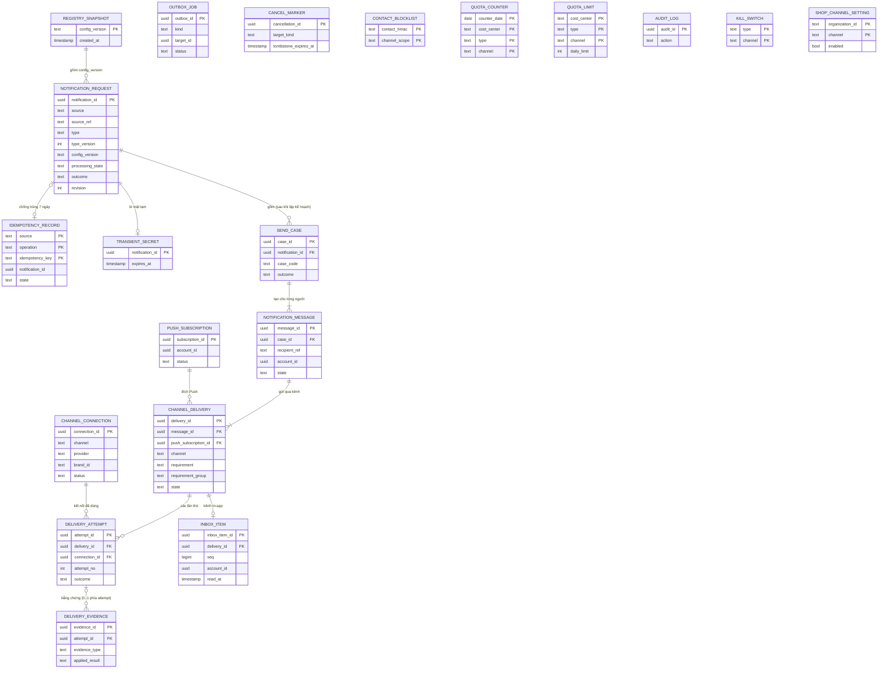

# Notitek - MÔ HÌNH DỮ LIỆU LOGIC VÀ TỪ ĐIỂN DỮ LIỆU

**Phiên bản:** 0.5. **Ngày:** 12/10/2026. **Chủ trì:** PO Notification. **Trạng thái:** Bản nháp PO để Tech Lead review. Tech Lead hoàn thiện thành Physical DB (kiểu dữ liệu, index, partition, khóa lạc quan, migration) sau khi chốt các điểm ở mục 9.

Bản 0.5 so với 0.4: đổi tên trường và trạng thái theo [OpenAPI v1](api/openapi.json), [API README](api/README.md) và code hiện có (`internal/notification/domain`); thêm ma trận chuyển trạng thái R1 (ADR-04) theo quyết định A và B ngày 12/10/2026; đồng bộ với cơ chế hủy, outbox và transaction của worker trong [CẤU TRÚC MÃ NGUỒN](<Notitek - CẤU TRÚC MÃ NGUỒN.md>) §11; thêm dữ liệu cần để tiếp tục gửi sau `accepted`; thêm ràng buộc duy nhất cho các bảng con; sửa ERD cho khớp từ điển.

Căn cứ: [SRS](<Notitek - ĐẶC TẢ YÊU CẦU PHẦN MỀM (SRS).md>) mục 4 và 8, [quyết định PO](<Notitek - QUYẾT ĐỊNH PO CHO CÁC DEC.md>) v1.8, [đề xuất công nghệ](<Notitek - ĐỀ XUẤT CÔNG NGHỆ SỬ DỤNG CHO DỰ ÁN.md>) (PostgreSQL, partition theo tháng cho lịch sử). Kiểu dữ liệu ở đây là kiểu logic, không phải kiểu PostgreSQL.

## 1 Nguyên tắc thiết kế dữ liệu

| # | Nguyên tắc | Căn cứ |
|---|---|---|
| 0 | **Mỗi trường phải trả lời được: yêu cầu, truy vấn hoặc quy tắc nào cần nó, và có suy ra được từ chỗ khác không.** Trường không trả lời được thì không đưa vào. | PO |
| 1 | **Không có bảng nào chứa OTP/token nguyên văn.** OTP đồng bộ chỉ nằm trong bộ nhớ. Bí mật của yêu cầu bất đồng bộ (link lời mời, kích hoạt) chỉ được giữ mã hóa trong `transient_secret` với TTL ≤ 10 phút. Dấu chống trùng dùng HMAC. | DEC-05, DEC-09 |
| 2 | **Chia nơi lưu theo tính chất thay đổi.** Chính sách đổi chậm, cần người duyệt (loại thông báo, mẫu, tiêu chí đạt, mục đích, cost center theo brand, kênh được phép) nằm ở registry YAML trong repo; DB ghim `config_version` (hash cả registry) vào từng yêu cầu, bản chụp đã resolve lưu bất biến ở `registry_snapshot`. **Dữ liệu vận hành đổi lúc chạy nằm trong DB và đổi qua API có quyền và audit, không cần deploy**: kết nối kênh, kill-switch, hạn mức ngày, bật/tắt Push của Shop. | DEC-07, DEC-08, DEC-12, SRS-F15 |
| 3 | **Tên trạng thái và kết quả theo OpenAPI v1.** Chi tiết hơn (bounce, từ chối chắc chắn, hết retry) nằm ở `reason_code` (danh sách đóng, mục 4.5) và ở bằng chứng, không thêm trạng thái ngoài OpenAPI. | OpenAPI, code |
| 4 | **Bằng chứng chỉ thêm, không sửa nội dung.** Chỉ hai cột đối chiếu của bằng chứng (`attempt_id`, `applied_result`) được cập nhật khi khớp muộn. | SRS-F09.06 |
| 5 | **Mọi yêu cầu có ngữ cảnh rõ**: `ACCOUNT` (không có organization) hoặc `WORKSPACE` (bắt buộc `organization_id`). | DEC-03, API §4 |
| 6 | **Dữ liệu có thời gian lưu khác nhau thì ở bảng khác nhau**, hoặc là cột có job làm rỗng riêng và được ghi rõ ở mục 6. | DEC-09 |
| 7 | **Liên hệ (SĐT/email) lưu nguyên văn ở `channel_delivery`.** Ngoại lệ duy nhất là `recipients_spec` của yêu cầu, giữ đến khi lập kế hoạch người nhận xong rồi xóa liên hệ. Nội dung hiển thị lưu trữ (`rendered_content`, `title`, `preview`) không được chứa liên hệ đầy đủ; nếu mẫu cần, phải che trước khi lưu. | DEC-09 |
| 8 | **Không có cột môi trường.** Mỗi môi trường là một triển khai và DB riêng; "môi trường" trong khóa chống trùng là hằng số của triển khai, không phải cột. | PO, 09/10/2026 |
| 9 | **Giá trị danh mục mở rộng được (kênh, provider, loại bằng chứng, mã lý do) lưu dạng văn bản, không dùng enum hoặc CHECK ở DB**; tính hợp lệ do code và cấu hình kiểm tra. Thêm kênh mới chỉ cần thêm Adapter, không phải migration. | PO |
| 10 | Notification không sở hữu User, Organization, Order, thiết bị tin cậy. Các cột `account_id`, `organization_id`, `subject_ref` là tham chiếu, không có khóa ngoại sang module khác. | Thiết kế sơ bộ mục 6 |
| 11 | **Không lưu giá trị suy ra được** (số lần thử, loại đích, mức đạt từng người). Ngoại lệ phải có ghi chú lý do. | PO |
| 12 | **Ranh giới `accepted` phải đủ dữ liệu để gửi tiếp sau crash**: một transaction ghi khóa chống trùng, yêu cầu, biến không bí mật, bí mật mã hóa, selector người nhận và `outbox_job`. | CẤU TRÚC §11.1 |
| 13 | **Một yêu cầu và mọi bản ghi con bị xóa cùng lúc**, mốc là `accepted_at` của yêu cầu. Không để bản con mồ côi. | DEC-09 |

## 2 Phân loại độ nhạy cảm

| Mức | Tên | Ví dụ | Quy tắc |
|---|---|---|---|
| P0 | Công khai nội bộ | Mã loại thông báo, tên kênh | Không giới hạn |
| P1 | Vận hành | ID, thời điểm, trạng thái, mã lỗi | Vận hành xem được theo quyền `notification.delivery.view` |
| P2 | Dữ liệu cá nhân | SĐT, email, nội dung đã dựng, biến mẫu | Mặc định hiển thị đã che; xem gốc cần `notification.delivery.view_sensitive`, nhập lý do, có audit |
| P3 | Bí mật | OTP, link có token, token FCM, credential kết nối | Không lưu nguyên văn, không vào log/trace/audit/dead-letter/backup chưa mã hóa |

## 3 Mô hình quan hệ (ERD)



Các quan hệ đáng chú ý:

- `IDEMPOTENCY_RECORD` chỉ tồn tại 7 ngày, còn yêu cầu 180 ngày, nên phía record là 0..1 trong toàn vòng đời.
- `SEND_CASE` chỉ có sau bước lập kế hoạch người nhận (CẤU TRÚC §11.2). Yêu cầu đã `accepted` nhưng chưa lập kế hoạch thì chưa có bản con.
- `DELIVERY_EVIDENCE` có thể chưa khớp lần thử (`attempt_id` rỗng), nên phía attempt là 0..1.
- `OUTBOX_JOB` không vẽ quan hệ vì trỏ qua `target_id` đa hình (yêu cầu cho `PLAN`, delivery cho `SEND`), không có khóa ngoại cứng.
- `CANCEL_MARKER`, `CONTACT_BLOCKLIST`, `QUOTA_COUNTER`, `QUOTA_LIMIT`, `AUDIT_LOG`, `KILL_SWITCH`, `SHOP_CHANNEL_SETTING` tra theo khóa tự nhiên nên không cần khóa ngoại. `AUDIT_LOG` phải sống lâu hơn dữ liệu gốc.

### 3.1 Chuỗi đối tượng và ví dụ

Một sự việc `order.delivery_failed` cho Shop A và người nhận hàng:

```
notification_request   type=order.delivery_failed v1, source_ref=<order_id>:order.delivery_failed:<id lần thất bại>
 ├─ send_case SHOP_ALERT            (In-app bắt buộc; Push tùy chọn)
 │   ├─ notification_message  shop-u1 ── channel_delivery IN_APP  (REQUIRED, nhóm g1) ── inbox_item
 │   │                                └─ channel_delivery PUSH    (OPTIONAL, nhóm g1) ── delivery_attempt ── delivery_evidence
 │   └─ notification_message  shop-u2 ── ...
 └─ send_case CONSIGNEE_NOTICE      (ZNS bắt buộc; SMS thay thế)
     └─ notification_message  cons-1 (không có account_id)
          ├─ channel_delivery ZNS  (REQUIRED)    ┐ cùng requirement_group g3
          └─ channel_delivery SMS  (ALTERNATIVE) ┘ chỉ chạy khi ZNS bị từ chối chắc chắn
```

## 4 Vòng đời trạng thái (ADR-04, R1)

### 4.1 Yêu cầu: `processing_state` và `outcome`

`processing_state` theo OpenAPI: `PENDING` → `PROCESSING` → `CLOSED`.

- `PENDING`: đã `accepted` (lưu bền vững), chưa có việc đang chạy. `planned_at` rỗng nghĩa là chưa lập kế hoạch người nhận.
- `PROCESSING`: có delivery đang gửi, chờ retry hoặc chờ đối chiếu `UNKNOWN`.
- `CLOSED`: không còn chủ động gửi. Callback đến muộn vẫn có thể cập nhật bằng chứng, **không mở lại việc gửi**. `close_reason`: `COMPLETED`, `CANCELLED`, `EXPIRED`, `RECONCILE_TIMEOUT`.

`outcome` theo OpenAPI, tính bởi `AggregateOutcome` (code): `PENDING`, `ACHIEVED`, `PARTIAL`, `FAILED`, `UNKNOWN`, `CANCELLED`, `EXPIRED`, `SUPPRESSED`.

**Quy tắc B (PO chốt 12/10/2026): `outcome` chỉ là kết quả chốt khi `processing_state = CLOSED`.** Khi chưa `CLOSED`, `PARTIAL` nghĩa là "đã đạt một phần, phần còn lại đang chạy". Consumer xét `processing_state` trước (xem API README §8).

Đầu vào bị từ chối (`STALE_REQUEST`, sai schema, xung đột khóa) **không tạo** `notification_request`.

### 4.2 `notification_message.state`

`PENDING` → `COMPLETED`, hoặc dừng: `CANCELLED`, `EXPIRED`, `SUPPRESSED`. Kèm `reason_code` (mục 4.5). Không phải thành công. Mức đạt riêng từng người suy ra từ các delivery của bản tin và tiêu chí đã ghim, không lưu.

### 4.3 `channel_delivery.state`

Giá trị theo OpenAPI/code: `PENDING`, `PROCESSING`, `AVAILABLE`, `PROVIDER_ACCEPTED`, `DELIVERED`, `FAILED`, `UNKNOWN`, `CANCELLED`, `EXPIRED`, `SUPPRESSED`.

- `AVAILABLE` chỉ cho `IN_APP` (đã lưu và người nhận truy cập được).
- **Chờ retry không phải trạng thái riêng:** delivery ở `PROCESSING` với `next_attempt_at` có giá trị (API suy ra `RETRYING`).
- Thứ tự mức bằng chứng: `PROVIDER_ACCEPTED` < `DELIVERED`. Chỉ tăng, trừ ngoại lệ ở ma trận dòng 15 (bounce sau `PROVIDER_ACCEPTED`).

### 4.4 Ma trận chuyển trạng thái của `channel_delivery`

Mọi chuyển trạng thái là câu `UPDATE` có điều kiện trên trạng thái hiện tại (CẤU TRÚC §11). Mỗi dòng có hiệu lực kèm **tăng `revision`** và **tính lại `outcome`** nếu trạng thái đổi.

| # | Từ | Sự kiện | Điều kiện | Sang | Ghi chú |
|---|---|---|---|---|---|
| 1 | `PENDING` | Worker claim (Tx1) | Còn hạn, trong khung giờ, không bị hủy/kill-switch/chặn, còn hạn mức | `PROCESSING` | Tạo attempt `STARTED`, tăng bộ đếm hạn mức, commit **trước** khi gọi provider |
| 2 | `PENDING` | Kiểm tra Tx1 không thỏa | Kill-switch, liên hệ bị chặn, hết hạn mức, vượt tần suất, kênh không được phép | `SUPPRESSED` | `reason_code` tương ứng |
| 3 | `PENDING`, `PROCESSING` (chờ retry) | Hủy thắng race | Chưa có attempt đang `STARTED` | `CANCELLED` | |
| 4 | `PENDING`, `PROCESSING` (chờ retry) | Quá `deadline_at` | | `EXPIRED` | `DEADLINE_PASSED`; không bắt đầu lần mới |
| 5 | `PENDING` | In-app ghi bản tin thành công | Kênh `IN_APP` | `AVAILABLE` | Không có attempt provider; idempotent theo `delivery_id` |
| 6 | `PROCESSING` | Attempt `ACCEPTED` | | `PROVIDER_ACCEPTED` | SMS, Email, ZNS, Push |
| 7 | `PROCESSING` | Attempt `TRANSIENT_NOT_SENT` | Còn lần retry theo chính sách và còn hạn | `PROCESSING` | Đặt `next_attempt_at`; hoàn 1 đơn vị hạn mức (chắc chắn chưa gửi) |
| 8 | `PROCESSING` | Attempt `TRANSIENT_NOT_SENT` | Hết retry hoặc hết hạn | `FAILED` | `RETRY_EXHAUSTED`; hoàn hạn mức |
| 9 | `PROCESSING` | Attempt `REJECTED_DEFINITE` | | `FAILED` | `PROVIDER_REJECTED`, `INVALID_DESTINATION` hoặc `TEMPLATE_REJECTED`. **Chỉ trường hợp này mới kích hoạt delivery `ALTERNATIVE` cùng nhóm** (ZNS lỗi chắc chắn → SMS). Hoàn hạn mức |
| 10 | `PROCESSING` | Attempt `UNKNOWN` (timeout sau khi yêu cầu đã rời đi) hoặc attempt `STARTED` quá `lease_until` | | `UNKNOWN` | Đặt `reconcile_deadline_at` = thời điểm kết thúc attempt + 24 giờ, **cố định**. Không retry, không fallback, **không hoàn hạn mức** |
| 11 | `UNKNOWN` | Callback/tra cứu `ACCEPTED` | | `PROVIDER_ACCEPTED` | Cũng áp dụng sau khi yêu cầu đã `CLOSED` |
| 12 | `UNKNOWN` | Callback `DELIVERED` | | `DELIVERED` | |
| 13 | `UNKNOWN` | Callback thất bại, bounce cứng, hoặc tra cứu cho thấy chưa gửi | | `FAILED` | Reason tương ứng; **không** tự kích hoạt `ALTERNATIVE` (không còn là "từ chối chắc chắn trước khi gửi") |
| 14 | `PROVIDER_ACCEPTED` | Delivery report `DELIVERED` | | `DELIVERED` | |
| 15 | `PROVIDER_ACCEPTED` | **Bounce cứng hoặc báo giao thất bại** | | `FAILED` | **Quyết định A (PO 12/10/2026).** Reason `BOUNCE_HARD` hoặc `DELIVERY_FAILED`; `revision` tăng; `outcome` được tính lại (có thể từ `ACHIEVED` xuống `FAILED`). Đây là sự kiện tiêu cực cuối cùng, không phải bằng chứng yếu hơn. Bằng chứng `PROVIDER_ACCEPTED` vẫn giữ trong lịch sử |
| 16 | `DELIVERED` | Bounce/thất bại đến sau | | `DELIVERED` | Giữ nguyên; bằng chứng được đánh `CONFLICT` để vận hành đối chiếu |
| 17 | Bất kỳ trạng thái đã có bằng chứng | Bằng chứng yếu hơn mức hiện có (ví dụ `PROVIDER_ACCEPTED` đến sau `DELIVERED`) | | Giữ nguyên | Bằng chứng đánh `SUPERSEDED` |
| 18 | `UNKNOWN` quá `reconcile_deadline_at` | Scheduler đóng | | `UNKNOWN` | Vẫn `UNKNOWN`, không tự đổi; yêu cầu có thể `CLOSED` với `RECONCILE_TIMEOUT`. Callback sau đó vẫn áp dụng theo dòng 11 đến 13 |
| 19 | `FAILED`, `CANCELLED`, `EXPIRED`, `SUPPRESSED` | Callback nhận được | | Giữ nguyên | Lưu làm bằng chứng; ngoại lệ là dòng 13 |

Hệ quả cho Email lời mời: bounce cứng (dòng 15) làm outcome xuống `FAILED`, nên User biết lời mời chưa tới và có thể cấp lại link.

### 4.5 Danh sách đóng `reason_code`

Lưu dạng văn bản (nguyên tắc 9); danh sách này chuyển thành enum trong OpenAPI khi triển khai.

| Trạng thái | Mã |
|---|---|
| `SUPPRESSED` | `CONTACT_BLOCKED`, `RECIPIENT_UNRESOLVED`, `RECIPIENT_LIMIT_EXCEEDED`, `NO_VALID_RECIPIENT`, `BLOCKED_QUOTA`, `RATE_LIMITED`, `KILL_SWITCH`, `CHANNEL_NOT_ALLOWED` |
| `FAILED` | `PROVIDER_REJECTED`, `INVALID_DESTINATION`, `TEMPLATE_REJECTED`, `RETRY_EXHAUSTED`, `BOUNCE_HARD`, `DELIVERY_FAILED` |
| `EXPIRED` | `DEADLINE_PASSED` |
| `UNKNOWN` | `PROVIDER_TIMEOUT`, `WORKER_LOST` |
| `CANCELLED` | Mã do nguồn cấp trong lệnh hủy (`reason_code` của lệnh) |

### 4.6 Kết quả theo trường hợp gửi (C, hoãn)

R1 **không** lộ kết quả theo từng trường hợp gửi ra API. Quyết định PO 12/10/2026: thêm trường tùy chọn `case_code` vào `Delivery` để consumer gom nhóm; bảng `send_case` vẫn giữ nội bộ (có `outcome`) để khi cần chỉ phải lộ thêm `cases[]` mà không đổi dữ liệu. API `case_code` suy ra từ `send_case` qua `notification_message`, không lưu ở delivery.

## 5 Từ điển dữ liệu

Cột "Bắt buộc": **Y** = không được rỗng; **N** = có thể rỗng; **C** = bắt buộc có điều kiện (ghi trong mô tả). "Nguồn": ai cung cấp giá trị.

### 5.1 `notification_request` — Yêu cầu/sự việc tiếp nhận

**Ý nghĩa:** một lần nguồn đề nghị thông báo. **Lưu:** 180 ngày (mục 6). **Phân vùng gợi ý:** theo tháng `accepted_at`.

| Trường | Kiểu logic | Bắt buộc | Mức | Ý nghĩa và giá trị hợp lệ | Nguồn |
|---|---|---|---|---|---|
| `notification_id` | Định danh | Y | P1 | Định danh yêu cầu, trả cho nguồn. Không dùng thay `inbox_item_id`. | Hệ thống |
| `source` | Văn bản | Y | P1 | Nguồn ổn định ánh xạ từ client OAuth2 trong registry, ví dụ `user`, `order`. Không lấy từ payload. | Token |
| `source_ref` | Văn bản | Y | P1 | Reference ổn định của một ý định/sự việc (bằng header `Idempotency-Key`). Không chứa OTP, email, SĐT, token. | Nguồn |
| `subject_ref` | Văn bản | C | P1 | Đối tượng nghiệp vụ mà thông báo nói về; bắt buộc với `order.*` và bằng `order_id`. Dùng để liệt kê và tra cứu, không phải khóa chống trùng, không chứa PII. | Nguồn |
| `type` | Văn bản | Y | P0 | Loại thông báo đã đăng ký, ví dụ `order.delivery_failed`, `user.otp`. Mục đích, chế độ `sync`/`async`, cost center suy ra từ registry đã ghim. | Nguồn |
| `type_version` | Số nguyên | Y | P0 | Phiên bản schema của loại thông báo, từ 1. | Nguồn |
| `config_version` | Văn bản | Y | P0 | Hash toàn bộ registry YAML ghim lúc tạo. Trỏ `registry_snapshot` (mục 5.19). | Hệ thống |
| `context_type` | Mã | Y | P0 | `ACCOUNT` hoặc `WORKSPACE`. | Nguồn |
| `application_id` | Mã | Y | P1 | Application/Client đích (API §4). | Nguồn |
| `organization_id` | Định danh ngoài | C | P1 | Bắt buộc khi `WORKSPACE` (Shop là Organization loại SHOP); rỗng khi `ACCOUNT`. | Nguồn |
| `brand_id` | Mã | N | P0 | Brand tùy chọn nhưng phải được xác minh; để chọn kết nối gửi và cost center. | Nguồn |
| `correlation_id` | Văn bản | N | P1 | Từ header `X-Correlation-Id`; không tham gia chống trùng. | Nguồn |
| `cancel_group` | Văn bản | N | P1 | Nhóm hủy ổn định, namespace theo nguồn, context đầy đủ. | Nguồn |
| `occurred_at` | Thời điểm | Y | P1 | Thời điểm sự việc ở nguồn, có offset. Cũ hơn 7 ngày bị từ chối `STALE_REQUEST`. Không dùng thời gian nhận thay thế. | Nguồn |
| `accepted_at` | Thời điểm | Y | P1 | Lúc đã lưu bền vững (ranh giới `accepted`, RPO = 0). Mốc đo độ trễ, khóa phân vùng và mốc xóa 180 ngày. | Hệ thống |
| `send_deadline` | Thời điểm | Y | P1 | Hạn muộn nhất được bắt đầu gửi. OTP: ≤ `accepted_at` + 5s. | Nguồn |
| `expires_at` | Thời điểm | C | P1 | Hạn nghiệp vụ của mã/lời mời/cảnh báo, bắt buộc với OTP, lời mời, cảnh báo thiết bị. | Nguồn |
| `data` | Tập khóa-giá trị | N | P2 | Biến mẫu **không bí mật** theo schema loại thông báo, mỗi biến ≤ 2 KiB, tổng ≤ 64 KiB. Cần để dựng nội dung ở worker sau `accepted`. Làm rỗng sau 90 ngày. | Nguồn |
| `recipients_spec` | Dữ liệu có cấu trúc | C | **P2** | Selector người nhận (tối đa 100): `ACCOUNT`, `CONTACT` (có SĐT/email), `AUDIENCE`. **Xóa liên hệ ngay khi `planned_at` được ghi**, chỉ còn `recipient_ref`. | Nguồn |
| `processing_state` | Mã | Y | P1 | `PENDING`, `PROCESSING`, `CLOSED` (mục 4.1). | Hệ thống |
| `planned_at` | Thời điểm | N | P1 | Lúc lập kế hoạch người nhận xong (đã tạo delivery). Rỗng nghĩa là chưa lập. | Hệ thống |
| `dispatch_started_at` | Thời điểm | N | P1 | Chỉ yêu cầu `sync`: ghi và commit **trước** khi gọi provider. Có giá trị thì khi phục hồi coi là `UNKNOWN`; rỗng thì chứng minh được chưa gọi, coi là `FAILED` (CẤU TRÚC §11.1). | Hệ thống |
| `outcome` | Mã | Y | P1 | Mục 4.1. Chốt khi `CLOSED`. | Hệ thống |
| `revision` | Số nguyên | Y | P1 | Tăng 1 mỗi thay đổi quan sát được, từ 1. Dùng cho polling và consumer. | Hệ thống |
| `closed_at`, `close_reason` | Thời điểm, Mã | C | P1 | Điền khi `CLOSED`. | Hệ thống |

**Ràng buộc:** `WORKSPACE` thì `organization_id` không rỗng; `ACCOUNT` thì rỗng. Duy nhất `(source, source_ref)` được bảo đảm qua `idempotency_record` trong 7 ngày.

### 5.2 `idempotency_record` — Khóa chống trùng

**Ý nghĩa:** nhận ra lần gửi lại, cho cả lệnh gửi và lệnh hủy (namespace riêng). **Lưu:** 7 ngày (SRS-P07).

| Trường | Kiểu logic | Bắt buộc | Mức | Ý nghĩa và giá trị hợp lệ |
|---|---|---|---|---|
| `source` | Văn bản | Y | P1 | Từ token. Cùng hai cột dưới tạo **khóa chính tổ hợp**. |
| `operation` | Mã | Y | P0 | `SEND` hoặc `CANCEL`. Hai không gian khóa tách nhau (API §9). |
| `idempotency_key` | Văn bản | Y | P1 | `source_ref` với `SEND`; khóa riêng của lệnh với `CANCEL`. |
| `payload_hmac` | Chuỗi băm | Y | P1 | HMAC của toàn bộ body đã chuẩn hóa JCS, gồm cả bí mật, nhưng không lưu nội dung. Cùng khóa, cùng HMAC là replay; khác HMAC là `IDEMPOTENCY_CONFLICT`. |
| `hmac_key_id` | Mã | Y | P1 | Khóa HMAC đã dùng, so được bằng khóa cũ trong cửa sổ 7 ngày. |
| `notification_id` | Định danh | C | P1 | Yêu cầu đã tạo (`SEND`). |
| `cancellation_id` | Định danh | C | P1 | Lệnh hủy đã tạo (`CANCEL`). |
| `state` | Mã | Y | P1 | `IN_PROGRESS` hoặc `COMPLETED`. Yêu cầu đồng bộ song song nhận `IDEMPOTENCY_IN_PROGRESS`. |
| `expires_at` | Thời điểm | Y | P1 | `accepted_at` + 7 ngày; job xóa theo cột này. |

### 5.3 `cancel_marker` — Lệnh hủy và dấu hủy

**Ý nghĩa:** ghi nhận một lệnh hủy và biên nhận của nó. Với hủy theo **nhóm**, dòng này đồng thời là **dấu hủy (tombstone)** có hiệu lực 72 giờ, kể cả khi chưa có yêu cầu nào khớp, để sự việc đến muộn không khởi tạo lại phần đã hủy (SRS-F06.06). Hủy theo `notification_id` chưa tồn tại trả 404 nên không cần dấu hủy. **Lưu:** 7 ngày (đủ cho phát lại lệnh theo khóa chống trùng); hiệu lực chặn chỉ đến `tombstone_expires_at`.

| Trường | Kiểu logic | Bắt buộc | Mức | Ý nghĩa và giá trị hợp lệ |
|---|---|---|---|---|
| `cancellation_id` | Định danh | Y | P1 | Trả cho nguồn trong biên nhận. |
| `source` | Văn bản | Y | P1 | |
| `target_kind` | Mã | Y | P0 | `NOTIFICATION` hoặc `GROUP`. Tách hai loại định danh, không gộp. |
| `notification_id` | Định danh | C | P1 | Với `NOTIFICATION`. |
| `cancel_group` | Văn bản | C | P1 | Với `GROUP`. |
| `application_id`, `organization_id` | Mã | C | P1 | Với `GROUP`: context đầy đủ. Hủy nhóm không xuyên Shop hay app. |
| `reason_code` | Văn bản | Y | P1 | Mã do nguồn cấp. |
| `matched_requests` | Số nguyên | Y | P1 | Biên nhận tại thời điểm áp dụng. |
| `cancelled_deliveries`, `not_recallable_deliveries`, `unknown_deliveries` | Số nguyên | Y | P1 | Ba số **không chồng nhau**; không sửa bản đã gửi thành cancelled. |
| `tombstone_expires_at` | Thời điểm | C | P1 | Với `GROUP`: lúc tạo + 72 giờ. |
| `created_at` | Thời điểm | Y | P1 | |

**Quy tắc:** phát lại lệnh với cùng khóa chống trùng trả biên nhận ban đầu, **không** kéo dài `tombstone_expires_at` và không hủy rộng hơn. Khi yêu cầu mới đến, tra dấu còn hiệu lực theo `(source, application_id, organization_id, cancel_group)` trong cùng khóa advisory với việc tạo yêu cầu (CẤU TRÚC §11.1) để hai bên không lọt qua nhau.

### 5.4 `transient_secret` — Bí mật tạm của yêu cầu bất đồng bộ

**Ý nghĩa:** giữ biến bí mật (link lời mời, link kích hoạt) mã hóa để worker dựng và gửi sau `accepted`. Không lưu OTP (đồng bộ). **Lưu:** TTL ≤ 10 phút (DEC-09, S5).

| Trường | Kiểu logic | Bắt buộc | Mức | Ý nghĩa và giá trị hợp lệ |
|---|---|---|---|---|
| `notification_id` | Định danh | Y | P1 | **Khóa chính**; mỗi yêu cầu một dòng. |
| `ciphertext` | Dữ liệu mã hóa | Y | **P3** | Biến bí mật mã hóa envelope. Chỉ giải mã trong tiến trình gửi, không vào log/trace/audit/dead-letter. |
| `key_id` | Mã | Y | P1 | Khóa mã hóa đã dùng. |
| `expires_at` | Thời điểm | Y | P1 | Tối đa `accepted_at` + 10 phút; job xóa dòng khi quá hạn. |

**Quy tắc phục hồi:** sau khi dòng hết TTL mà delivery còn cần gửi (retry email lời mời sau 10 phút), worker **không kéo dài TTL** mà gọi API cấp lại link của User (CF-10, B1) để có bí mật mới, rồi ghi lại dòng mới. Hết nguồn cấp lại thì delivery kết thúc theo hạn gửi, không gửi mà thiếu link.

### 5.5 `send_case` — Trường hợp gửi

**Ý nghĩa:** nhóm người nhận và tiêu chí đạt riêng, ví dụ `SHOP_ALERT`, `CONSIGNEE_NOTICE`. Chỉ có sau khi lập kế hoạch. **Lưu:** 180 ngày.

| Trường | Kiểu logic | Bắt buộc | Mức | Ý nghĩa và giá trị hợp lệ |
|---|---|---|---|---|
| `case_id` | Định danh | Y | P1 | |
| `notification_id` | Định danh | Y | P1 | |
| `case_code` | Mã | Y | P0 | Mã trường hợp trong registry đã ghim. **Duy nhất theo `(notification_id, case_code)`.** |
| `outcome` | Mã | Y | P1 | Mức đạt của riêng trường hợp này (mục 4.1). |

Tiêu chí đạt lấy từ registry ở `config_version` đã ghim, không copy vào bảng. Không lộ ra API ở R1 (mục 4.6).

### 5.6 `notification_message` — Bản thông báo

**Ý nghĩa:** một **người nhận** trong một trường hợp gửi. **Lưu:** 180 ngày.

| Trường | Kiểu logic | Bắt buộc | Mức | Ý nghĩa và giá trị hợp lệ | Nguồn |
|---|---|---|---|---|---|
| `message_id` | Định danh | Y | P1 | | Hệ thống |
| `case_id` | Định danh | Y | P1 | | Hệ thống |
| `recipient_ref` | Văn bản | Y | P1 | Định danh người/vai trò do nguồn cấp, hiện ra trong `Delivery.recipient_ref` của API. **Duy nhất theo `(case_id, recipient_ref)`.** | Nguồn |
| `account_id` | Định danh ngoài | C | P1 | Có khi người nhận là tài khoản User. **Rỗng khi là liên hệ không có tài khoản**: người nhận hàng, và cả người được mời chưa có tài khoản. Không suy từ số/email. | User/Authorization |
| `state` | Mã | Y | P1 | Mục 4.2. | Hệ thống |
| `reason_code` | Mã | C | P1 | Bắt buộc khi `SUPPRESSED`, `CANCELLED`, `EXPIRED`. | Hệ thống |
| `recipient_resolved_at` | Thời điểm | C | P1 | Lúc xác định người nhận từ User/Authorization. Quá 5 phút không dùng lại (DEC-03). | Hệ thống |

### 5.7 `channel_delivery` — Kênh gửi của một bản tin

**Ý nghĩa:** một bản tin trên **một kênh và một đích**. **Lưu:** 180 ngày; `destination_value` che sau 30 ngày; `rendered_content` rỗng sau 90 ngày.

| Trường | Kiểu logic | Bắt buộc | Mức | Ý nghĩa và giá trị hợp lệ |
|---|---|---|---|---|
| `delivery_id` | Định danh | Y | P1 | |
| `message_id` | Định danh | Y | P1 | |
| `channel` | Văn bản | Y | P0 | `SMS`, `EMAIL`, `ZNS`, `PUSH`, `IN_APP` (nguyên tắc 9). |
| `requirement` | Mã | Y | P0 | `REQUIRED`, `OPTIONAL`, `ALTERNATIVE` (OpenAPI). Push luôn `OPTIONAL` (DEC-01). |
| `requirement_group` | Văn bản | Y | P0 | Nhóm tiêu chí. `REQUIRED`: mọi delivery của nhóm đạt; `ALTERNATIVE`: một delivery đạt là đủ. Một nhóm không trộn hai loại (code từ chối). |
| `destination_value` | Văn bản | C | **P2** | SĐT/email nguyên văn, sau 30 ngày chỉ giữ 3 ký tự cuối. Rỗng với `IN_APP` và `PUSH`. |
| `push_subscription_id` | Định danh | C | P1 | Bắt buộc khi `PUSH`. |
| `template_code` | Mã | Y | P0 | Mẫu của riêng kênh này. Version mẫu suy ra từ `config_version`. |
| `rendered_content` | Văn bản | N | P2 | Nội dung đã dựng, ghi khi worker render. **Biến bí mật bị che**, liên hệ đầy đủ không được xuất hiện (nguyên tắc 7). Với OTP chỉ lưu mẫu và biến đã che. Rỗng sau 90 ngày. |
| `deadline_at` | Thời điểm | Y | P1 | Hạn gửi tính cho kênh theo DEC-06 và `send_deadline`. Quá hạn thì `EXPIRED`. |
| `state` | Mã | Y | P1 | Mục 4.3. |
| `reason_code` | Mã | C | P1 | Mục 4.5; bắt buộc ở mọi trạng thái dừng, lỗi và `UNKNOWN`. |
| `next_attempt_at` | Thời điểm | N | P1 | Lần thử kế tiếp, kể cả giữ đến 07:00 cho ZNS/SMS người nhận hàng. Có giá trị khi chờ retry. Scheduler quét cột này. |
| `reconcile_deadline_at` | Thời điểm | C | P1 | Điền **một lần** khi vào `UNKNOWN`: kết thúc attempt + 24 giờ. Mốc cố định cho cửa sổ đối chiếu (DEC-10); không đổi khi có callback khác. |
| `updated_at` | Thời điểm | Y | P1 | Lần đổi trạng thái gần nhất, để phát hiện tồn đọng. Không dùng để tính cửa sổ đối chiếu. |

**Ràng buộc duy nhất:** `(message_id, channel, push_subscription_id)`, trong đó `push_subscription_id` rỗng với kênh khác Push. Replay job không tạo delivery trùng, và hai đích Push hợp lệ của cùng người vẫn tồn tại. Số lần thử (`attempt_count` của API) đếm từ `delivery_attempt`, không lưu.

### 5.8 `delivery_attempt` — Lần thử gửi

**Ý nghĩa:** một lần giao yêu cầu cho nhà cung cấp. Thử lại không là sự việc nguồn mới. **Lưu:** 180 ngày.

| Trường | Kiểu logic | Bắt buộc | Mức | Ý nghĩa và giá trị hợp lệ |
|---|---|---|---|---|
| `attempt_id` | Định danh | Y | P1 | |
| `delivery_id` | Định danh | Y | P1 | |
| `attempt_no` | Số nguyên | Y | P1 | Từ 1. **Duy nhất theo `(delivery_id, attempt_no)`**: worker nhận lại message không tạo lần thử thứ hai. |
| `provider` | Văn bản | Y | P0 | `VIETGUYS`, `INCOM`, `FCM`, `ZALO_ZNS`... Giữ riêng để thống kê theo provider. |
| `connection_id` | Định danh | Y | P1 | Kết nối thực tế đã dùng (SRS-F15.05), trỏ `channel_connection`. |
| `connection_version` | Số nguyên | Y | P1 | Version kết nối lúc gửi, để truy vết sau khi đổi credential hoặc sender. |
| `dispatch_started_at` | Thời điểm | Y | P1 | Ghi và commit **trước** khi gọi provider. |
| `lease_until` | Thời điểm | C | P1 | Có khi `outcome = STARTED`. Quá lease thì scheduler chuyển `UNKNOWN` (worker chết giữa chừng) và không tự gửi lại. |
| `ended_at` | Thời điểm | N | P1 | Rỗng khi chưa có phản hồi. |
| `outcome` | Mã | Y | P1 | `STARTED`, `ACCEPTED`, `REJECTED_DEFINITE`, `TRANSIENT_NOT_SENT`, `UNKNOWN` (khớp `channel.Class`). Timeout sau khi yêu cầu đã rời đi là `UNKNOWN`, không phải thất bại. |
| `provider_message_id` | Văn bản | C | P1 | Có khi `ACCEPTED`; khóa để khớp callback. |
| `provider_error_code` | Văn bản | N | P1 | Mã lỗi nguyên văn (SRS-F19.04). |
| `safe_reason_code` | Mã | N | P1 | Lý do đã ánh xạ, an toàn để hiển thị. |

Không lưu thân request/response thô của provider.

### 5.9 `delivery_evidence` — Bằng chứng kênh

**Ý nghĩa:** callback đã **xác thực chữ ký** và kết quả tra cứu. Callback sai chữ ký bị từ chối, chỉ ghi log bảo mật, không vào bảng này. Nội dung bất biến; chỉ `attempt_id` và `applied_result` được cập nhật khi khớp muộn (nguyên tắc 4). **Lưu:** 180 ngày; bản ghi `UNMATCHED` không có yêu cầu cha nên xóa theo `received_at` + 180 ngày. **Phân vùng:** theo tháng `received_at`.

| Trường | Kiểu logic | Bắt buộc | Mức | Ý nghĩa và giá trị hợp lệ |
|---|---|---|---|---|
| `evidence_id` | Định danh | Y | P1 | |
| `attempt_id` | Định danh | N | P1 | Rỗng khi chưa khớp được lần thử (`UNMATCHED`). |
| `provider` | Văn bản | Y | P0 | Cần riêng vì `UNMATCHED` không có `attempt_id`. |
| `provider_message_id` | Văn bản | C | P1 | Khóa khớp lần thử. |
| `provider_event_id` | Văn bản | C | P1 | Có khi provider cấp. Cùng `(provider, provider_event_id)` chỉ ghi một lần: chống callback trùng. |
| `evidence_type` | Văn bản | Y | P0 | `PROVIDER_ACCEPTED`, `DELIVERED`, `BOUNCE_HARD`, `COMPLAINT`, `REJECTED`, `LOOKUP_RESULT`. |
| `provider_event_at` | Thời điểm | N | P1 | Thời gian theo provider; có thể đến trễ hoặc sai thứ tự. |
| `received_at` | Thời điểm | Y | P1 | |
| `applied_result` | Mã | Y | P1 | `APPLIED` (đã đổi trạng thái), `SUPERSEDED` (yếu hơn mức hiện có, dòng 17), `CONFLICT` (trái nhau sau `DELIVERED`, dòng 16), `UNMATCHED` (không khớp lần thử). |
| `safe_reason_code` | Mã | N | P1 | |

### 5.10 `inbox_item` — Bản tin In-app

**Ý nghĩa:** tin trong hộp tin của **một người**. Mỗi `inbox_item` ứng với đúng một `channel_delivery` kênh `IN_APP`. Backend là nguồn sự thật của trạng thái đọc (SRS-F08.05). **Lưu:** hiển thị 90 ngày, xóa sau 180 ngày, tính từ `created_at`.

| Trường | Kiểu logic | Bắt buộc | Mức | Ý nghĩa và giá trị hợp lệ |
|---|---|---|---|---|
| `inbox_item_id` | Định danh | Y | P1 | Định danh bản In-app của một người, lộ ra API. |
| `seq` | Số nguyên tăng đơn điệu | Y | P1 | `Last-Event-ID` cho SSE và khóa phân xử khi cùng thời điểm tạo. |
| `delivery_id` | Định danh | Y | P1 | Delivery `IN_APP` tương ứng. **Duy nhất** (ghi lại idempotent khi retry). |
| `account_id` | Định danh ngoài | Y | P1 | Chủ hộp tin. |
| `context_type`, `organization_id` | Mã, Định danh ngoài | Y/C | P1 | Tách tin tài khoản với tin công việc. Điều kiện lọc của mọi truy vấn danh sách và đếm chưa đọc. |
| `source_dedupe_key` | Văn bản | C | P1 | Khóa đối chiếu ổn định, **có namespace**: `<source>:<id nguồn>` (ví dụ `user:device-alert-42` khác `order:42`). **Duy nhất theo `(account_id, source_dedupe_key)`**: phát lại không tạo bản kép (SRS-F10.02). |
| `category` | Mã | Y | P0 | `ORDER_ALERT`, `DEVICE_ALERT`... Registry quyết định app nào hiển thị loại này. |
| `title`, `preview` | Văn bản | Y | P2 | Nội dung hiển thị, **không chứa liên hệ đầy đủ** (nguyên tắc 7). |
| `action_type`, `action_ref` | Mã, Văn bản | N | P1 | Đích mở; quyền kiểm tra lại khi mở. |
| `event_at` | Thời điểm | N | P1 | Thời điểm sự việc nguồn. |
| `created_at` | Thời điểm | Y | P1 | |
| `read_at` | Thời điểm | N | P1 | Rỗng = chưa đọc. Đánh dấu đọc lặp lại cho cùng kết quả. Đọc **không** đổi kết quả gửi hay nghiệp vụ. |

Trạng thái nghiệp vụ nguồn (đã chấp nhận, đã từ chối) **không lưu**: lấy từ User khi tải.

### 5.11 `push_subscription` — Đích Push

**Ý nghĩa:** đích Web Push (FCM) do Notification giữ (DEC-01). Khác "thiết bị tin cậy" của User. **Lưu:** đến khi hủy hoặc 60 ngày không hoạt động.

| Trường | Kiểu logic | Bắt buộc | Mức | Ý nghĩa và giá trị hợp lệ |
|---|---|---|---|---|
| `subscription_id` | Định danh | Y | P1 | |
| `account_id` | Định danh ngoài | Y | P1 | Từ Access Context, không từ payload. |
| `application_id` | Mã | Y | P1 | Ví dụ Shop `business-web`. |
| `token_encrypted` | Dữ liệu mã hóa | Y | **P3** | Token FCM mã hóa, cần giải mã để gửi. |
| `token_hmac` | Chuỗi băm | Y | P1 | Để tìm và kiểm tra trùng mà không giải mã. **Duy nhất trong tập `ACTIVE`**: một token một chủ hiện hành. |
| `registration_version` | Số nguyên | Y | P1 | Bản đăng ký cũ hơn không hồi sinh token đã thu hồi (SRS-F16.02). |
| `status` | Mã | Y | P1 | `ACTIVE`, `REVOKED`. |
| `revoke_reason` | Mã | C | P1 | `LOGOUT`, `INACTIVE_60D`, `FCM_UNREGISTERED`, `FCM_INVALID_ARGUMENT`, `OWNER_CHANGED`. |
| `registered_at`, `last_active_at` | Thời điểm | Y | P1 | `INACTIVE_60D` tính từ `last_active_at`. |
| `revoked_at` | Thời điểm | C | P1 | Đo yêu cầu hủy có hiệu lực ≤ 1 phút (SRS-P11). |

Một người có nhiều đích sinh nhiều `channel_delivery`, nên token lỗi không che token khác.

### 5.12 `contact_blocklist` — Danh sách chặn toàn cục

**Ý nghĩa:** SĐT/email đã yêu cầu ngừng nhận. Áp dụng cho mọi mục đích **trừ SECURITY** (DEC-04). Ai thêm/gỡ ghi ở `audit_log`; gỡ chặn là xóa dòng.

| Trường | Kiểu logic | Bắt buộc | Mức | Ý nghĩa và giá trị hợp lệ |
|---|---|---|---|---|
| `contact_hmac` | Chuỗi băm | Y | P1 | HMAC liên hệ chuẩn hóa. Cùng cột dưới tạo **khóa chính tổ hợp**. |
| `channel_scope` | Mã | Y | P0 | `ALL` hoặc một kênh. |
| `contact_masked` | Văn bản | Y | P2 | Dạng che để vận hành nhận ra. |
| `reason` | Mã | Y | P1 | |
| `created_at` | Thời điểm | Y | P1 | |

### 5.13 `quota_counter` — Bộ đếm hạn mức ngày

**Ý nghĩa:** bộ đếm theo cặp loại thông báo × kênh có phí (SMS, ZNS, Email) cho từng cost center (DEC-08). Notification **không giữ sổ tài chính**. Hạn mức nằm ở `quota_limit` (5.18); cảnh báo 80% do giám sát. **Lưu:** 180 ngày (đủ báo cáo tháng).

| Trường | Kiểu logic | Bắt buộc | Mức | Ý nghĩa và giá trị hợp lệ |
|---|---|---|---|---|
| `counter_date` | Ngày | Y | P1 | Theo `Asia/Ho_Chi_Minh`. |
| `cost_center` | Mã | Y | P1 | Lấy từ registry theo `brand_id`. |
| `type` | Mã | Y | P0 | |
| `channel` | Văn bản | Y | P0 | Bốn cột này tạo **khóa chính tổ hợp**. |
| `used_count` | Số nguyên | Y | P1 | Số lần gửi được tính. |

**Quy tắc đếm (chống vượt hạn mức đồng thời và đếm đôi):**

1. **Cấp suất nguyên tử** ở Tx1 của worker: `UPDATE ... SET used_count = used_count + 1 WHERE used_count < daily_limit`. Hai worker cùng thấy còn một suất thì chỉ một thành công; bên kia nhận `BLOCKED_QUOTA`.
2. Việc cấp suất và việc tạo attempt (`attempt_no` duy nhất) nằm **cùng transaction**, nên message bị giao lại không cấp suất lần hai.
3. **Hoàn suất** (trừ 1) chỉ khi **chắc chắn chưa gửi** (`TRANSIENT_NOT_SENT`, `REJECTED_DEFINITE`; ma trận dòng 7 đến 9), bảo vệ bằng điều kiện `attempt.outcome = STARTED`.
4. **Không hoàn** khi `ACCEPTED` hoặc `UNKNOWN`: có thể đã bị tính phí.

### 5.14 `outbox_job` — Công việc chuyển sang RabbitMQ

**Ý nghĩa:** cầu nối giữa PostgreSQL và broker (không có transaction chung). R1 chỉ có **công việc gửi nội bộ**: kết quả cho nguồn đi qua REST (`GET`), chưa có event `notification.result_changed` (broker để phân kỳ sau, DEC 2.13 A2). **Lưu:** xóa 7 ngày sau khi `PUBLISHED`.

| Trường | Kiểu logic | Bắt buộc | Mức | Ý nghĩa và giá trị hợp lệ |
|---|---|---|---|---|
| `outbox_id` | Định danh | Y | P1 | |
| `kind` | Mã | Y | P0 | `PLAN` (lập kế hoạch người nhận) hoặc `SEND` (gửi một delivery). |
| `target_id` | Định danh | Y | P1 | `notification_id` với `PLAN`, `delivery_id` với `SEND`. |
| `attempt_seq` | Số nguyên | C | P1 | Với `SEND`: số thứ tự lần thử dự kiến, để consumer idempotent. |
| `status` | Mã | Y | P1 | `PENDING`, `PUBLISHED`. Chỉ đánh `PUBLISHED` sau khi broker xác nhận (publisher confirms). |
| `available_at` | Thời điểm | Y | P1 | Không claim trước thời điểm này; dùng cho retry có trễ (không dựa TTL của RabbitMQ). |
| `claimed_by`, `claim_until` | Văn bản, Thời điểm | N | P1 | Lease của relay (`FOR UPDATE SKIP LOCKED`); hết lease thì claim lại. |
| `attempts` | Số nguyên | Y | P1 | Số lần relay đã thử; theo dõi job kẹt. |
| `headers` | Dữ liệu có cấu trúc | N | P1 | Trace context và correlation id. **Không chứa bí mật hay liên hệ.** |
| `created_at`, `published_at` | Thời điểm | Y/N | P1 | |

### 5.15 `audit_log` — Nhật ký vận hành (append-only)

**Ý nghĩa:** ai làm gì, lúc nào, lý do, thay đổi gì. **Lưu:** 2 năm (DEC-09). Không chứa OTP/token/credential.

| Trường | Kiểu logic | Bắt buộc | Mức | Ý nghĩa và giá trị hợp lệ |
|---|---|---|---|---|
| `audit_id` | Định danh | Y | P1 | |
| `occurred_at` | Thời điểm | Y | P1 | |
| `actor_type`, `actor_id` | Mã, Văn bản | Y | P1 | `USER`, `SERVICE`, `SYSTEM`. |
| `action` | Mã | Y | P0 | Quyền DEC-12 (`notification.delivery.view_sensitive`, `.cancel`, `.resend`, `.connection.manage`, `.usage.export`) và hành động hệ thống (bật/tắt kill-switch, đổi hạn mức, đổi thiết lập Push của Shop, thêm/gỡ chặn liên hệ). `config.edit/approve` đi qua PR nên audit ở git. |
| `target_type`, `target_id` | Mã, Văn bản | N | P1 | Đối tượng bị tác động. |
| `scope` | Văn bản | N | P1 | Organization/application liên quan, **giữ để tra được sau khi đối tượng đích đã bị xóa** (yêu cầu bị xóa ở 180 ngày, audit còn 2 năm). |
| `change` | Dữ liệu có cấu trúc | N | P1 | Giá trị **trước và sau** theo danh sách trường cho phép, không bí mật. Với đổi kết nối chỉ ghi các trường không phải credential. Để dựng lại chuỗi thay đổi (ví dụ hạn mức 100 → 200 → 150). |
| `reason` | Văn bản | C | P1 | **Bắt buộc** với: xem dữ liệu gốc, hủy, gửi lại, đổi hoặc thu hồi kết nối, bật/tắt kill-switch, đổi hạn mức, thêm/gỡ chặn. |
| `trace_id` | Văn bản | N | P1 | |
| `outcome` | Mã | Y | P1 | `ALLOWED`, `DENIED`, `FAILED`. Từ chối quyền cũng được ghi. |

### 5.16 `channel_connection` — Kết nối kênh

**Ý nghĩa:** cấu hình đủ để gửi thật qua một provider cho một brand/app: OA Zalo, sender SMS, domain Email, dự án FCM. **Quản lý lúc chạy** qua API nội bộ với quyền `notification.connection.manage`, mọi thay đổi vào `audit_log`; không cần sửa repo hay deploy (SRS-F15, DEC-07). **Lưu:** đến khi thu hồi. Khi thu hồi chỉ xóa credential, giữ dòng vì `delivery_attempt` trong 180 ngày còn tham chiếu.

| Trường | Kiểu logic | Bắt buộc | Mức | Ý nghĩa và giá trị hợp lệ |
|---|---|---|---|---|
| `connection_id` | Định danh | Y | P1 | |
| `channel` | Văn bản | Y | P0 | `SMS`, `EMAIL`, `ZNS`, `PUSH`... |
| `provider` | Văn bản | Y | P0 | Phải có Adapter tương ứng trong code. Thêm kết nối cho provider đã có thì không cần code. |
| `brand_id` | Mã | Y | P0 | Brand được dùng. Kết nối không tự chuyển sang brand hoặc pháp nhân khác (SRS-F15.06). |
| `application_id` | Mã | N | P1 | Thu hẹp thêm theo app nếu cần. |
| `sender_identity` | Văn bản | Y | P1 | Tên sender SMS, OA ID của ZNS, domain/địa chỉ gửi Email, project FCM. Không phải credential. |
| `priority` | Số nguyên | Y | P1 | 1 là chính; số lớn hơn là dự phòng cùng kênh và brand, chỉ dùng theo chính sách đã duyệt (ví dụ OTP thử một lần sang provider SMS khác, DEC-05). |
| `credential_encrypted` | Dữ liệu mã hóa | C | **P3** | Gói credential (API key, secret, khóa xác thực callback), mã hóa envelope; **bắt buộc trừ khi `REVOKED`**. Chỉ giải mã khi gửi và xác thực callback. API không trả lại. |
| `credential_key_id` | Mã | C | P1 | Khóa mã hóa đã dùng; cùng điều kiện với cột trên. |
| `status` | Mã | Y | P1 | `DRAFT`, `ACTIVE`, `DISABLED` (dừng tạm), `REVOKED` (thu hồi hẳn, đã xóa credential). Chỉ `ACTIVE` được gửi thật; `DRAFT` → `ACTIVE` chỉ khi `verified_at` có giá trị. |
| `verified_at` | Thời điểm | N | P1 | Lần gửi thử đạt gần nhất. Đổi credential hoặc `sender_identity` thì xóa giá trị, **kết nối `ACTIVE` bị đổi phải quay về `DRAFT` cho đến khi thử lại đạt**. Gửi thử dùng `type = CONNECTION_TEST`, loại khỏi báo cáo. |
| `version` | Số nguyên | Y | P1 | Tăng 1 mỗi lần đổi. |
| `updated_at` | Thời điểm | Y | P1 | Để tiến trình gửi làm mới bản lưu tạm. |

**Ràng buộc:** với mỗi `(channel, brand_id, application_id, priority)` chỉ có một kết nối `ACTIVE`.

### 5.17 `kill_switch` — Công tắc dừng khẩn cấp

**Ý nghĩa:** dừng ngay một loại thông báo hoặc một kênh (DEC-07). Có dòng là đang dừng, xóa dòng là bật lại. Kiểm tra trước **mỗi** lần đưa tin ra kênh, kể cả tin đang chờ; tin bị chặn nhận `SUPPRESSED` với `KILL_SWITCH`. Đổi qua API vận hành có kiểm tra quyền; ai bật/tắt và vì sao ghi ở `audit_log`.

| Trường | Kiểu logic | Bắt buộc | Mức | Ý nghĩa và giá trị hợp lệ |
|---|---|---|---|---|
| `type` | Mã | Y | P0 | Loại thông báo bị dừng; `ALL` là mọi loại. Cùng cột dưới tạo **khóa chính tổ hợp**. |
| `channel` | Mã | Y | P0 | Kênh bị dừng; `ALL` là mọi kênh. |
| `activated_at` | Thời điểm | Y | P1 | |

### 5.18 `shop_channel_setting` và `quota_limit`

**`shop_channel_setting`**: Shop ghi đè bật/tắt **kênh tùy chọn** (DEC-07). R1 chỉ có Push. Không có dòng nghĩa là theo mặc định registry. R1 chưa có màn hình cài đặt (DEC-04) nên vận hành đặt qua API.

| Trường | Kiểu logic | Bắt buộc | Mức | Ý nghĩa và giá trị hợp lệ |
|---|---|---|---|---|
| `organization_id` | Định danh ngoài | Y | P1 | Shop (Organization loại SHOP). Cùng cột dưới tạo **khóa chính tổ hợp**. |
| `channel` | Văn bản | Y | P0 | R1 chỉ `PUSH`. Kênh bắt buộc của luồng không được tắt; code từ chối. |
| `enabled` | Có/không | Y | P1 | |
| `updated_at` | Thời điểm | Y | P1 | |

**`quota_limit`**: hạn mức cứng theo ngày cho cặp loại × kênh có phí của một cost center (DEC-08), vận hành đặt theo đề nghị của chủ ngân sách (CF-02). OTP có dòng riêng, hạn mức cao. Lịch sử thay đổi ở `audit_log.change`.

| Trường | Kiểu logic | Bắt buộc | Mức | Ý nghĩa và giá trị hợp lệ |
|---|---|---|---|---|
| `cost_center`, `type`, `channel` | Mã | Y | P0/P1 | **Khóa chính tổ hợp.** |
| `daily_limit` | Số nguyên | Y | P1 | Lớn hơn 0. Chạm giới hạn thì tin nhận `BLOCKED_QUOTA`. |
| `updated_at` | Thời điểm | Y | P1 | |

### 5.19 `registry_snapshot` — Snapshot registry đã ghim

**Ý nghĩa:** bản chụp bất biến của registry YAML đã resolve (loại thông báo, chính sách, mẫu, ghi đè ba cấp) tại một `config_version`. `api` tính hash registry khi khởi động và ghi snapshot nếu chưa có; `worker` xử lý theo snapshot mà yêu cầu đã ghim, nên đổi YAML không đổi tin đang chờ (CẤU TRÚC §6). Chỉ thêm, không sửa. **Lưu:** đến khi không còn yêu cầu nào trong 180 ngày ghim version đó. Kết nối kênh, kill-switch, hạn mức **không** nằm trong snapshot vì là dữ liệu runtime.

| Trường | Kiểu logic | Bắt buộc | Mức | Ý nghĩa và giá trị hợp lệ |
|---|---|---|---|---|
| `config_version` | Văn bản | Y | P0 | Hash của toàn bộ registry. **Khóa chính.** |
| `content` | Dữ liệu có cấu trúc | Y | P1 | Registry đã resolve. Không chứa secret. |
| `created_at` | Thời điểm | Y | P1 | |

## 6 Thời gian lưu và xóa (tổng hợp theo DEC-09)

**Quy tắc mốc (nguyên tắc 13):** 180 ngày tính từ `accepted_at` của yêu cầu. Yêu cầu và mọi bản con (`send_case`, `notification_message`, `channel_delivery`, `delivery_attempt`, `delivery_evidence` đã khớp, `inbox_item` theo `created_at` của chính nó) bị xóa cùng lúc, không để bản con mồ côi. Physical DB phải bảo đảm điều này (ví dụ cột phân vùng chung hoặc xóa lô theo yêu cầu). **180 ngày là mức tối thiểu để tra cứu**; nếu xóa theo partition cả tháng thì thời gian lưu thực tế tối đa 180 ngày + 1 tháng, cần PO xác nhận (Q9).

| Dữ liệu | Bảng/cột | Thời gian lưu | Cách xóa |
|---|---|---|---|
| Khóa chống trùng | `idempotency_record` | 7 ngày | Job theo `expires_at` |
| Lệnh hủy và dấu hủy | `cancel_marker` | 7 ngày; hiệu lực chặn 72 giờ | Job |
| Bí mật tạm | `transient_secret` | ≤ 10 phút | Job theo `expires_at` |
| Selector người nhận (liên hệ) | `notification_request.recipients_spec` | Đến khi lập kế hoạch xong | Làm rỗng liên hệ khi ghi `planned_at` |
| Biến mẫu không bí mật | `notification_request.data` | 90 ngày | Làm rỗng cột |
| Nội dung đã dựng | `channel_delivery.rendered_content` | 90 ngày | Làm rỗng cột |
| SĐT/email trong lần gửi | `channel_delivery.destination_value` | Nguyên văn 30 ngày, sau đó chỉ 3 ký tự cuối | Job che |
| Metadata gửi, lần thử, kết quả | `notification_request`, `send_case`, `notification_message`, `channel_delivery`, `delivery_attempt`, `delivery_evidence` | 180 ngày từ `accepted_at` | Xóa lô theo yêu cầu hoặc drop partition (Q9) |
| Bằng chứng chưa khớp | `delivery_evidence` (`UNMATCHED`) | 180 ngày từ `received_at` | Job |
| Tin In-app | `inbox_item` | Hiển thị 90 ngày, xóa sau 180 ngày từ `created_at` | Lọc khi tải, rồi xóa |
| Đích Push | `push_subscription` | Đến khi hủy hoặc 60 ngày không hoạt động | Job theo `last_active_at` |
| Bộ đếm hạn mức | `quota_counter` | 180 ngày | Job |
| Công việc outbox | `outbox_job` | 7 ngày sau `PUBLISHED` | Job |
| Kết nối kênh | `channel_connection` | Đến khi thu hồi; xóa credential khi thu hồi, giữ dòng ít nhất 180 ngày | Thu hồi qua API |
| Snapshot registry | `registry_snapshot` | Đến khi không còn yêu cầu ghim | Job |
| Kill-switch, thiết lập Shop, hạn mức | `kill_switch`, `shop_channel_setting`, `quota_limit` | Giá trị hiện hành; lịch sử ở `audit_log.change` | Đổi/xóa dòng qua API |
| Audit | `audit_log` | 2 năm | Drop partition theo tháng |
| Backup | Toàn bộ | 30 ngày; dữ liệu đã xóa không được khôi phục ra ngoài cửa sổ lưu | Chính sách backup |

`delivery_attempt` và `delivery_evidence` **không chứa SĐT/email nguyên văn** (chỉ `channel_delivery` có), nên việc che sau 30 ngày chỉ cần làm ở một bảng.

## 7 Đối chiếu tên với CẤU TRÚC MÃ NGUỒN §7

Tên vật lý do Tech Lead chốt; bảng này chỉ nối hai bộ tên.

| Mô hình logic | CẤU TRÚC §7 | Ghi chú |
|---|---|---|
| `notification_request` | `request` | |
| `channel_delivery` | `delivery` | |
| `delivery_attempt` | `attempt` | |
| `delivery_evidence` | `provider_callback` | Cộng cả kết quả tra cứu |
| `idempotency_record` | `idempotency_key` | Thêm `operation` để dùng chung cho lệnh hủy |
| `cancel_marker` | `cancellation` | Gồm lệnh, biên nhận và dấu hủy nhóm |
| `quota_counter` + `quota_limit` | `budget_usage` | Tách giới hạn (cấu hình vận hành) khỏi bộ đếm |
| `contact_blocklist` | `suppressed_contact` | |
| `transient_secret` | (chưa có) | Module `secretstore` |
| `outbox_job`, `registry_snapshot`, `kill_switch`, `inbox_item`, `push_subscription`, `audit_log` | Cùng tên | |
| `channel_connection`, `shop_channel_setting` | (chưa có) | Module `connection`, `registry` |
| (không cần) | `inbox_read` | `read_at` nằm ở `inbox_item` vì mỗi bản thuộc đúng một người |

## 8 Các trường đã loại bỏ hoặc đổi và lý do

| Thay đổi | Lý do |
|---|---|
| Bỏ `environment` mọi bảng | Mỗi môi trường là một triển khai và DB riêng. |
| Bỏ `intake_mode`, `purpose`, `cost_center` ở yêu cầu | Suy ra từ `type` trong registry đã ghim. `cost_center` chỉ lưu ở `quota_counter`. |
| Bỏ `source_version`, `received_at` | R1 không có luồng dùng version nguồn; `received_at` trùng `accepted_at`. |
| Đổi `source_system`, `flow_code`, `brand_code`, `app_client_id`, `shop_id`/`org_id`, `object_ref_*`, `result_revision`, `goal_status` | Theo tên của OpenAPI: `source`, `type`, `brand_id`, `application_id`, `organization_id`, `subject_ref`, `revision`, `outcome`. |
| Bỏ `role = FALLBACK` và `fallback_of_delivery_id` | OpenAPI dùng `requirement` + `requirement_group`: SMS là `ALTERNATIVE` cùng nhóm với ZNS. Thứ tự "chỉ khi ZNS bị từ chối chắc chắn" là chính sách ở ma trận dòng 9. |
| Bỏ `strongest_evidence`, `attempt_count`, `row_version`, `duration_ms` | Trùng `state`; đếm từ attempt; khóa lạc quan là chi tiết Physical DB; suy ra từ thời điểm. |
| Bỏ `destination_kind`, `connection_ref` ở delivery | Suy ra từ `channel`; kết nối nằm ở attempt. |
| Bỏ trạng thái `RECONCILING`, `FAILED_FINAL`, `BOUNCED`, `SENDING` | OpenAPI không có; thay bằng `PROCESSING`/`UNKNOWN`, `FAILED` + `reason_code`. |
| Bỏ `recipient_kind`, `contact_hmac`, `goal_status` ở message | Suy ra từ `account_id`; tính từ đích lúc gửi; tính từ delivery và tiêu chí. |
| Bỏ `variables_masked`; **thêm** `data` và `recipients_spec` ở yêu cầu | Worker cần biến không bí mật và selector người nhận để gửi tiếp sau `accepted` (nguyên tắc 12). Bản 0.4 loại sai vì chỉ nghĩ đến nội dung đã dựng. |
| Bỏ `signature_verified`, `payload_masked`, `READ`, `BOUNCE_SOFT` ở bằng chứng | Callback sai chữ ký bị từ chối; payload thô không cần; R1 không có kênh nào trả bằng chứng đọc hay nêu bounce mềm. |
| Bỏ `allowed_app_client_ids`, `hidden_at`, `delete_after`, `message_id` ở `inbox_item` | App do registry theo `category`; mốc suy từ `created_at`; thay bằng `delivery_id` duy nhất. |
| Bỏ `client_meta`, `last_success_at`, trạng thái `INVALID` ở push | Không yêu cầu nào dùng. |
| Bỏ `block_id`, `source`, `created_by`, `removed_at` ở blocklist | Khóa tự nhiên đủ; ai thêm/gỡ ghi ở audit. |
| Bỏ `limit_applied`, `warned_at_80`, `blocked_at` ở counter | Hạn mức ở `quota_limit`; cảnh báo và chặn suy từ `used_count`. |
| Bỏ `event_kind = RESULT_CHANGED`, `partition_key`, `result_revision` ở outbox | R1 không có broker sự kiện kết quả; nguồn tra `GET` theo `revision`. |
| Đổi `outbox_event` thành `outbox_job` và thêm `status`, `available_at`, `claimed_by`, `claim_until`, `attempts`, `headers` | Cơ chế claim bằng lease của relay (CẤU TRÚC §11.3). |
| Thêm lại `scope` và `change` ở audit | Bản 0.4 bỏ `scope` vì suy từ đối tượng, nhưng đối tượng bị xóa sau 180 ngày còn audit 2 năm; `change` để dựng lại chuỗi thay đổi. |
| `cancel_marker`: bỏ `REF`, thêm biên nhận, thêm context đầy đủ | Hủy theo `notification_id` chưa tồn tại trả 404 nên không cần dấu; hủy nhóm cần context để không xuyên Shop (API §9). |
| `idempotency_record`: thêm `operation`, `state`, `cancellation_id` | Lệnh hủy có không gian khóa riêng; đồng bộ OTP có `IN_PROGRESS`. |

## 9 Câu hỏi mở cho Tech Lead và PO

| Mã | Câu hỏi | Đề xuất |
|---|---|---|
| Q1 | Chi tiết mã hóa credential kết nối và `transient_secret`: thuật toán, `key_id`, xoay khóa, ai được giải mã. | **PO đã chốt (12/10/2026): credential lưu trong DB, mã hóa envelope**, khóa gốc từ secret manager qua biến môi trường. Tech Lead mô tả chi tiết ở ADR-03. |
| Q2 | Giới hạn tần suất (5 OTP/số/giờ, 3 tin ZNS/SMS/số/đơn/ngày) lưu ở đâu? | Redis với TTL (đã có ở R1). Nếu cần chính xác khi Redis lỗi thì thêm bảng riêng. |
| Q3 | UUIDv4 hay UUIDv7? | UUIDv7 cho bảng phân vùng theo thời gian. |
| Q4 | `recipient_ref` khi `AUDIENCE` mở rộng thành nhiều tài khoản: sinh thế nào để duy nhất trong yêu cầu? | Đề xuất `<recipient_ref của selector>:<account_id>`. Chốt cùng hợp đồng. |
| Q5 | Hạn mức ngày và cost center cụ thể. | Chờ CF-02 (22/10/2026). Không chặn thiết kế. |
| Q6 | DEC-02, SRS-F02.01, CẤU TRÚC §11.1 và API §7 còn ghi "môi trường" trong khóa chống trùng. | Bản này coi môi trường là hằng số triển khai, không phải cột. Cần sửa câu chữ các tài liệu đó cho nhất quán. |
| Q7 | Quyền cho API vận hành đổi kill-switch, hạn mức, thiết lập Shop. | R1 dùng `notification.connection.manage`. Vận hành Notification cần bật kill-switch nhanh nên có thể cần gán thêm. Xác nhận cùng CF-07. |
| Q8 | Độ trễ hiệu lực của kill-switch và kết nối. | Kill-switch gần tức thì: tín hiệu Redis Pub/Sub khi đổi, kèm TTL tối đa 5 giây dự phòng. Kết nối làm mới tối đa 30 giây. Tech Lead chốt. |
| Q9 | 180 ngày là mức tối thiểu hay tối đa? Drop partition cả tháng làm thời gian lưu thực tế dài hơn tới 1 tháng. | Đề xuất chấp nhận 180 ngày đến 180 ngày + 1 tháng cho metadata không chứa PII (nội dung và liên hệ đã được làm rỗng/che sớm hơn). PO xác nhận. |
| Q10 | **Hoãn có chủ đích:** callback không khớp có cùng ID giữa hai kết nối (C03), lịch sử version kết nối cho xác thực callback sau khi xoay khóa (C04), tombstone token Push chống hồi sinh (C05), xoay khóa HMAC của blocklist và token Push (C14). | Thiết kế khi chọn provider (CF-12) và làm Push (M2), vì phụ thuộc hành vi provider thật. Ghi nhận rủi ro. |

## 10 Việc tiếp theo

1. Tech Lead review mô hình này cùng ADR-03, ADR-04 (ma trận mục 4.4 là bản nháp ADR-04), rồi thiết kế Physical DB: kiểu PostgreSQL, index cho tra cứu theo `source_ref`, `subject_ref` và `account_id` + `seq`, partition, khóa lạc quan, ràng buộc duy nhất đã nêu, DDL migration.
2. Tech Lead cập nhật OpenAPI: thêm `case_code` tùy chọn cho `Delivery`, chuyển danh sách `reason_code` thành enum.
3. QA đối chiếu ma trận mục 4.4 với các ca AT (AT-02, AT-07, AT-09, AT-10, AT-12, AT-19, AT-23, AT-25, AT-28) và thêm ca cho dòng 15 (bounce sau `PROVIDER_ACCEPTED`).
4. PO cập nhật tài liệu này sau mỗi thay đổi hợp đồng API.

Tài liệu này không chứng nhận đã có schema hay migration, và chưa thay phê duyệt kỹ thuật của Tech Lead.
