# Notitek - MÔ HÌNH DỮ LIỆU LOGIC VÀ TỪ ĐIỂN DỮ LIỆU

**Phiên bản:** 0.9. **Ngày:** 13/10/2026. **Trạng thái:** Thiết kế lại phần dữ liệu gốc theo 3NF để triển khai migration phase đầu; chưa tạo/chạy migration bảng nghiệp vụ. PostgreSQL 17 là mục tiêu hiện tại theo deploy/compose.yaml.

Người yêu cầu đã yêu cầu thiết kế lại theo 3NF và tránh thất thoát dữ liệu ở phase đầu. Bản này có **56 bảng, 260 trường**, mỗi bảng/trường có showcase. Cấu trúc tăng do tách quy tắc dùng chung, các tập biến/selector/header/audit, lịch sử kết nối và những nhóm dữ liệu có TTL khác nhau. Không chia bảng chỉ vì một giá trị được tính lại được; quota_counter và biên nhận lịch sử vẫn có khóa/phụ thuộc đúng.

Giữ nguyên DB01–DB06 đã chốt ở DEC v1.9: metadata 180 ngày đến 180 ngày + 1 tháng; inbox theo tuổi request, nội dung 90 ngày; liên hệ tạm ≤ 24 giờ/hạn gửi; R1 chỉ polling kết quả; quyền vận hành riêng. [Bản v0.8 lưu lịch sử](<Notitek - DATABASE v0.8 (LỊCH SỬ).md>), [phân tích 3NF và kế hoạch migration](<Notitek - THIẾT KẾ DATABASE 3NF VÀ AN TOÀN MIGRATION.md>), [manifest máy đọc](db/notitek_3nf.schema.json). API giữ tên trường hiện hành qua view/adapter. GET sync đang xử lý còn khoảng trống hợp đồng, cần chốt trước tích hợp persistence (mục 9).

## 1 Nguyên tắc và ranh giới 3NF

3NF được xét trên khóa ứng viên và phụ thuộc hàm của nghiệp vụ, không trên số bảng hoặc số giá trị trùng trong dữ liệu mẫu. Với FD X → A không tầm thường, X phải là siêu khóa hoặc A thuộc một khóa ứng viên. Mục 3 công bố khóa/FD; mục 5 cho vị trí mọi trường v0.8.

- Mỗi trường vận hành là một giá trị theo domain. Các tập người nhận, biến mẫu, header, scope và field audit có dòng/khóa riêng; không cất mảng quan hệ trong request.
- Không có provider trong attempt/evidence khi connection_id đã quyết định provider; không có channel/requirement/template/group bản sao trong delivery khi rule đã quyết định chúng.
- notice_type quyết định mode; schema có khóa type/version riêng. Profile đã resolve quyết định scope/context/brand nên request chỉ giữ profile_id. Template ghi cả scope để override cùng mã theo Shop không bị ghi đè.
- Một FK và các thuộc tính của chính sự kiện không tự vi phạm 3NF. delivery_id là khóa ứng viên của inbox; các bản sao chủ/ngữ cảnh cũ không tự động là vi phạm 3NF, nhưng vẫn bỏ để giảm cập nhật lệch. Số đếm quota phụ thuộc toàn khóa bucket nên giữ được trong 3NF.
- Biên nhận sync/cancel, action_ref tại lúc tạo inbox, nội dung đã che và bằng chứng là sự thật lịch sử, không tính lại từ trạng thái hiện tại để tiết kiệm cột. Giữ chúng tránh mất ý nghĩa sau callback/TTL.
- config_snapshot.content và type_schema.schema_doc là artifact bất biến được đọc như một tài liệu; ciphertext là một envelope bảo mật. Không dùng chúng thay quan hệ người nhận/biến hoặc để tìm metadata nghiệp vụ đang thay đổi. Quy tắc/kênh/mẫu đã resolve có bảng riêng; phần purpose/retry/quiet-hour/cost-center còn được đọc từ artifact ghim, không YAML mới.
- Các FD bổ sung không có trong tài liệu phải được review trước migration. Không suy FD chỉ vì sample chỉ có một provider/kênh, một app/brand, hoặc vài dòng trùng nhau. category/action có thể đổi theo config/scope; error_code không một mình quyết định reason_code.
- ID nội bộ dùng UUIDv7 do code sinh; account/organization/application/brand/reference bên ngoài dùng text. Không tạo FK sang DB User/Order hoặc bản sao profile/membership của họ.

Tham khảo định nghĩa và phân rã chuẩn hóa: [Microsoft Learn](https://learn.microsoft.com/en-us/previous-versions/troubleshoot/microsoft-365/microsoft-365-apps/access/database-normalization-description). Không kết luận một cột JSON/blob tự động làm vi phạm 3NF; phải xét vai trò/domain và FD của quan hệ đó.

## 2 Quan hệ dữ liệu và view API

ERD vẽ PK và quan hệ chính; cardinality dựa nullable FK và khóa unique, vòng current connection/version có hai quan hệ; đầy đủ trường/FK ở mục 3–4 và manifest. Các quan hệ scope/profile/target hợp lệ qua nhiều bảng được kiểm bằng constraint trigger có thể hoãn tới commit, không thêm cột sao chép để tạo FK.

```mermaid
erDiagram
    notice_type ||--o{ type_schema : "FK"
    config_snapshot ||--o{ notice_profile : "FK"
    type_schema ||--o{ notice_profile : "FK"
    profile_scope ||--o{ notice_profile : "FK"
    send_context ||--o{ profile_scope : "FK"
    notice_profile ||--o{ profile_case : "FK"
    profile_case ||--o{ case_selector : "FK"
    profile_case ||--o{ rule_group : "FK"
    config_snapshot ||--o{ send_template : "FK"
    profile_scope ||--o{ send_template : "FK"
    send_channel ||--o{ send_template : "FK"
    rule_group ||--o{ send_rule : "FK"
    send_template ||--o{ send_rule : "FK"
    notice_profile ||--o{ send_request : "FK"
    send_context ||--o{ cancel_group : "FK"
    send_request ||--o| request_group : "FK"
    send_request ||--o{ request_var : "FK"
    send_request ||--o{ recipient_spec : "FK"
    send_request ||--o| send_secret : "FK"
    send_request ||--o| send_dedupe : "FK"
    send_request ||--o| sync_receipt : "FK"
    send_request ||--o| request_plan : "FK"
    cancel_group ||--o{ request_group : "FK"
    recipient_spec ||--o{ spec_contact : "FK"
    cancel_group |o--o{ cancel_request : "FK"
    cancel_request ||--o| cancel_key : "FK"
    cancel_request ||--o| cancel_dedupe : "FK"
    send_request ||--o{ send_case : "FK"
    profile_case ||--o{ send_case : "FK"
    send_case ||--o{ recipient_message : "FK"
    recipient_message ||--o{ message_contact : "FK"
    recipient_message ||--o{ delivery : "FK"
    send_rule ||--o{ delivery : "FK"
    push_target |o--o{ delivery : "FK"
    delivery ||--o| delivery_text : "FK"
    delivery ||--o{ send_attempt : "FK"
    connection_rev ||--o{ send_attempt : "FK"
    send_channel ||--o{ channel_connection : "FK"
    connection_rev ||--o| channel_connection : "FK"
    channel_connection ||--o{ connection_rev : "FK"
    connection_rev ||--o| connection_secret : "FK"
    channel_connection ||--o{ send_evidence : "FK"
    send_evidence ||--o| evidence_link : "FK"
    send_attempt ||--o{ evidence_link : "FK"
    delivery ||--o| inbox_item : "FK"
    inbox_item ||--o| inbox_text : "FK"
    push_token ||--o{ push_hash : "FK"
    push_token ||--o| push_secret : "FK"
    push_token ||--o{ push_target : "FK"
    contact_ref ||--o{ contact_hash : "FK"
    contact_ref ||--o{ blocked_contact : "FK"
    notice_type ||--o{ quota_limit : "FK"
    send_channel ||--o{ quota_limit : "FK"
    quota_limit ||--o{ quota_counter : "FK"
    outbox_job ||--o| plan_job : "FK"
    send_request ||--o{ plan_job : "FK"
    outbox_job ||--o| send_job : "FK"
    delivery ||--o{ send_job : "FK"
    outbox_job ||--o{ outbox_header : "FK"
    audit_log ||--o{ audit_scope : "FK"
    send_context ||--o{ audit_scope : "FK"
    audit_log ||--o{ audit_change : "FK"
    send_channel ||--o{ shop_channel_setting : "FK"
    config_snapshot {
        text config_hash PK
    }
    notice_type {
        text notice_type PK
    }
    type_schema {
        uuid schema_id PK
    }
    send_context {
        uuid context_id PK
    }
    profile_scope {
        uuid scope_id PK
    }
    notice_profile {
        uuid profile_id PK
    }
    profile_case {
        uuid case_rule_id PK
    }
    case_selector {
        uuid case_rule_id PK
        text selector_code PK
    }
    rule_group {
        uuid group_id PK
    }
    send_channel {
        text channel PK
    }
    send_template {
        uuid template_id PK
    }
    send_rule {
        uuid rule_id PK
    }
    cancel_group {
        uuid cancel_group_id PK
    }
    send_request {
        uuid request_id PK
    }
    request_group {
        uuid request_id PK
    }
    request_var {
        uuid request_id PK
        text var_name PK
    }
    recipient_spec {
        uuid spec_id PK
    }
    spec_contact {
        uuid spec_id PK
        text contact_kind PK
    }
    send_secret {
        uuid request_id PK
    }
    send_dedupe {
        uuid request_id PK
    }
    request_plan {
        uuid request_id PK
    }
    sync_receipt {
        uuid request_id PK
    }
    cancel_request {
        uuid cancel_id PK
    }
    cancel_key {
        uuid cancel_id PK
    }
    cancel_dedupe {
        uuid cancel_id PK
    }
    send_case {
        uuid case_id PK
    }
    recipient_message {
        uuid message_id PK
    }
    message_contact {
        uuid message_id PK
        text contact_kind PK
    }
    delivery {
        uuid delivery_id PK
    }
    delivery_text {
        uuid delivery_id PK
    }
    channel_connection {
        uuid connection_id PK
    }
    connection_rev {
        uuid connection_id PK
        integer version PK
    }
    connection_secret {
        uuid connection_id PK
        integer version PK
    }
    send_attempt {
        uuid attempt_id PK
    }
    send_evidence {
        uuid evidence_id PK
    }
    evidence_link {
        uuid evidence_id PK
    }
    inbox_item {
        uuid inbox_item_id PK
    }
    inbox_text {
        uuid inbox_item_id PK
    }
    push_token {
        uuid token_id PK
    }
    push_hash {
        uuid token_id PK
        text hmac_key_id PK
    }
    push_secret {
        uuid token_id PK
    }
    push_target {
        uuid push_target_id PK
    }
    contact_ref {
        uuid contact_id PK
    }
    contact_hash {
        uuid contact_id PK
        text hmac_key_id PK
    }
    blocked_contact {
        uuid contact_id PK
        text channel_scope PK
    }
    quota_limit {
        text cost_center PK
        text notice_type PK
        text channel PK
    }
    quota_counter {
        date counter_date PK
        text cost_center PK
        text notice_type PK
        text channel PK
    }
    outbox_job {
        uuid outbox_id PK
    }
    plan_job {
        uuid outbox_id PK
    }
    send_job {
        uuid outbox_id PK
    }
    outbox_header {
        uuid outbox_id PK
        text header_name PK
    }
    audit_log {
        uuid audit_id PK
    }
    audit_scope {
        uuid audit_id PK
        uuid context_id PK
    }
    audit_change {
        uuid audit_id PK
        text field_name PK
    }
    send_pause {
        text notice_type PK
        text channel PK
    }
    shop_channel_setting {
        text organization_id PK
        text channel PK
    }
```

### 2.1 Chuỗi phục hồi minh họa

N1 nhận order.delivery_failed; profile P1 = H1/TS1/PS1, PS1 = CTX1/brand supership. PC1 nhận audience Shop; PC2 nhận CONTACT. PLAN tạo C1/M1(U1), C2/M3(consignee_42); message_contact M3/PHONE giữ số một lần cho cả ZNS và SMS. D3 ghim R1/T1/ZNS, D4 ghim R2/T2/SMS. A1 ghim K1/v3; callback E1 khớp A1 qua evidence_link. I1 chỉ ghim D1 và trạng thái đọc; API JOIN ra chủ U1/ngữ cảnh.

### 2.2 Kết quả tổng hợp và tương thích

- v_request: type/type_version/mode/config_version/context lấy qua profile/schema/type/scope; notification_id = request_id; created_at = accepted_at; sync_result từ sync_receipt. Revision/updated_at vẫn là dữ liệu gốc transaction.
- v_delivery: channel/template từ template, requirement/group từ rule_group; attempt_count COUNT send_attempt; case_code từ profile_case.
- Nhóm mục tiêu có goal_scope. RECIPIENT dùng khóa runtime (case_id,message_id,group_id), mọi người bắt buộc phải đạt nhóm của họ. CASE dùng (case_id,group_id): ví dụ đổi mật khẩu chỉ cần một liên hệ xác minh đạt. DTO đưa khóa scope này vào RequirementGroup cho AggregateOutcome; không gom mọi người theo group_code chung.
- outcome request/case được tính trên snapshot đọc nhất quán bằng một query hoặc transaction read-only REPEATABLE READ; không đọc revision ở thời điểm khác cây delivery. Chưa PLAN và request còn mở → PENDING; đóng trước gửi vì hủy/hết hạn → CANCELLED/EXPIRED; PLAN dừng có request_plan.reason_code → kết quả/lý do đúng hợp đồng; sync thất bại trước attempt lấy sync_receipt. Không suy SUPPRESSED chỉ vì cây đang chưa được tạo.
- v_inbox: account/ngữ cảnh/event_at/category/action_type qua cây FK; title/preview LEFT JOIN inbox_text, hết TTL là NULL; action_ref snapshot ở inbox_item giữ đích mở qua TTL biến. source_key chỉ là alias namespace source/source_ref/recipient_ref cho đối chiếu, không dùng subject_ref đơn lẻ.
- Cấu hình/biên nhận lịch sử không đổi khi chuẩn hóa. API data/recipients/headers/changes là view gom dòng, có thứ tự ổn định nếu cần; không lặp nội dung bí mật trong JSON projections.

## 3 Khóa và phụ thuộc hàm

K = khóa ứng viên; mọi khóa dưới có thể quyết định toàn bộ non-key của dòng. Các FK dẫn tới bảng riêng không kéo thuộc tính parent vào cùng relation. Không có FD non-key → non-key đã biết còn giữ trong cùng bảng. Đây là kết luận theo FD nghiệp vụ nêu ở đây; cần review thêm nếu xuất hiện FD mới. Các unique nullable trên phạm vi SQL phải có NULLS NOT DISTINCT/partial uniqueness đúng điều kiện; không coi việc thêm surrogate ID là tự động giải quyết chuẩn hóa.

| Bảng | PK | Khóa ứng viên/unique toàn bảng bổ sung | FD và kết luận |
|---|---|---|---|
| `config_snapshot` | `(config_hash)` | — | K → `content, created_at`; phụ thuộc toàn khóa; 3NF theo FD đã nêu. |
| `notice_type` | `(notice_type)` | — | K → `mode`; phụ thuộc toàn khóa; 3NF theo FD đã nêu. |
| `type_schema` | `(schema_id)` | `(notice_type, type_version)` | K → `notice_type, type_version, schema_doc`; phụ thuộc toàn khóa; 3NF theo FD đã nêu. |
| `send_context` | `(context_id)` | `(application_id, organization_id)` | K → `application_id, organization_id`; phụ thuộc toàn khóa; 3NF theo FD đã nêu. |
| `profile_scope` | `(scope_id)` | `(context_id, brand_id)` | K → `context_id, brand_id`; phụ thuộc toàn khóa; 3NF theo FD đã nêu. |
| `notice_profile` | `(profile_id)` | `(config_hash, schema_id, scope_id)` | K → `config_hash, schema_id, scope_id, category, action_type, action_var`; phụ thuộc toàn khóa; 3NF theo FD đã nêu. |
| `profile_case` | `(case_rule_id)` | `(profile_id, case_code)` | K → `profile_id, case_code`; phụ thuộc toàn khóa; 3NF theo FD đã nêu. |
| `case_selector` | `(case_rule_id, selector_code)` | — | K → không có non-key; phụ thuộc toàn khóa; 3NF theo FD đã nêu. |
| `rule_group` | `(group_id)` | `(case_rule_id, group_code)` | K → `case_rule_id, group_code, requirement, goal_scope, dispatch_mode`; phụ thuộc toàn khóa; 3NF theo FD đã nêu. |
| `send_channel` | `(channel)` | — | K → `contact_kind`; phụ thuộc toàn khóa; 3NF theo FD đã nêu. |
| `send_template` | `(template_id)` | `(config_hash, scope_id, channel, template_code)` | K → `config_hash, scope_id, channel, template_code, body`; phụ thuộc toàn khóa; 3NF theo FD đã nêu. |
| `send_rule` | `(rule_id)` | `(group_id, template_id)`; `(group_id, send_rank)` | K → `group_id, template_id, send_rank`; phụ thuộc toàn khóa; 3NF theo FD đã nêu. |
| `cancel_group` | `(cancel_group_id)` | `(source, context_id, group_code)` | K → `source, context_id, group_code`; phụ thuộc toàn khóa; 3NF theo FD đã nêu. |
| `send_request` | `(request_id)` | `(source, source_ref)` | K → `source, source_ref, subject_ref, profile_id, correlation_id, occurred_at, accepted_at, send_deadline, expires_at, processing_state, revision, updated_at, closed_at, close_reason`; phụ thuộc toàn khóa; 3NF theo FD đã nêu. |
| `request_group` | `(request_id)` | — | K → `cancel_group_id`; phụ thuộc toàn khóa; 3NF theo FD đã nêu. |
| `request_var` | `(request_id, var_name)` | — | K → `var_value`; phụ thuộc toàn khóa; 3NF theo FD đã nêu. |
| `recipient_spec` | `(spec_id)` | `(request_id, recipient_ref)` | K → `request_id, recipient_ref, account_id, audience_code`; phụ thuộc toàn khóa; 3NF theo FD đã nêu. |
| `spec_contact` | `(spec_id, contact_kind)` | — | K → `contact_value`; phụ thuộc toàn khóa; 3NF theo FD đã nêu. |
| `send_secret` | `(request_id)` | — | K → `ciphertext, key_id, stored_at, expires_at`; phụ thuộc toàn khóa; 3NF theo FD đã nêu. |
| `send_dedupe` | `(request_id)` | — | K → `payload_hmac, hmac_key_id`; phụ thuộc toàn khóa; 3NF theo FD đã nêu. |
| `request_plan` | `(request_id)` | — | K → `reason_code, finished_at`; phụ thuộc toàn khóa; 3NF theo FD đã nêu. |
| `sync_receipt` | `(request_id)` | — | K → `sync_result, finished_at`; phụ thuộc toàn khóa; 3NF theo FD đã nêu. |
| `cancel_request` | `(cancel_id)` | — | K → `request_ref, cancel_group_id, reason_code, created_at, matched_count, cancelled_count, unrecallable_count, unknown_count`; phụ thuộc toàn khóa; 3NF theo FD đã nêu. |
| `cancel_key` | `(cancel_id)` | `(source, dedupe_key)` | K → `source, dedupe_key`; phụ thuộc toàn khóa; 3NF theo FD đã nêu. |
| `cancel_dedupe` | `(cancel_id)` | — | K → `payload_hmac, hmac_key_id`; phụ thuộc toàn khóa; 3NF theo FD đã nêu. |
| `send_case` | `(case_id)` | `(request_id, case_rule_id)` | K → `request_id, case_rule_id`; phụ thuộc toàn khóa; 3NF theo FD đã nêu. |
| `recipient_message` | `(message_id)` | `(case_id, recipient_ref)` | K → `case_id, recipient_ref, account_id, state, reason_code, resolved_at`; phụ thuộc toàn khóa; 3NF theo FD đã nêu. |
| `message_contact` | `(message_id, contact_kind)` | — | K → `contact_value`; phụ thuộc toàn khóa; 3NF theo FD đã nêu. |
| `delivery` | `(delivery_id)` | `(message_id, rule_id, push_target_id)` | K → `message_id, rule_id, push_target_id, deadline_at, state, reason_code, next_attempt_at, reconcile_until, updated_at`; phụ thuộc toàn khóa; 3NF theo FD đã nêu. |
| `delivery_text` | `(delivery_id)` | — | K → `rendered_text`; phụ thuộc toàn khóa; 3NF theo FD đã nêu. |
| `channel_connection` | `(connection_id)` | — | K → `channel, provider, brand_id, application_id, priority, status, current_version, updated_at`; phụ thuộc toàn khóa; 3NF theo FD đã nêu. |
| `connection_rev` | `(connection_id, version)` | — | K → `sender_ref, verified_at, created_at`; phụ thuộc toàn khóa; 3NF theo FD đã nêu. |
| `connection_secret` | `(connection_id, version)` | — | K → `ciphertext, key_id`; phụ thuộc toàn khóa; 3NF theo FD đã nêu. |
| `send_attempt` | `(attempt_id)` | `(delivery_id, attempt_no)` | K → `delivery_id, attempt_no, connection_id, connection_version, send_started_at, lease_until, ended_at, outcome, provider_message_id, provider_error_code, reason_code`; phụ thuộc toàn khóa; 3NF theo FD đã nêu. |
| `send_evidence` | `(evidence_id)` | — | K → `connection_id, provider_message_id, provider_event_id, evidence_type, provider_event_at, received_at, reason_code`; phụ thuộc toàn khóa; 3NF theo FD đã nêu. |
| `evidence_link` | `(evidence_id)` | — | K → `attempt_id, applied_result, matched_at`; phụ thuộc toàn khóa; 3NF theo FD đã nêu. |
| `inbox_item` | `(inbox_item_id)` | `(delivery_id)`; `(inbox_seq)` | K → `delivery_id, inbox_seq, created_at, read_at, action_ref`; phụ thuộc toàn khóa; 3NF theo FD đã nêu. |
| `inbox_text` | `(inbox_item_id)` | — | K → `title, preview`; phụ thuộc toàn khóa; 3NF theo FD đã nêu. |
| `push_token` | `(token_id)` | — | K → `created_at`; phụ thuộc toàn khóa; 3NF theo FD đã nêu. |
| `push_hash` | `(token_id, hmac_key_id)` | `(hmac_key_id, token_hmac)` | K → `token_hmac`; phụ thuộc toàn khóa; 3NF theo FD đã nêu. |
| `push_secret` | `(token_id)` | — | K → `ciphertext, key_id`; phụ thuộc toàn khóa; 3NF theo FD đã nêu. |
| `push_target` | `(push_target_id)` | `(token_id, registration_version)` | K → `token_id, registration_version, account_id, application_id, status, registered_at, last_active_at, revoked_at, revoke_reason`; phụ thuộc toàn khóa; 3NF theo FD đã nêu. |
| `contact_ref` | `(contact_id)` | — | K → `contact_kind, masked_contact`; phụ thuộc toàn khóa; 3NF theo FD đã nêu. |
| `contact_hash` | `(contact_id, hmac_key_id)` | `(hmac_key_id, contact_hmac)` | K → `contact_hmac`; phụ thuộc toàn khóa; 3NF theo FD đã nêu. |
| `blocked_contact` | `(contact_id, channel_scope)` | — | K → `reason, created_at`; phụ thuộc toàn khóa; 3NF theo FD đã nêu. |
| `quota_limit` | `(cost_center, notice_type, channel)` | — | K → `daily_limit, updated_at`; phụ thuộc toàn khóa; 3NF theo FD đã nêu. |
| `quota_counter` | `(counter_date, cost_center, notice_type, channel)` | — | K → `used_count`; phụ thuộc toàn khóa; 3NF theo FD đã nêu. |
| `outbox_job` | `(outbox_id)` | — | K → `status, available_at, claimed_by, claim_until, publish_count, created_at, published_at`; phụ thuộc toàn khóa; 3NF theo FD đã nêu. |
| `plan_job` | `(outbox_id)` | `(request_id, plan_no)` | K → `request_id, plan_no`; phụ thuộc toàn khóa; 3NF theo FD đã nêu. |
| `send_job` | `(outbox_id)` | `(delivery_id, attempt_no)` | K → `delivery_id, attempt_no`; phụ thuộc toàn khóa; 3NF theo FD đã nêu. |
| `outbox_header` | `(outbox_id, header_name)` | — | K → `header_value`; phụ thuộc toàn khóa; 3NF theo FD đã nêu. |
| `audit_log` | `(audit_id)` | — | K → `occurred_at, actor_type, actor_id, action, target_type, target_ref, reason, trace_id, outcome`; phụ thuộc toàn khóa; 3NF theo FD đã nêu. |
| `audit_scope` | `(audit_id, context_id)` | — | K → không có non-key; phụ thuộc toàn khóa; 3NF theo FD đã nêu. |
| `audit_change` | `(audit_id, field_name)` | — | K → `old_value, new_value`; phụ thuộc toàn khóa; 3NF theo FD đã nêu. |
| `send_pause` | `(notice_type, channel)` | — | K → `activated_at`; phụ thuộc toàn khóa; 3NF theo FD đã nêu. |
| `shop_channel_setting` | `(organization_id, channel)` | — | K → `enabled, updated_at`; phụ thuộc toàn khóa; 3NF theo FD đã nêu. |

### 3.1 Các phép tách có căn cứ

| Vị trí trước | Phụ thuộc/rủi ro | Sau chuẩn hóa |
|---|---|---|
| send_attempt có connection_id và provider | connection_id → provider, connection_id không là khóa attempt | Provider chỉ ở channel_connection; attempt giữ FK version. |
| Delivery lặp thuộc tính quy tắc cho nhiều đích Push/người nhận | Rule quyết định nhóm/kênh/template; surrogate delivery_id không xóa phụ thuộc này | delivery chỉ ghim rule_id và dữ liệu tiến trình/đích của chính nó. |
| Request có profile và scope/type/category bản sao | profile_id → schema/hash/scope, scope → context/brand | Các bảng profile/scope/context/type; request giữ profile_id. |
| Token HMAC không gắn key và epoch owner bị sửa | Xoay khóa hoặc đổi chủ có thể làm lookup/lịch sử sai | Token identity + nhiều hash theo key + secret + epoch target bất biến. |
| Bằng chứng bị sửa để gắn attempt | Mất phân biệt receipt gốc và lần áp kết quả | send_evidence immutable + evidence_link một lần. |
| JSON selectors/vars/scope/changes là dữ liệu quan hệ | Không có khóa/constraint riêng cho mỗi phần tử | recipient_spec/spec_contact/request_var/audit_scope/audit_change/outbox_header. |

## 4 Từ điển dữ liệu chuẩn hóa

Y = bắt buộc, N = nullable, C = bắt buộc theo điều kiện mô tả/constraint. Kiểu PostgreSQL là định hướng cho DDL. P0: mã/cấu hình, P1: metadata vận hành, P2: nội dung/liên hệ, P3: secret mã hóa. N1/D1/K1/H1… là nhãn minh họa thay UUID/hash thực; ENC/HMAC là nhãn gói/hash, không dữ liệu gửi thật. Mỗi showcase có giá trị và lý do cần trường đó.

### 4.1 `config_snapshot`

**Showcase vì sao cần bảng:** H1 là bản registry đã phát hành; H2 không ghi đè H1. Giữ tài liệu cấu hình gốc bất biến để kiểm chứng việc biên dịch các bảng cấu hình.

**Khóa:** PK (config_hash); không có candidate bổ sung.

| Trường | Kiểu dự kiến | Bắt buộc | Mức | Ý nghĩa/ràng buộc | Showcase: giá trị → cách dùng |
|---|---|---|---|---|---|
| `config_hash` | text | Y | P1 | Hash registry và PK. | `H1` → N1 luôn tra được cấu hình đã ghim. |
| `content` | jsonb (tài liệu) | Y | P1 | Artifact cấu hình bất biến; không chứa dữ liệu vận hành, liên hệ hay secret. Không dùng JSON này thay các bảng quy tắc vận hành đã chuẩn hóa. | `{"types":{},"templates":{}}` → Ví dụ rút gọn; bản thật chứa đủ registry để so lại quá trình biên dịch. |
| `created_at` | timestamptz | Y | P1 | Lúc công bố snapshot. | `2026-10-13T08:00:00+07:00` → Biết H1 tồn tại trước lúc nhận N1. |

### 4.2 `notice_type`

**Showcase vì sao cần bảng:** user.otp luôn đồng bộ; order.delivery_failed xử lý nền. Chế độ nhận thuộc loại thông báo, không lặp ở mọi request/schema.

**Khóa:** PK (notice_type); không có candidate bổ sung.

| Trường | Kiểu dự kiến | Bắt buộc | Mức | Ý nghĩa/ràng buộc | Showcase: giá trị → cách dùng |
|---|---|---|---|---|---|
| `notice_type` | text | Y | P0 | PK, tên loại đã đăng ký. | `user.otp` → Chọn đúng nghiệp vụ gửi OTP. |
| `mode` | text | Y | P0 | sync hoặc async; không đổi mode của loại đã có, muốn đổi phải đăng ký loại mới. | `sync` → Worker không tự gửi lại OTP ở nền. |

### 4.3 `type_schema`

**Showcase vì sao cần bảng:** Loại order.delivery_failed có schema v1/v2 khác nhau; mode vẫn lấy từ notice_type. Tách schema để không phụ thuộc một phần của khóa phiên bản.

**Khóa:** PK (schema_id); unique toàn bảng (notice_type, type_version).

| Trường | Kiểu dự kiến | Bắt buộc | Mức | Ý nghĩa/ràng buộc | Showcase: giá trị → cách dùng |
|---|---|---|---|---|---|
| `schema_id` | uuid | Y | P1 | PK nội bộ của schema. | `TS1` → Profile P1 tham chiếu đúng schema. |
| `notice_type` | text | Y | P0 | FK notice_type.notice_type. | `order.delivery_failed` → Schema thuộc đúng loại Order. |
| `type_version` | integer | Y | P1 | Phiên bản ≥ 1; cùng notice_type là khóa ứng viên. | `1` → Không nhầm biến của v2 vào request v1. |
| `schema_doc` | jsonb (tài liệu) | Y | P1 | JSON Schema bất biến của phiên bản; tài liệu kiểm tra hợp đồng, không phải mảng dữ liệu nghiệp vụ của request. | `{"type":"object"}` → Artifact minh họa rút gọn; phục hồi vẫn kiểm được hợp đồng schema cũ. |

### 4.4 `send_context`

**Showcase vì sao cần bảng:** CTX1 là business-web/Shop 17. Request và nhóm hủy cùng dùng CTX1; context_type suy từ organization_id, không lưu bản sao ở inbox.

**Khóa:** PK (context_id); candidate/unique (application_id, organization_id).

| Trường | Kiểu dự kiến | Bắt buộc | Mức | Ý nghĩa/ràng buộc | Showcase: giá trị → cách dùng |
|---|---|---|---|---|---|
| `context_id` | uuid | Y | P1 | PK khung app/organization bất biến. | `CTX1` → Phân biệt ngữ cảnh gửi với ID tài khoản. |
| `application_id` | text | Y | P1 | ID app ngoài Notification, không FK sang User. | `business-web` → Không hủy/hiển thị xuyên ứng dụng. |
| `organization_id` | text | N | P1 | ID Organization ngoài; NULL là ACCOUNT, có giá trị là WORKSPACE. | `shop_17` → CTX1 thuộc Shop 17; ID không bị ép sang UUID. |

**Ràng buộc/vòng đời:** Unique NULLS NOT DISTINCT (application_id, organization_id). Không lưu context_type; không thay chủ/app của dòng đã dùng.

### 4.5 `profile_scope`

**Showcase vì sao cần bảng:** Global → App/Brand → Shop được resolve cho CTX1/brand supership thành một scope bất biến. Profile ghim scope này nên request không lặp context/brand do profile đã quyết định.

**Khóa:** PK (scope_id); candidate/unique (context_id, brand_id).

| Trường | Kiểu dự kiến | Bắt buộc | Mức | Ý nghĩa/ràng buộc | Showcase: giá trị → cách dùng |
|---|---|---|---|---|---|
| `scope_id` | uuid | Y | P1 | PK tổ hợp phạm vi cấu hình đã resolve. | `PS1` → Cùng loại/config nhưng Shop khác có thể chọn profile khác. |
| `context_id` | uuid | Y | P1 | FK send_context.context_id. | `CTX1` → Lấy đúng override app/Shop; không chép app/org vào profile. |
| `brand_id` | text | N | P1 | Brand đã xác minh của tổ hợp, NULL nếu loại không cần brand. | `supership` → Resolve mẫu/cost center đúng thương hiệu. |

**Ràng buộc/vòng đời:** Unique NULLS NOT DISTINCT (context_id,brand_id). Đây là scope cụ thể sau merge, không phải selector wildcard. API biên dịch/lưu profile scope mới bằng cùng hash registry và transaction khi cần; không tái resolve request cũ theo YAML mới.

### 4.6 `notice_profile`

**Showcase vì sao cần bảng:** P1 ghim TS1/H1/PS1 đã resolve Global → App/Brand → Shop. Request chỉ giữ P1, không lặp hash/type/version/mode/category/context/brand.

**Khóa:** PK (profile_id); candidate/unique (config_hash, schema_id, scope_id).

| Trường | Kiểu dự kiến | Bắt buộc | Mức | Ý nghĩa/ràng buộc | Showcase: giá trị → cách dùng |
|---|---|---|---|---|---|
| `profile_id` | uuid | Y | P1 | PK của cấu hình loại trong snapshot. | `P1` → N1 trỏ một cấu hình không nhập nhằng. |
| `config_hash` | text | Y | P1 | FK config_snapshot.config_hash. | `H1` → Deploy H2 không đổi profile P1. |
| `schema_id` | uuid | Y | P1 | FK type_schema.schema_id. | `TS1` → Suy ra type và type_version cho API. |
| `scope_id` | uuid | Y | P1 | FK profile_scope.scope_id; phạm vi App/Brand/Shop đã resolve. | `PS1` → Shop 17 và Shop 18 có override khác dù cùng H1/TS1; N1 vẫn ghim PS1. |
| `category` | text | N | P0 | Nhóm hiển thị của profile; có thể thay đổi theo phiên bản cấu hình. | `ORDER_ALERT` → Inbox gom cảnh báo Order bằng JOIN profile. |
| `action_type` | text | N | P1 | Loại hành động hiển thị; đi cùng action_var. Category không quyết định action_type. | `ORDER_DETAIL` → Frontend mở chức năng đơn hàng. |
| `action_var` | text | N | P1 | Tên biến/ref dùng làm đích; subject_ref là tên dành riêng cho reference ở request. | `subject_ref` → Mọi I1/I2 dùng ord_42 của N1, không chép action_ref vào từng inbox. |

**Ràng buộc/vòng đời:** Immutable sau công bố. category/action có thể đổi theo config và scope; không giả định schema_id hay category một mình quyết định các thuộc tính này.

### 4.7 `profile_case`

**Showcase vì sao cần bảng:** P1 có SHOP_ALERT và CONSIGNEE_NOTICE với tiêu chí khác nhau. Mã case nằm ở cấu hình, không lặp trên case của mọi request.

**Khóa:** PK (case_rule_id); candidate/unique (profile_id, case_code).

| Trường | Kiểu dự kiến | Bắt buộc | Mức | Ý nghĩa/ràng buộc | Showcase: giá trị → cách dùng |
|---|---|---|---|---|---|
| `case_rule_id` | uuid | Y | P1 | PK cấu hình case. | `PC1` → C1 biết dùng tiêu chí Shop. |
| `profile_id` | uuid | Y | P1 | FK notice_profile.profile_id. | `P1` → Case thuộc đúng config H1/schema TS1. |
| `case_code` | text | Y | P0 | Mã case, duy nhất trong profile. | `SHOP_ALERT` → Delivery.case_code của API được JOIN ra mã này. |

### 4.8 `case_selector`

**Showcase vì sao cần bảng:** PC1 chỉ nhận audience Shop, PC2 chỉ nhận CONTACT người nhận hàng, PC3 nhận audience vận hành. Không dựa vào tên case để đoán người nhận.

**Khóa:** PK (case_rule_id, selector_code); không có candidate bổ sung.

| Trường | Kiểu dự kiến | Bắt buộc | Mức | Ý nghĩa/ràng buộc | Showcase: giá trị → cách dùng |
|---|---|---|---|---|---|
| `case_rule_id` | uuid | Y | P1 | FK profile_case.case_rule_id, phần PK. | `PC1` → Chỉ selector hợp lệ mới tạo message của SHOP_ALERT. |
| `selector_code` | text | Y | P0 | ACCOUNT/CONTACT hoặc audience_code đã đăng ký; ACCOUNT/CONTACT là tên dành riêng. Phần PK, mỗi membership một dòng. | `SHOP_ORDER_ALERT_RECEIVERS` → Selector vận hành không bị đưa nhầm vào case Shop. |

**Ràng buộc/vòng đời:** kind của recipient_spec suy từ account_id/audience_code. Không giữ liên hệ của selector CONTACT không tham gia case/kênh liên hệ ở profile, theo hợp đồng Order R1.

### 4.9 `rule_group`

**Showcase vì sao cần bảng:** Nhóm RG2 của người nhận hàng có tiêu chí ALTERNATIVE; mọi rule ZNS/SMS cùng lấy một tiêu chí, tránh trộn REQUIRED/ALTERNATIVE.

**Khóa:** PK (group_id); candidate/unique (case_rule_id, group_code).

| Trường | Kiểu dự kiến | Bắt buộc | Mức | Ý nghĩa/ràng buộc | Showcase: giá trị → cách dùng |
|---|---|---|---|---|---|
| `group_id` | uuid | Y | P1 | PK nhóm mục tiêu cấu hình, khác cancel_group. | `RG2` → Hai rule gửi cùng góp vào một mục tiêu. |
| `case_rule_id` | uuid | Y | P1 | FK profile_case.case_rule_id. | `PC2` → Nhóm thuộc CONSIGNEE_NOTICE. |
| `group_code` | text | Y | P0 | Mã nhóm duy nhất trong case cấu hình. | `consignee_contact` → Gom kết quả ZNS/SMS đúng nhóm. |
| `requirement` | text | Y | P0 | REQUIRED/OPTIONAL/ALTERNATIVE; cả nhóm có một giá trị. | `ALTERNATIVE` → Một kênh đạt là đủ, không chép requirement vào delivery. |
| `goal_scope` | text | Y | P0 | CASE hoặc RECIPIENT; phạm vi xét đạt. Không suy từ requirement vì ALTERNATIVE có thể dùng cho cả hai phạm vi. | `RECIPIENT` → Hai người nhận hàng đều phải có một kênh đạt; riêng đổi mật khẩu CASE đạt khi một liên hệ đã xác minh nhận được. |
| `dispatch_mode` | text | Y | P0 | PARALLEL hoặc FALLBACK. FALLBACK chỉ với ALTERNATIVE và kích hoạt kênh sau khi từ chối chắc chắn. | `FALLBACK` → ZNS UNKNOWN không kích hoạt SMS; nhóm SMS/Email khác có thể chạy song song theo cấu hình. |

### 4.10 `send_channel`

**Showcase vì sao cần bảng:** SMS và ZNS dùng cùng loại liên hệ PHONE; Email dùng EMAIL. Ánh xạ này thuộc kênh và không lặp ở rule/delivery.

**Khóa:** PK (channel); không có candidate bổ sung.

| Trường | Kiểu dự kiến | Bắt buộc | Mức | Ý nghĩa/ràng buộc | Showcase: giá trị → cách dùng |
|---|---|---|---|---|---|
| `channel` | text | Y | P0 | PK tên kênh; bổ sung bằng dữ liệu/adapter, không dùng enum PostgreSQL. | `ZNS` → Chọn adapter ZNS. |
| `contact_kind` | text | N | P1 | PHONE/EMAIL cho kênh liên hệ; NULL với IN_APP/PUSH. | `PHONE` → D3 lấy đúng message_contact của M3. |

### 4.11 `send_template`

**Showcase vì sao cần bảng:** T1 là mẫu ZNS của H1/PS1 đã resolve override. Cùng template_code có thể khác nội dung theo Shop/kênh; rule ghim đúng template_id.

**Khóa:** PK (template_id); candidate/unique (config_hash, scope_id, channel, template_code).

| Trường | Kiểu dự kiến | Bắt buộc | Mức | Ý nghĩa/ràng buộc | Showcase: giá trị → cách dùng |
|---|---|---|---|---|---|
| `template_id` | uuid | Y | P1 | PK mẫu của một snapshot/kênh. | `T1` → Rule R1 ghim đúng mẫu. |
| `config_hash` | text | Y | P1 | FK config_snapshot.config_hash. | `H1` → Nội dung mẫu không bị deploy H2 sửa. |
| `scope_id` | uuid | Y | P1 | FK profile_scope.scope_id; nội dung đã resolve cho tổ hợp App/Brand/Shop. | `PS1` → Hai Shop đổi cùng template_code trong H1 vẫn giữ hai mẫu đúng scope, không ghi đè. |
| `channel` | text | Y | P0 | FK send_channel.channel. | `ZNS` → Suy ra kênh từ template, không chép thêm channel ở send_rule. |
| `template_code` | text | Y | P0 | Mã mẫu trong snapshot và kênh. | `consignee_delivery_failed` → Tra mẫu nghiệp vụ giao thất bại. |
| `body` | text | Y | P0 | Mẫu literal đã duyệt, có placeholder; không có giá trị OTP/link token thực. | `Đơn {{order_code}} giao chưa thành công.` → Worker dựng nội dung sau crash từ cùng mẫu H1. |

### 4.12 `send_rule`

**Showcase vì sao cần bảng:** R1 dùng T1/ZNS trước, R2 dùng T2/SMS khi từ chối chắc chắn. Policy dùng chung cho mọi người của case; không chép channel/requirement/template/group vào delivery.

**Khóa:** PK (rule_id); candidate/unique (group_id, template_id), (group_id, send_rank).

| Trường | Kiểu dự kiến | Bắt buộc | Mức | Ý nghĩa/ràng buộc | Showcase: giá trị → cách dùng |
|---|---|---|---|---|---|
| `rule_id` | uuid | Y | P1 | PK quy tắc gửi. | `R1` → D3 chỉ ghim một rule. |
| `group_id` | uuid | Y | P1 | FK rule_group.group_id. | `RG2` → Suy ra case và tiêu chí ALTERNATIVE. |
| `template_id` | uuid | Y | P1 | FK send_template.template_id. | `T1` → Suy ra kênh ZNS/mẫu/nội dung. |
| `send_rank` | integer | Y | P1 | Thứ tự ≥ 1 trong nhóm; chỉ dùng tuần tự khi ALTERNATIVE, REQUIRED/OPTIONAL có thể chạy song song. | `1` → ZNS chính trước SMS dự phòng có rank 2. |

**Ràng buộc/vòng đời:** Constraint trigger khi import cấu hình: template và profile của group cùng config_hash/scope_id; mỗi case cấu hình chỉ có một rule cho mỗi kênh. Không chép channel/hash/scope vào rule chỉ để tạo unique.

### 4.13 `cancel_group`

**Showcase vì sao cần bảng:** G1 là nhóm cảnh báo đơn 42 của Order trong CTX1. Sự việc chưa tới vẫn bị hủy theo cùng nhóm; scope nằm một nơi.

**Khóa:** PK (cancel_group_id); candidate/unique (source, context_id, group_code).

| Trường | Kiểu dự kiến | Bắt buộc | Mức | Ý nghĩa/ràng buộc | Showcase: giá trị → cách dùng |
|---|---|---|---|---|---|
| `cancel_group_id` | uuid | Y | P1 | PK nhóm hủy, khác rule_group.group_id. | `G1` → X1/N1 đối chiếu đúng nhóm. |
| `source` | text | Y | P1 | Nguồn đã xác thực sở hữu nhóm. | `order` → User không hủy nhóm của Order. |
| `context_id` | uuid | Y | P1 | FK send_context.context_id. | `CTX1` → Nhóm không xuyên Shop/app. |
| `group_code` | text | Y | P0 | Mã cancel_group do nguồn cấp, không PII. | `ord_42:delivery_alert` → Nhiều reference khác nhau cùng nhóm này. |

### 4.14 `send_request`

**Showcase vì sao cần bảng:** N1 giữ ý định đã accepted và trạng thái điều phối; cấu hình/ngữ cảnh ghim bằng FK. Đầu vào còn đủ để worker phục hồi, không chỉ lưu ID.

**Khóa:** PK (request_id); candidate/unique (source, source_ref).

| Trường | Kiểu dự kiến | Bắt buộc | Mức | Ý nghĩa/ràng buộc | Showcase: giá trị → cách dùng |
|---|---|---|---|---|---|
| `request_id` | uuid | Y | P1 | PK, API gọi notification_id. | `N1` → Nguồn tra đúng yêu cầu đã nhận. |
| `source` | text | Y | P1 | Từ OAuth2 mapping, không payload. | `order` → Tách namespace reference. |
| `source_ref` | text | Y | P1 | Reference ổn định và Idempotency-Key SEND; unique xuyên thời gian request còn giữ. | `ord_42:delivery_failed:fail_7` → Ngày 8 không được tạo request mới bằng reference cũ. |
| `subject_ref` | text | N | P1 | Đối tượng ngoài, bắt buộc với order.*; không khóa chống trùng. | `ord_42` → Tra mọi sự việc của đơn 42. |
| `profile_id` | uuid | Y | P1 | FK notice_profile.profile_id; suy type/version/hash/mode qua JOIN. | `P1` → Không có ba bản sao config/type/version để lệch. |
| `correlation_id` | text | N | P1 | Correlation nguồn; không dedupe. | `corr_42` → Nối log tiếp nhận và worker. |
| `occurred_at` | timestamptz | Y | P1 | Giờ sự việc nguồn có offset. | `2026-10-13T08:59:58+07:00` → Kiểm stale bằng thời gian nghiệp vụ. |
| `accepted_at` | timestamptz | Y | P1 | Giờ commit tiếp nhận; mốc retention DB01. | `2026-10-13T09:00:00+07:00` → Không báo accepted trước lúc commit đủ dữ liệu. |
| `send_deadline` | timestamptz | Y | P1 | Hạn bắt đầu gửi từ nguồn theo profile. | `2026-10-13T18:00:00+07:00` → Restart 18:01 không bắt đầu gửi mới. |
| `expires_at` | timestamptz | C | P1 | Hạn nghiệp vụ nguồn của OTP/link/cảnh báo; độc lập hạn gửi. | `2026-10-14T09:00:00+07:00` → Link không dùng sau hạn User cấp. |
| `processing_state` | text | Y | P1 | PENDING/PROCESSING/CLOSED; trạng thái điều phối gốc, không kết quả tổng hợp. | `PROCESSING` → Lịch gửi còn chạy dù một nhóm đã đạt. |
| `revision` | bigint | Y | P1 | Từ 1, tăng mọi thay đổi API quan sát được trong cùng transaction. | `4` → Polling nhận ra callback/retry mới. |
| `updated_at` | timestamptz | Y | P1 | Khởi tạo accepted_at; đổi cùng revision. | `2026-10-13T09:00:06+07:00` → GET trả mốc hiện hành sau callback. |
| `closed_at` | timestamptz | C | P1 | Có khi CLOSED. | `2026-10-13T09:00:06+07:00` → Biết thời điểm dừng điều phối. |
| `close_reason` | text | C | P1 | COMPLETED/CANCELLED/EXPIRED/RECONCILE_TIMEOUT khi CLOSED. | `COMPLETED` → Phân biệt kết thúc bình thường và hết hạn. |

**Ràng buộc/vòng đời:** Không lưu outcome, template_data, recipients_spec, context_type, config_hash, notice_type, type_version hay send_started_at bản sao. outcome tính từ delivery; marker gửi OTP lấy từ send_attempt đã commit. context_id/brand_id lấy qua profile_scope; quy tắc brand bắt buộc được kiểm trước accepted theo type/profile. planned_at là view của request_plan thành công, không cột bản sao.

### 4.15 `request_group`

**Showcase vì sao cần bảng:** N1 thuộc G1; N2 không có dòng nếu không hủy theo nhóm. Tách liên kết để group không quyết định context/source lặp trong cùng request.

**Khóa:** PK (request_id); không có candidate bổ sung.

| Trường | Kiểu dự kiến | Bắt buộc | Mức | Ý nghĩa/ràng buộc | Showcase: giá trị → cách dùng |
|---|---|---|---|---|---|
| `request_id` | uuid | Y | P1 | PK/FK send_request.request_id. | `N1` → Mỗi request có tối đa một nhóm hủy. |
| `cancel_group_id` | uuid | Y | P1 | FK cancel_group.cancel_group_id. | `G1` → X1 hủy được N1 và request khác trong nhóm. |

**Ràng buộc/vòng đời:** Constraint trigger: request.source và context_id suy từ profile_scope phải khớp cancel_group; không sửa scope nhóm đã dùng.

### 4.16 `request_var`

**Showcase vì sao cần bảng:** N1 có order_code và reason_code ở các dòng riêng; không có mảng biến hoặc copy order_id không cần thiết.

**Khóa:** PK (request_id, var_name); không có candidate bổ sung.

| Trường | Kiểu dự kiến | Bắt buộc | Mức | Ý nghĩa/ràng buộc | Showcase: giá trị → cách dùng |
|---|---|---|---|---|---|
| `request_id` | uuid | Y | P1 | FK send_request.request_id, phần PK. | `N1` → Biến thuộc đúng yêu cầu. |
| `var_name` | text | Y | P1 | Tên biến schema, phần PK; không dùng biến để mô hình lại bảng nghiệp vụ cố định. | `order_code` → Worker lấy đúng placeholder. |
| `var_value` | text | Y | P2 | Một giá trị chuỗi không bí mật, ≤ 2 KiB; dọn 90 ngày từ accepted_at. | `SS000042` → Crash vẫn dựng được nội dung đã nhận. |

**Ràng buộc/vòng đời:** order.* data.order_id tái tạo từ subject_ref khi hợp đồng yêu cầu hai giá trị bằng nhau; không giữ hai bản sao. JSON data của API là view gom các dòng, không cột JSON gốc.

### 4.17 `recipient_spec`

**Showcase vì sao cần bảng:** N1 nhận selector Shop và liên hệ người nhận hàng ở các dòng riêng. Selector ACCOUNT/AUDIENCE tham chiếu scalar; CONTACT có dữ liệu tạm trong spec_contact.

**Khóa:** PK (spec_id); candidate/unique (request_id, recipient_ref).

| Trường | Kiểu dự kiến | Bắt buộc | Mức | Ý nghĩa/ràng buộc | Showcase: giá trị → cách dùng |
|---|---|---|---|---|---|
| `spec_id` | uuid | Y | P1 | PK selector đầu vào. | `SP1` → PLAN xử lý đúng selector đã accepted. |
| `request_id` | uuid | Y | P1 | FK send_request.request_id. | `N1` → Selector không rơi khỏi request khi restart. |
| `recipient_ref` | text | Y | P1 | Reference do nguồn cấp, duy nhất trong request. | `shop_alert` → AUDIENCE mở rộng vẫn giữ reference gốc làm namespace. |
| `account_id` | text | N | P1 | ID ngoài khi ACCOUNT; không được có cùng audience_code. | `U1` → Selector ACCOUNT trỏ đúng tài khoản, không ép UUID. |
| `audience_code` | text | N | P1 | Mã audience khi AUDIENCE; NULL với ACCOUNT/CONTACT. | `SHOP_ORDER_ALERT_RECEIVERS` → Sau crash biết phải resolve nhóm nào. |

**Ràng buộc/vòng đời:** kind suy từ account_id/audience_code: có account là ACCOUNT, có audience là AUDIENCE, cả hai NULL là CONTACT. Không cần kind bản sao. Khi CONTACT còn cần PLAN và chưa hết DB04, phải có ít nhất một spec_contact; guard ở transaction/constraint trigger.

### 4.18 `spec_contact`

**Showcase vì sao cần bảng:** SP2 có PHONE và có thể thêm EMAIL ở dòng khác. Chỉ đây giữ liên hệ đầu vào trước PLAN, xóa theo DB04 kể cả resolver kẹt.

**Khóa:** PK (spec_id, contact_kind); không có candidate bổ sung.

| Trường | Kiểu dự kiến | Bắt buộc | Mức | Ý nghĩa/ràng buộc | Showcase: giá trị → cách dùng |
|---|---|---|---|---|---|
| `spec_id` | uuid | Y | P1 | FK recipient_spec.spec_id, phần PK. | `SP2` → Liên hệ gắn đúng selector consignee_42. |
| `contact_kind` | text | Y | P1 | PHONE/EMAIL, phần PK. | `PHONE` → Không gộp email và số điện thoại vào một giá trị. |
| `contact_value` | text | Y | P2 | Liên hệ chuẩn hóa P2; không nằm trong JSON request. | `+84900000042` → PLAN chuyển vào message_contact rồi xóa ở đây cùng transaction. |

**Ràng buộc/vòng đời:** Xóa khi planned_at được ghi, request đóng, hoặc trước min(accepted_at + 24 giờ, send_deadline). Không xóa recipient_spec/metadata để che việc PLAN thất bại.

### 4.19 `send_secret`

**Showcase vì sao cần bảng:** Link lời mời N2 phải còn giải mã được để gửi tiếp sau accepted. Gói bí mật là một blob bảo mật, không phải bảng OTP hoặc dữ liệu nền User.

**Khóa:** PK (request_id); không có candidate bổ sung.

| Trường | Kiểu dự kiến | Bắt buộc | Mức | Ý nghĩa/ràng buộc | Showcase: giá trị → cách dùng |
|---|---|---|---|---|---|
| `request_id` | uuid | Y | P1 | PK/FK send_request.request_id. | `N2` → Không lấy nhầm link của request khác. |
| `ciphertext` | bytea | Y | P3 | Envelope gồm format version/nonce/tag/wrapped key và dữ liệu mã hóa; không được cắt mất metadata giải mã. | `ENC1` → Restart có đủ gói để giải mã link. |
| `key_id` | text | Y | P1 | Key reference của secret manager, không lưu khóa gốc. | `enc_2026_10` → Sau đổi khóa hiện hành vẫn giải mã được gói cũ còn hạn. |
| `stored_at` | timestamptz | Y | P1 | Lúc lưu gói hiện tại. | `2026-10-13T09:00:00+07:00` → Gói User cấp lại có mốc TTL mới. |
| `expires_at` | timestamptz | Y | P1 | ≤ stored_at + 10 phút và hạn nghiệp vụ nguồn nếu có; không gia hạn gói cũ. | `2026-10-13T09:10:00+07:00` → Job xóa đúng gói hết hạn, không xóa nhầm gói vừa cấp lại. |

**Ràng buộc/vòng đời:** OTP không có dòng này. Khi thay gói phải CAS theo stored_at/row lock để TTL job cũ không xóa gói mới.

### 4.20 `send_dedupe`

**Showcase vì sao cần bảng:** Dấu HMAC N1 giữ 7 ngày, request/reference giữ 180 ngày trở lên. Namespace SEND có từ quan hệ với send_request, không chép source/ref/operation vào dấu.

**Khóa:** PK (request_id); không có candidate bổ sung.

| Trường | Kiểu dự kiến | Bắt buộc | Mức | Ý nghĩa/ràng buộc | Showcase: giá trị → cách dùng |
|---|---|---|---|---|---|
| `request_id` | uuid | Y | P1 | PK/FK send_request.request_id. | `N1` → Lookup source/source_ref JOIN về đúng fingerprint. |
| `payload_hmac` | bytea | Y | P1 | HMAC của body đã chuẩn hóa, gồm bí mật nhưng không giữ body. | `HMAC1` → Replay đổi phone trả IDEMPOTENCY_CONFLICT. |
| `hmac_key_id` | text | Y | P1 | Key reference cho so lại HMAC trong 7 ngày. | `hmac_2026_10` → Replay vẫn so được sau xoay khóa. |

**Ràng buộc/vòng đời:** expires_at suy accepted_at + 7 ngày. state: async đã commit là COMPLETED; sync chưa có sync_receipt là IN_PROGRESS, có receipt là COMPLETED. Hết 7 ngày nhưng request còn thì REFERENCE_RETIRED; unique source/ref trên request bảo vệ race.

### 4.21 `request_plan`

**Showcase vì sao cần bảng:** PLAN của N1 thành công có một biên nhận; N4 mất resolver/vượt 100 người vẫn có biên nhận lý do, không mất kết quả chỉ vì chưa có message/delivery.

**Khóa:** PK (request_id); không có candidate bổ sung.

| Trường | Kiểu dự kiến | Bắt buộc | Mức | Ý nghĩa/ràng buộc | Showcase: giá trị → cách dùng |
|---|---|---|---|---|---|
| `request_id` | uuid | Y | P1 | PK/FK send_request.request_id; insert một lần khi PLAN kết thúc. | `N1` → Restart biết đã lập kế hoạch hay chưa. |
| `reason_code` | text | N | P1 | NULL = PLAN thành công; có mã = PLAN dừng/không có người hợp lệ. | `RECIPIENT_UNRESOLVED` → Request không có delivery vẫn trả được lý do dừng đúng. |
| `finished_at` | timestamptz | Y | P1 | Giờ chốt PLAN; planned_at của API/nội bộ suy ở nhánh thành công. | `2026-10-13T09:00:01+07:00` → Dọn spec_contact và tạo cây cùng transaction này. |

**Ràng buộc/vòng đời:** Khi success phải có cây case/message/delivery hợp lệ; không cho success rỗng. Biên nhận lỗi được chốt cùng CLOSED/close_reason và revision; TTL job không chỉ xóa input rồi bỏ mặc request pending.

### 4.22 `sync_receipt`

**Showcase vì sao cần bảng:** N3 đã trả UNKNOWN cho User; callback muộn nâng delivery nhưng receipt không đổi. Đây là phản hồi lịch sử cần giữ, không phải cache outcome.

**Khóa:** PK (request_id); không có candidate bổ sung.

| Trường | Kiểu dự kiến | Bắt buộc | Mức | Ý nghĩa/ràng buộc | Showcase: giá trị → cách dùng |
|---|---|---|---|---|---|
| `request_id` | uuid | Y | P1 | PK/FK send_request.request_id; chỉ profile mode sync. | `N3` → Mỗi yêu cầu OTP chỉ có một phản hồi chốt đầu tiên. |
| `sync_result` | text | Y | P1 | PROVIDER_ACCEPTED/FAILED/UNKNOWN, insert một lần; callback không UPDATE. | `UNKNOWN` → Không giả lập rằng User từng nhận accepted khi callback đến sau. |
| `finished_at` | timestamptz | Y | P1 | Thời điểm chốt phản hồi hoặc phục hồi nếu chết trước receipt. | `2026-10-13T09:00:05+07:00` → Biết receipt thuộc cửa sổ đồng bộ nào. |

**Ràng buộc/vòng đời:** Insert một lần sau khi sync kết thúc; callback không sửa biên nhận. GET sync đang chạy chưa có sync_receipt là khoảng trống hợp đồng hiện hành: OpenAPI GET chưa khai báo 409 và Notification sync yêu cầu sync_result. Tech Lead phải chốt và đồng bộ OpenAPI/adapter trước tích hợp persistence; không trả sync_result giả, không tự gửi lại OTP. 409 IDEMPOTENCY_IN_PROGRESS hiện chỉ được mô tả cho replay POST.

### 4.23 `cancel_request`

**Showcase vì sao cần bảng:** X1 hủy G1 và lưu đúng biên nhận ban đầu. Những số đếm là sự thật tại lần hủy, không được tính lại từ trạng thái mới.

**Khóa:** PK (cancel_id); không có candidate bổ sung.

| Trường | Kiểu dự kiến | Bắt buộc | Mức | Ý nghĩa/ràng buộc | Showcase: giá trị → cách dùng |
|---|---|---|---|---|---|
| `cancel_id` | uuid | Y | P1 | PK lệnh hủy. | `X1` → Replay trả đúng biên nhận X1. |
| `request_ref` | uuid | N | P1 | ID request đã được kiểm tra tồn tại/quyền lúc áp dụng; reference lịch sử, không FK cứng vì receipt 7 ngày có thể sống sau lúc request hết retention. | `N1` → N1 bị xóa đúng hạn vẫn không làm X1 mất mục tiêu hủy đã ghi. |
| `cancel_group_id` | uuid | N | P1 | FK cancel_group.cancel_group_id nếu hủy nhóm. | `G1` → Nhóm có thể chưa có request nhưng vẫn có dấu hủy. |
| `reason_code` | text | Y | P1 | Lý do do nguồn cấp. | `ORDER_RESOLVED` → Không tự suy nghiệp vụ Order. |
| `created_at` | timestamptz | Y | P1 | Giờ áp dụng lệnh gốc. | `2026-10-13T09:00:00+07:00` → Dấu nhóm hết ở created_at + 72 giờ; replay không kéo dài. |
| `matched_count` | integer | Y | P1 | Số request khớp tại lúc áp dụng, ≥ 0. | `2` → Sự việc đến muộn không đổi biên nhận cũ. |
| `cancelled_count` | integer | Y | P1 | Số delivery hủy được tại lúc áp dụng. | `3` → Không bao gồm phần đã đưa ra ngoài. |
| `unrecallable_count` | integer | Y | P1 | Số delivery không thu hồi được tại lúc áp dụng. | `1` → Nguồn không hiểu rằng tất cả đã hủy. |
| `unknown_count` | integer | Y | P1 | Số delivery chưa rõ tại lúc áp dụng, không chồng hai số trên. | `1` → Callback đến sau không sửa receipt lịch sử. |

**Ràng buộc/vòng đời:** Exactly one request_ref/cancel_group_id. request_ref giữ nguyên sau khi request bị xóa, không SET NULL; lệnh NOTIFICATION mới vẫn phải kiểm tồn tại/owner trong transaction. target_kind/state/block_until API suy từ target/created_at. Không chép source/app/org ở đây; cancel_key và nhóm giữ 7 ngày/đến khi hết tham chiếu.

### 4.24 `cancel_key`

**Showcase vì sao cần bảng:** Order CANCEL K1 và SEND K1 là hai namespace khác nhau. Khóa hủy và scope mục tiêu là hai sự thật riêng, không nhét fingerprint vào request gửi.

**Khóa:** PK (cancel_id); candidate/unique (source, dedupe_key).

| Trường | Kiểu dự kiến | Bắt buộc | Mức | Ý nghĩa/ràng buộc | Showcase: giá trị → cách dùng |
|---|---|---|---|---|---|
| `cancel_id` | uuid | Y | P1 | PK/FK cancel_request.cancel_id. | `X1` → Khóa tìm được biên nhận X1. |
| `source` | text | Y | P1 | Nguồn từ token, namespace khóa. | `order` → K1 của User không đè K1 của Order. |
| `dedupe_key` | text | Y | P1 | Idempotency-Key của lệnh hủy, không PII. | `cancel_ord_42_1` → Replay dùng đúng ý định hủy gốc. |

**Ràng buộc/vòng đời:** Constraint trigger/command transaction xác nhận source sở hữu request/group mục tiêu. Cả bảng và receipt giữ 7 ngày từ created_at.

### 4.25 `cancel_dedupe`

**Showcase vì sao cần bảng:** Cùng khóa hủy nhưng đổi phạm vi phải báo conflict. Fingerprint chỉ trỏ lệnh hủy, không lặp source/key đã nằm ở cancel_key.

**Khóa:** PK (cancel_id); không có candidate bổ sung.

| Trường | Kiểu dự kiến | Bắt buộc | Mức | Ý nghĩa/ràng buộc | Showcase: giá trị → cách dùng |
|---|---|---|---|---|---|
| `cancel_id` | uuid | Y | P1 | PK/FK cancel_request.cancel_id. | `X1` → Tìm fingerprint sau lookup cancel_key. |
| `payload_hmac` | bytea | Y | P1 | HMAC body hủy đã chuẩn hóa. | `HMAC_CANCEL_1` → Không hủy rộng hơn khi phát lại khóa cũ. |
| `hmac_key_id` | text | Y | P1 | Khóa dùng so payload hủy. | `hmac_2026_10` → Xoay khóa không làm mất khả năng phát hiện conflict. |

### 4.26 `send_case`

**Showcase vì sao cần bảng:** N1 tạo C1 theo PC1/SHOP_ALERT và C2 theo PC2/CONSIGNEE_NOTICE. Không lưu outcome hay case_code cấu hình bản sao.

**Khóa:** PK (case_id); candidate/unique (request_id, case_rule_id).

| Trường | Kiểu dự kiến | Bắt buộc | Mức | Ý nghĩa/ràng buộc | Showcase: giá trị → cách dùng |
|---|---|---|---|---|---|
| `case_id` | uuid | Y | P1 | PK case thực thi. | `C1` → Gắn người nhận Shop vào đúng case. |
| `request_id` | uuid | Y | P1 | FK send_request.request_id. | `N1` → C1/C2 cùng một sự việc được tổng hợp. |
| `case_rule_id` | uuid | Y | P1 | FK profile_case.case_rule_id. | `PC1` → Suy mã SHOP_ALERT từ cấu hình ghim. |

**Ràng buộc/vòng đời:** Constraint trigger: case_rule.profile_id = request.profile_id. outcome là view tính từ message/delivery.

### 4.27 `recipient_message`

**Showcase vì sao cần bảng:** C1 có M1/U1, M2/U2; C2 có M3 liên hệ không tài khoản. Cùng người có nhiều kênh nhưng không lẫn trạng thái với người khác.

**Khóa:** PK (message_id); candidate/unique (case_id, recipient_ref).

| Trường | Kiểu dự kiến | Bắt buộc | Mức | Ý nghĩa/ràng buộc | Showcase: giá trị → cách dùng |
|---|---|---|---|---|---|
| `message_id` | uuid | Y | P1 | PK bản theo người nhận trong case. | `M1` → D1/D2 cùng thuộc U1. |
| `case_id` | uuid | Y | P1 | FK send_case.case_id. | `C1` → M1 góp vào mục tiêu Shop. |
| `recipient_ref` | text | Y | P1 | Reference ổn định; AUDIENCE mở rộng dạng selector_ref:account_id. | `shop_alert:U1` → Replay PLAN không tạo thêm M1. |
| `account_id` | text | N | P1 | ID User ngoài, NULL với CONTACT chưa có tài khoản. | `U1` → Tạo inbox cho đúng chủ; người nhận hàng không bị tạo account. |
| `state` | text | Y | P1 | PENDING/COMPLETED/CANCELLED/EXPIRED/SUPPRESSED; tình trạng xử lý gốc. | `COMPLETED` → Không suy thành công chỉ từ kết thúc xử lý. |
| `reason_code` | text | C | P1 | Bắt buộc khi dừng/chặn; theo hợp đồng. | `RECIPIENT_UNRESOLVED` → Biết dừng vì không resolve được người nhận. |
| `resolved_at` | timestamptz | C | P1 | Giờ xác minh người/quyền của ACCOUNT/AUDIENCE; cache ≤ 5 phút. | `2026-10-13T09:00:01+07:00` → Đến 09:06 phải kiểm quyền lại. |

### 4.28 `message_contact`

**Showcase vì sao cần bảng:** M3 có một PHONE dùng chung cho ZNS và SMS, có thể có EMAIL khác. Không lưu cùng số hai lần ở D3/D4.

**Khóa:** PK (message_id, contact_kind); không có candidate bổ sung.

| Trường | Kiểu dự kiến | Bắt buộc | Mức | Ý nghĩa/ràng buộc | Showcase: giá trị → cách dùng |
|---|---|---|---|---|---|
| `message_id` | uuid | Y | P1 | FK recipient_message.message_id, phần PK. | `M3` → Giữ liên hệ của đúng người trong case. |
| `contact_kind` | text | Y | P1 | PHONE/EMAIL, phần PK. | `PHONE` → send_channel xác định lấy PHONE cho ZNS/SMS. |
| `contact_value` | text | Y | P2 | Snapshot liên hệ đã resolve; sau 30 ngày từ request.accepted_at chỉ giữ 3 ký tự cuối. | `+84900000042` → D3/D4 JOIN cùng số nguyên văn khi còn hạn gửi. |

**Ràng buộc/vòng đời:** Không đổi snapshot sang liên hệ của người khác khi retry. R1 CONTACT do nguồn cung cấp; đổi đích là ý định mới/reference mới. PLAN chuyển spec_contact sang đây và xóa nguồn tạm trong cùng transaction.

### 4.29 `delivery`

**Showcase vì sao cần bảng:** D3 gửi M3 theo R1/ZNS, D4 theo R2/SMS. Rule cung cấp kênh/mục tiêu/mẫu; delivery chỉ giữ đích Push nếu có và tiến trình riêng.

**Khóa:** PK (delivery_id); candidate/unique (message_id, rule_id, push_target_id).

| Trường | Kiểu dự kiến | Bắt buộc | Mức | Ý nghĩa/ràng buộc | Showcase: giá trị → cách dùng |
|---|---|---|---|---|---|
| `delivery_id` | uuid | Y | P1 | PK một công việc gửi tới một đích. | `D3` → Retry không tạo sự việc hay delivery mới. |
| `message_id` | uuid | Y | P1 | FK recipient_message.message_id. | `M3` → Nối về người nhận và request. |
| `rule_id` | uuid | Y | P1 | FK send_rule.rule_id. | `R1` → JOIN ra channel/requirement/group/template, không chép các giá trị này. |
| `push_target_id` | uuid | C | P1 | FK push_target.push_target_id; bắt buộc chỉ khi kênh suy ra là PUSH, NULL ở kênh khác. | `S1` → Hai đích S1/S2 được tạo hai delivery nhưng non-Push không bị nhân đôi. |
| `deadline_at` | timestamptz | Y | P1 | Hạn đã áp dụng cho delivery, không vượt send_deadline và policy. | `2026-10-13T18:00:00+07:00` → Quá hạn không gọi provider thêm. |
| `state` | text | Y | P1 | Tiến trình/bằng chứng hiện tại theo ma trận API. | `UNKNOWN` → A1 có thể đã gửi: không tự retry. |
| `reason_code` | text | C | P1 | Mã lý do an toàn ở trạng thái dừng/lỗi/UNKNOWN. | `PROVIDER_TIMEOUT` → Không gọi timeout là thất bại chắc chắn. |
| `next_attempt_at` | timestamptz | N | P1 | Mốc lần thử kế tiếp khi chờ retry. | `2026-10-13T09:05:00+07:00` → Scheduler chỉ claim khi đến mốc. |
| `reconcile_until` | timestamptz | C | P1 | Anchor + 24 giờ khi UNKNOWN, cố định. Anchor mất worker = lease_until, timeout có phản hồi = ended_at. | `2026-10-14T09:00:32+07:00` → Scheduler chạy chậm không kéo dài cửa sổ đối chiếu. |
| `updated_at` | timestamptz | Y | P1 | Mốc chuyển trạng thái/lịch hiện hành. | `2026-10-13T09:00:32+07:00` → Vận hành phát hiện delivery kẹt. |

**Ràng buộc/vòng đời:** UNIQUE NULLS NOT DISTINCT (message_id, rule_id, push_target_id). Constraint trigger: rule thuộc case/profile của message, PUSH target thuộc account/app đúng; ngoài PUSH target phải NULL. deadline_at là quyết định hạn áp dụng có thể chặt hơn hạn nguồn, không giả định rule_id quyết định một deadline tuyệt đối.

### 4.30 `delivery_text`

**Showcase vì sao cần bảng:** D3 lưu bản văn đã dựng và che để hỗ trợ tra soát; nội dung 90 ngày không được làm mất delivery/attempt giữ lâu hơn.

**Khóa:** PK (delivery_id); không có candidate bổ sung.

| Trường | Kiểu dự kiến | Bắt buộc | Mức | Ý nghĩa/ràng buộc | Showcase: giá trị → cách dùng |
|---|---|---|---|---|---|
| `delivery_id` | uuid | Y | P1 | PK/FK delivery.delivery_id. | `D3` → Nội dung gắn đúng lần điều phối kênh. |
| `rendered_text` | text | Y | P2 | Bản đã che bí mật/liên hệ đầy đủ; hỗ trợ tra soát, không dùng làm đầu vào gửi gốc. | `Đơn SS000042 giao chưa thành công.` → Dọn dòng sau 90 ngày từ request.accepted_at vẫn giữ lịch sử gửi. |

### 4.31 `channel_connection`

**Showcase vì sao cần bảng:** K1 là tài khoản gửi cố định của ZNS/brand supership. Thay sender/credential tạo version mới, không ghi đè dữ liệu A1 đã dùng.

**Khóa:** PK (connection_id); không có candidate bổ sung.

| Trường | Kiểu dự kiến | Bắt buộc | Mức | Ý nghĩa/ràng buộc | Showcase: giá trị → cách dùng |
|---|---|---|---|---|---|
| `connection_id` | uuid | Y | P1 | PK tài khoản kết nối. | `K1` → Scope đối chiếu callback không chỉ là tên provider. |
| `channel` | text | Y | P0 | FK send_channel.channel; immutable sau khi dùng. | `ZNS` → K1 không tự trở thành kết nối SMS. |
| `provider` | text | Y | P1 | Adapter provider; có thể hỗ trợ nhiều kênh, không giả định provider quyết định channel. Immutable sau khi dùng. | `ZALO_ZNS` → A1 JOIN K1 để thống kê provider, không chép provider ở attempt. |
| `brand_id` | text | Y | P1 | Thương hiệu ngoài, immutable sau khi dùng. | `supership` → Không chuyển tài khoản K1 sang brand khác. |
| `application_id` | text | N | P1 | App giới hạn thêm nếu có; NULL là không thu hẹp. Immutable sau khi dùng. | `business-web` → Chọn kết nối đúng scope đích. |
| `priority` | integer | Y | P1 | Ưu tiên ≥ 1 trong channel/brand/app. | `1` → K1 chính, kết nối khác rank 2 theo policy. |
| `status` | text | Y | P1 | DRAFT/ACTIVE/DISABLED/REVOKED. | `ACTIVE` → Chỉ gửi thật khi ACTIVE và version đã verify. |
| `current_version` | integer | Y | P1 | FK ghép (connection_id,current_version) đến connection_rev. | `3` → Worker không nhầm version 4 khi A1 ghim v3. |
| `updated_at` | timestamptz | Y | P1 | Mốc thay trạng thái/version/ưu tiên, phục vụ cache runtime. | `2026-10-13T08:30:00+07:00` → Invalidate cache đúng lúc đổi kết nối. |

**Ràng buộc/vòng đời:** Unique partial ACTIVE (channel,brand_id,application_id,priority), NULLS NOT DISTINCT. FK hai chiều connection/rev là DEFERRABLE; tạo cả hai cùng transaction. Đổi provider/channel/brand/app = tạo connection mới.

### 4.32 `connection_rev`

**Showcase vì sao cần bảng:** K1/v3 giữ sender cũ; K1/v4 có sender mới. A1 vẫn trỏ v3 kể cả sau deploy/rotate credential.

**Khóa:** PK (connection_id, version); không có candidate bổ sung.

| Trường | Kiểu dự kiến | Bắt buộc | Mức | Ý nghĩa/ràng buộc | Showcase: giá trị → cách dùng |
|---|---|---|---|---|---|
| `connection_id` | uuid | Y | P1 | FK channel_connection.connection_id, phần PK. | `K1` → Version chỉ thuộc một tài khoản kết nối. |
| `version` | integer | Y | P1 | Số version ≥ 1, phần PK. | `3` → Ghép K1/3 là identity lịch sử chính xác. |
| `sender_ref` | text | Y | P1 | Sender/OA/domain/project đã dùng; bất biến sau công bố. | `oa_demo_17` → Không hiển thị sender mới cho attempt cũ. |
| `verified_at` | timestamptz | N | P1 | Mốc test đạt cho đúng version; được chốt từ NULL một lần, không kế thừa qua version mới. | `2026-10-12T16:00:00+07:00` → v4 chưa test không được ACTIVE dù v3 từng đạt. |
| `created_at` | timestamptz | Y | P1 | Lúc tạo version cấu hình. | `2026-10-12T15:50:00+07:00` → Phân biệt tuổi v3 với tuổi kết nối K1. |

**Ràng buộc/vòng đời:** Không UPDATE sender/credential của version đã dùng; bản mới là version mới. Giữ metadata version tới khi không còn attempt/evidence cần tham chiếu.

### 4.33 `connection_secret`

**Showcase vì sao cần bảng:** Credential v3 giải mã bằng khóa ENC_K1, v4 dùng khóa khác. Xóa credential khi thu hồi không xóa metadata version/lịch sử gửi.

**Khóa:** PK (connection_id, version); không có candidate bổ sung.

| Trường | Kiểu dự kiến | Bắt buộc | Mức | Ý nghĩa/ràng buộc | Showcase: giá trị → cách dùng |
|---|---|---|---|---|---|
| `connection_id` | uuid | Y | P1 | Phần FK/PK ghép đến connection_rev. | `K1` → Credential không lẫn tài khoản khác. |
| `version` | integer | Y | P1 | Phần FK/PK ghép đến connection_rev. | `3` → Giải mã đúng credential thời điểm A1 gửi. |
| `ciphertext` | bytea | Y | P3 | Envelope đầy đủ, không log/trả API. | `ENC_CONN_V3` → Restart có đủ thông tin để mở gói khi còn được phép dùng. |
| `key_id` | text | Y | P1 | Khóa mã hóa của secret manager. | `enc_2026_10` → Xoay khóa không làm gói v3 mất khả năng giải mã. |

**Ràng buộc/vòng đời:** REVOKED xóa các secret không còn được phép; DISABLED giữ để có thể bật lại. Callback dùng khóa/version hợp lệ theo hợp đồng provider; chưa có hợp đồng xoay/xác thực thì chưa bật callback thật, không tự tin callback sai chữ ký.

### 4.34 `send_attempt`

**Showcase vì sao cần bảng:** A1 của D3 dùng K1/v3; A2 có thể dùng provider dự phòng K2 khi policy cho phép. Provider/sender được JOIN đúng version, không chép tên dễ lệch.

**Khóa:** PK (attempt_id); candidate/unique (delivery_id, attempt_no).

| Trường | Kiểu dự kiến | Bắt buộc | Mức | Ý nghĩa/ràng buộc | Showcase: giá trị → cách dùng |
|---|---|---|---|---|---|
| `attempt_id` | uuid | Y | P1 | PK một lần thử giao yêu cầu ra provider. | `A1` → Khớp callback và bảo vệ cấp suất một lần. |
| `delivery_id` | uuid | Y | P1 | FK delivery.delivery_id. | `D3` → Retry vẫn thuộc một delivery. |
| `attempt_no` | integer | Y | P1 | Số ≥ 1, unique trong delivery. | `1` → Message redelivery số 1 không tạo lần gọi số 2. |
| `connection_id` | uuid | Y | P1 | Phần FK ghép connection_rev. | `K1` → Truy nguồn provider qua kết nối bất biến. |
| `connection_version` | integer | Y | P1 | Phần FK ghép connection_rev.version. | `3` → A1 không đổi lịch sử khi K1 lên v4. |
| `send_started_at` | timestamptz | Y | P1 | Durable marker commit trước network call, đồng thời mốc bucket quota. | `2026-10-13T09:00:02+07:00` → Crash sau marker không được gọi lại như chắc chắn chưa gửi. |
| `lease_until` | timestamptz | Y | P1 | Anchor cố định lease đã cấp khi tạo attempt. | `2026-10-13T09:00:32+07:00` → Worker chết thì UNKNOWN từ mốc này; scheduler trễ không kéo TTL. |
| `ended_at` | timestamptz | N | P1 | Giờ có phản hồi hoặc chốt mất worker; mất worker dùng lease_until. | `2026-10-13T09:00:05+07:00` → Tính duration/anchor, không lưu duration_ms. |
| `outcome` | text | Y | P1 | STARTED/ACCEPTED/REJECTED_DEFINITE/TRANSIENT_NOT_SENT/UNKNOWN. | `UNKNOWN` → Không hoàn suất khi chưa rõ có gửi. |
| `provider_message_id` | text | N | P1 | Mã tin provider; có khi accepted hoặc được bổ sung qua đối chiếu. | `zns_msg_701` → Link E1 tới đúng A1 trong scope K1. |
| `provider_error_code` | text | N | P1 | Mã nguyên văn cần đối chiếu, không body thô. | `ERR_TEMP_01` → Vận hành tra lỗi adapter/provider; mã giả minh họa. |
| `reason_code` | text | N | P1 | Kết quả ánh xạ có xét ngữ cảnh, không giả định error_code một mình quyết định reason. | `PROVIDER_TIMEOUT` → API dùng mã an toàn thống nhất. |

**Ràng buộc/vòng đời:** FK (connection_id,connection_version) RESTRICT. Định nghĩa provider_message_id duy nhất trong scope K1 theo hợp đồng adapter; nếu provider không bảo đảm identity này thì chưa bật adapter đó, không tùy ý áp unique toàn provider.

### 4.35 `send_evidence`

**Showcase vì sao cần bảng:** E1 callback đã xác thực từ K1 đến sớm chưa khớp A1; vẫn lưu bản gốc. Provider suy từ K1, không lặp ở evidence.

**Khóa:** PK (evidence_id); không có candidate bổ sung.

| Trường | Kiểu dự kiến | Bắt buộc | Mức | Ý nghĩa/ràng buộc | Showcase: giá trị → cách dùng |
|---|---|---|---|---|---|
| `evidence_id` | uuid | Y | P1 | PK một lần nhận bằng chứng. | `E1` → Không ghi đè E1 khi E2 tới. |
| `connection_id` | uuid | Y | P1 | FK channel_connection.connection_id; từ route/config/chữ ký đã xác thực, không tin body tự khai. | `K1` → Event id 42 của K2 không bị loại nhầm là event K1. |
| `provider_message_id` | text | N | P1 | Reference tin theo provider/scope kết nối. | `zns_msg_701` → Matcher tìm A1 khi response được ghi. |
| `provider_event_id` | text | N | P1 | ID sự kiện ổn định nếu provider cấp. | `zns_evt_901` → Redelivery cùng K1/id chỉ insert một lần. |
| `evidence_type` | text | Y | P1 | PROVIDER_ACCEPTED/DELIVERED/BOUNCE_HARD/COMPLAINT/REJECTED/LOOKUP_RESULT theo adapter; mã mở đã kiểm tra bằng code. | `DELIVERED` → Đây là bằng chứng giao, khác chấp nhận gửi. |
| `provider_event_at` | timestamptz | N | P1 | Giờ sự kiện provider. | `2026-10-13T09:00:06+07:00` → Không nhầm với lúc callback tới. |
| `received_at` | timestamptz | Y | P1 | Giờ nhận bản đã xác thực. | `2026-10-13T09:00:10+07:00` → Unmatched có mốc lưu độc lập. |
| `reason_code` | text | N | P1 | Mã an toàn của bằng chứng, không phải payload thô. | `BOUNCE_HARD` → Email bounce có căn cứ hạ accepted thành FAILED. |

**Ràng buộc/vòng đời:** Partial unique (connection_id,provider_event_id) WHERE event id IS NOT NULL. Không có stable event id thì có thể lưu nhiều receipt; apply phải idempotent, không tự tạo send mới. Nội dung bất biến; không còn attempt_id/applied_result mutable ở đây.

### 4.36 `evidence_link`

**Showcase vì sao cần bảng:** E1 chưa có dòng link là UNMATCHED. Khi khớp A1 thì insert link và áp trạng thái trong cùng transaction; không sửa bằng chứng gốc.

**Khóa:** PK (evidence_id); không có candidate bổ sung.

| Trường | Kiểu dự kiến | Bắt buộc | Mức | Ý nghĩa/ràng buộc | Showcase: giá trị → cách dùng |
|---|---|---|---|---|---|
| `evidence_id` | uuid | Y | P1 | PK/FK send_evidence.evidence_id. | `E1` → Mỗi bằng chứng chỉ khớp một attempt. |
| `attempt_id` | uuid | Y | P1 | FK send_attempt.attempt_id. | `A1` → Nối E1 về request đúng, không nhét connection/provider bản sao. |
| `applied_result` | text | Y | P1 | APPLIED/SUPERSEDED/CONFLICT tại lần áp; không ghi UNMATCHED trong link đã khớp. | `APPLIED` → Lưu tác động lịch sử, không sửa E1 theo callback mới. |
| `matched_at` | timestamptz | Y | P1 | Lúc hoàn tất đối chiếu và commit tác động. | `2026-10-13T09:00:11+07:00` → Callback sớm không bị mất khi response đến sau. |

**Ràng buộc/vòng đời:** Constraint trigger: evidence và attempt cùng connection và reference phù hợp. Link immutable sau insert; reprocess cùng E1 đọc link có sẵn và không tăng revision lại. Retention phải xóa evidence/link đã khớp trước attempt, không để evidence biến thành UNMATCHED vì cascade mất link.

### 4.37 `inbox_item`

**Showcase vì sao cần bảng:** I1 của D1 và I2 của delivery U2 có trạng thái đọc riêng. Chủ tin/ngữ cảnh/type/category/action lấy qua JOIN, không phải bản sao.

**Khóa:** PK (inbox_item_id); candidate/unique (delivery_id), (inbox_seq).

| Trường | Kiểu dự kiến | Bắt buộc | Mức | Ý nghĩa/ràng buộc | Showcase: giá trị → cách dùng |
|---|---|---|---|---|---|
| `inbox_item_id` | uuid | Y | P1 | PK tin hộp thư. | `I1` → U1 đánh dấu đọc đúng tin. |
| `delivery_id` | uuid | Y | P1 | FK delivery.delivery_id, unique; kênh suy ra phải IN_APP. | `D1` → Replay ghi inbox trả I1, không thêm bản kép. |
| `inbox_seq` | bigint | Y | P1 | Sequence DB đơn điệu/unique toàn hệ thống; SSE lọc theo người trước khi dùng. | `105` → Tin cùng created_at vẫn có thứ tự ổn định. |
| `created_at` | timestamptz | Y | P1 | Lúc tin khả dụng, mốc nội dung/hiển thị 90 ngày. | `2026-10-13T09:00:02+07:00` → Khác accepted_at của request dùng xóa metadata. |
| `read_at` | timestamptz | N | P1 | Lần đọc đầu; CAS NULL, không đổi khi đọc lặp. | `2026-10-13T09:02:00+07:00` → U1 đọc không làm I2 của U2 thành đã đọc. |
| `action_ref` | text | N | P1 | Snapshot reference không bí mật của đích mở, chốt khi tạo inbox; action_type lấy từ profile. Không phải URL token. | `ord_42` → request_var dọn ở accepted+90 ngày vẫn không làm mất đích mở của inbox tạo muộn còn trong 90 ngày hiển thị. |

**Ràng buộc/vòng đời:** Không lưu account_id/context_type/organization_id/category/source_key. delivery_id là khóa ứng viên, nên các bản sao cũ không tự động là lỗi 3NF; bỏ để giảm rủi ro lệch dữ liệu giữa bảng. action_ref là sự thật hiển thị tại created_at cần giữ qua TTL biến, không suy lại từ dữ liệu đã xóa; snapshot này phụ thuộc khóa ứng viên delivery_id, không phải vi phạm 3NF.

### 4.38 `inbox_text`

**Showcase vì sao cần bảng:** I1 có title/preview trong 90 ngày rồi xóa dòng nội dung. I1/read_at vẫn còn đến lúc xóa cùng request.

**Khóa:** PK (inbox_item_id); không có candidate bổ sung.

| Trường | Kiểu dự kiến | Bắt buộc | Mức | Ý nghĩa/ràng buộc | Showcase: giá trị → cách dùng |
|---|---|---|---|---|---|
| `inbox_item_id` | uuid | Y | P1 | PK/FK inbox_item.inbox_item_id. | `I1` → Dọn đúng nội dung của tin, không xóa lịch sử đọc. |
| `title` | text | Y | P2 | Tiêu đề không bí mật/liên hệ đầy đủ; chỉ có khi còn hiển thị. | `Giao hàng chưa thành công` → Frontend hiện tiêu đề trước ngày 90. |
| `preview` | text | Y | P2 | Nội dung hiển thị/tóm tắt không bí mật; API body R1 ánh xạ từ đây. | `Đơn SS000042 cần kiểm tra lại.` → Ngày 91 không đọc/dựng lại nội dung từ dữ liệu lưu trữ. |

**Ràng buộc/vòng đời:** DB03: DELETE inbox_text khi created_at + 90 ngày; view LEFT JOIN trả title/preview=NULL, tương đương chính sách làm NULL cũ. Mọi API danh sách/chi tiết/read/unread-count kiểm điều kiện còn nội dung/còn hạn hiển thị.

### 4.39 `push_token`

**Showcase vì sao cần bảng:** Một token FCM có identity V1 độc lập với chủ đăng ký S1/S2. Owner đổi không làm mất dấu chống hồi sinh của token.

**Khóa:** PK (token_id); không có candidate bổ sung.

| Trường | Kiểu dự kiến | Bắt buộc | Mức | Ý nghĩa/ràng buộc | Showcase: giá trị → cách dùng |
|---|---|---|---|---|---|
| `token_id` | uuid | Y | P1 | PK identity token, không chứa token thô. | `V1` → Các epoch đăng ký cùng token có thể đối chiếu qua một identity. |
| `created_at` | timestamptz | Y | P1 | Lúc nhận diện token lần đầu; không thay bởi đăng ký/heartbeat sau. | `2026-10-01T09:00:00+07:00` → Còn biết tuổi token sau khi epoch đăng ký cũ đã hết hạn. |

### 4.40 `push_hash`

**Showcase vì sao cần bảng:** V1 có HMAC_K1 và HMAC_K2 khi xoay khóa. Đăng ký cũ vẫn tìm được tombstone dù không còn token ciphertext để tính lại hash.

**Khóa:** PK (token_id, hmac_key_id); candidate/unique (hmac_key_id, token_hmac).

| Trường | Kiểu dự kiến | Bắt buộc | Mức | Ý nghĩa/ràng buộc | Showcase: giá trị → cách dùng |
|---|---|---|---|---|---|
| `token_id` | uuid | Y | P1 | FK push_token.token_id, phần PK. | `V1` → Hai fingerprint trỏ cùng một token. |
| `hmac_key_id` | text | Y | P1 | Khóa dùng cho fingerprint, phần PK. | `hmac_2026_10` → Lookup thử các khóa còn hiệu lực/đang được tham chiếu. |
| `token_hmac` | bytea | Y | P1 | HMAC token chuẩn hóa bằng khóa này; cùng key là alternate key. | `HMAC_TOKEN_1` → Token trùng không tạo identity V2 mới để né dấu thu hồi. |

**Ràng buộc/vòng đời:** Giữ khóa HMAC cũ tới khi không còn hash/tombstone cần nó. Không thể tính HMAC mới từ HMAC cũ; chỉ thêm hash mới khi có token thô trong bộ nhớ đáng tin hoặc ciphertext còn được phép mở.

### 4.41 `push_secret`

**Showcase vì sao cần bảng:** V1 có token mã hóa để gửi khi có đích ACTIVE. Thu hồi/chuyển chủ được làm nguyên tử với trạng thái target, không xóa dấu token.

**Khóa:** PK (token_id); không có candidate bổ sung.

| Trường | Kiểu dự kiến | Bắt buộc | Mức | Ý nghĩa/ràng buộc | Showcase: giá trị → cách dùng |
|---|---|---|---|---|---|
| `token_id` | uuid | Y | P1 | PK/FK push_token.token_id. | `V1` → Secret không lẫn token khác. |
| `ciphertext` | bytea | Y | P3 | Envelope token FCM gồm đủ nonce/tag/wrapped key; không API/log. | `ENC_TOKEN_1` → Worker restart vẫn giải mã được khi target ACTIVE. |
| `key_id` | text | Y | P1 | Khóa mã hóa của secret manager. | `enc_2026_10` → Không mất token khi đổi khóa hiện hành. |

**Ràng buộc/vòng đời:** Không có target ACTIVE thì xóa secret ngay. Đổi chủ: thu hồi target cũ, tạo target mới và cập nhật secret trong một transaction.

### 4.42 `push_target`

**Showcase vì sao cần bảng:** S1/V1/version 8 thuộc U1 rồi thu hồi; version 9 tạo S2/U2 mới. D2 của U1 vẫn tham chiếu S1, không đổi chủ lịch sử.

**Khóa:** PK (push_target_id); candidate/unique (token_id, registration_version).

| Trường | Kiểu dự kiến | Bắt buộc | Mức | Ý nghĩa/ràng buộc | Showcase: giá trị → cách dùng |
|---|---|---|---|---|---|
| `push_target_id` | uuid | Y | P1 | PK một epoch đăng ký/chủ token. | `S1` → Delivery cũ giữ đúng đích đã lập kế hoạch. |
| `token_id` | uuid | Y | P1 | FK push_token.token_id. | `V1` → S1/S2 cùng token nhưng khác epoch. |
| `registration_version` | bigint | Y | P1 | Version tin cậy/đơn điệu theo token từ bên đăng ký, không tự nhận số tùy ý payload. | `8` → Replay version ≤ 8 bị loại sau thu hồi. |
| `account_id` | text | Y | P1 | Owner đã xác thực từ Access Context, immutable trong epoch. | `U1` → Token chuyển U2 không sửa owner của S1. |
| `application_id` | text | Y | P1 | App của đăng ký, immutable trong epoch. | `business-web` → Không gửi tin app khác đến đích này. |
| `status` | text | Y | P1 | ACTIVE/REVOKED. | `REVOKED` → Delivery D2 không được gửi vào S1 nữa. |
| `registered_at` | timestamptz | Y | P1 | Lúc tạo epoch đăng ký. | `2026-10-01T09:00:00+07:00` → Không thay tuổi đăng ký khi heartbeat. |
| `last_active_at` | timestamptz | Y | P1 | Hoạt động đáng tin gần nhất. | `2026-10-13T08:50:00+07:00` → Thu hồi khi không hoạt động 60 ngày. |
| `revoked_at` | timestamptz | C | P1 | Mốc thu hồi; giữ epoch ≥ 180 ngày và tới khi hết tham chiếu delivery. | `2026-10-13T09:03:00+07:00` → Không xóa dấu trước lịch sử gửi. |
| `revoke_reason` | text | C | P1 | LOGOUT/INACTIVE_60D/FCM_UNREGISTERED/OWNER_CHANGED... khi REVOKED. | `LOGOUT` → Vận hành biết vì sao token không được dùng. |

**Ràng buộc/vòng đời:** Unique partial token_id WHERE status=ACTIVE. Contract version Push phải chốt trước bật Push thật; epoch có version không đáng tin không được ACTIVE.

### 4.43 `contact_ref`

**Showcase vì sao cần bảng:** Số kết thúc 042 bị chặn SMS và ZNS; dạng che và loại liên hệ nằm một dòng, không lặp theo mỗi scope chặn.

**Khóa:** PK (contact_id); không có candidate bổ sung.

| Trường | Kiểu dự kiến | Bắt buộc | Mức | Ý nghĩa/ràng buộc | Showcase: giá trị → cách dùng |
|---|---|---|---|---|---|
| `contact_id` | uuid | Y | P1 | PK identity liên hệ chặn; không liên hệ thô. | `B1` → Nhiều scope và HMAC cùng trỏ liên hệ này. |
| `contact_kind` | text | Y | P1 | PHONE/EMAIL để chuẩn hóa đầu vào trong bộ nhớ. | `PHONE` → Không dùng phép chuẩn hóa email cho số điện thoại. |
| `masked_contact` | text | Y | P2 | Dạng che để hỗ trợ vận hành. | `*******042` → Nhận diện yêu cầu gỡ chặn mà không lưu SĐT đầy đủ. |

### 4.44 `contact_hash`

**Showcase vì sao cần bảng:** B1 giữ fingerprint theo K1; sau khi có liên hệ đầu vào đáng tin có thể thêm K2. Không đánh mất blocklist khi xoay khóa.

**Khóa:** PK (contact_id, hmac_key_id); candidate/unique (hmac_key_id, contact_hmac).

| Trường | Kiểu dự kiến | Bắt buộc | Mức | Ý nghĩa/ràng buộc | Showcase: giá trị → cách dùng |
|---|---|---|---|---|---|
| `contact_id` | uuid | Y | P1 | FK contact_ref.contact_id, phần PK. | `B1` → Scope SMS/ZNS cùng đối chiếu identity. |
| `hmac_key_id` | text | Y | P1 | Key reference của fingerprint, phần PK. | `hmac_2026_10` → Job/key rotation biết khóa cũ còn phải giữ. |
| `contact_hmac` | bytea | Y | P1 | HMAC liên hệ chuẩn hóa, alternate key cùng key id. | `HMAC_CONTACT_1` → Trước gửi tra được chặn mà không cần DB có phone thô. |

**Ràng buộc/vòng đời:** Blocklist không tự hết hạn: không bỏ khóa HMAC cũ khi còn contact_hash cần tra. Nếu chính sách khóa buộc thu hồi thì phải có quy trình re-key đáng tin trước, không chuyển hash bằng phép giả HMAC(HMAC).

### 4.45 `blocked_contact`

**Showcase vì sao cần bảng:** B1 chặn SMS nhưng chưa chặn Email; gỡ scope là xóa dòng này, không đè lý do/hạn của scope khác.

**Khóa:** PK (contact_id, channel_scope); không có candidate bổ sung.

| Trường | Kiểu dự kiến | Bắt buộc | Mức | Ý nghĩa/ràng buộc | Showcase: giá trị → cách dùng |
|---|---|---|---|---|---|
| `contact_id` | uuid | Y | P1 | FK contact_ref.contact_id, phần PK. | `B1` → Không chép masked_contact/HMAC vào mỗi dòng chặn. |
| `channel_scope` | text | Y | P1 | ALL hoặc kênh; phần PK. | `SMS` → Đúng phạm vi yêu cầu ngừng nhận. |
| `reason` | text | Y | P1 | Lý do chặn của scope này. | `OPT_OUT` → Phân biệt opt-out với lỗi gửi. |
| `created_at` | timestamptz | Y | P1 | Giờ thêm chặn scope này. | `2026-10-13T08:00:00+07:00` → D3 lúc 09:00 phải thấy chặn có trước. |

**Ràng buộc/vòng đời:** Áp dụng trừ SECURITY theo DEC-04; ai thêm/gỡ ở audit. Không xóa contact_ref/hash khi còn scope chặn hoặc tham chiếu cần giữ.

### 4.46 `quota_limit`

**Showcase vì sao cần bảng:** Ngân sách shop_ops cho order.delivery_failed/SMS có limit riêng. Cả ba thành phần cần để xác định mức, không chỉ cost center.

**Khóa:** PK (cost_center, notice_type, channel); không có candidate bổ sung.

| Trường | Kiểu dự kiến | Bắt buộc | Mức | Ý nghĩa/ràng buộc | Showcase: giá trị → cách dùng |
|---|---|---|---|---|---|
| `cost_center` | text | Y | P1 | Phần PK, chủ ngân sách cấp; không suy từ tên provider. | `shop_ops` → OTP không dùng nhầm ngân sách Shop. |
| `notice_type` | text | Y | P0 | FK notice_type.notice_type, phần PK. | `order.delivery_failed` → Tách hạn mức của OTP với cảnh báo giao thất bại. |
| `channel` | text | Y | P0 | FK send_channel.channel, phần PK. | `SMS` → ZNS có hạn mức khác. |
| `daily_limit` | integer | Y | P1 | Mức > 0, Platform admin sửa với quota.manage theo CF-02. | `100` → Còn một suất khi counter=99. |
| `updated_at` | timestamptz | Y | P1 | Giờ đổi mức runtime; lịch sử before/after ở audit. | `2026-10-13T08:00:00+07:00` → Không dùng mức cũ ghim trong request. |

### 4.47 `quota_counter`

**Showcase vì sao cần bảng:** Ngày 13/10 bucket SMS còn một suất. Đây là tài nguyên vận hành cần cập nhật nguyên tử, không phải trường phụ thuộc một phần hay bản sao daily_limit.

**Khóa:** PK (counter_date, cost_center, notice_type, channel); không có candidate bổ sung.

| Trường | Kiểu dự kiến | Bắt buộc | Mức | Ý nghĩa/ràng buộc | Showcase: giá trị → cách dùng |
|---|---|---|---|---|---|
| `counter_date` | date | Y | P1 | Ngày cấp suất theo Asia/Ho_Chi_Minh, phần PK. | `2026-10-13` → Hoàn qua nửa đêm vẫn trừ bucket ngày 13. |
| `cost_center` | text | Y | P1 | Phần PK, lấy từ cấu hình/brand đã ghim khi claim. | `shop_ops` → Không hoàn vào ngân sách khác sau deploy. |
| `notice_type` | text | Y | P0 | Phần PK, loại của request. | `order.delivery_failed` → Không hoàn nhầm suất OTP. |
| `channel` | text | Y | P0 | Phần PK, kênh suy từ rule/template. | `SMS` → Không trừ bucket ZNS. |
| `used_count` | integer | Y | P1 | Suất cấp ròng chưa hoàn; ≥ 0, UPDATE có điều kiện cùng transaction tạo/chốt attempt. | `99 → 100` → Hai worker tranh suất cuối chỉ một được cấp. |

**Ràng buộc/vòng đời:** Khóa 4 cột → used_count; không lưu daily_limit/provider/brand. Vì vậy counter không vi phạm 3NF chỉ vì là số đếm. FK scope tới quota_limit RESTRICT khi còn counter; không xóa cấu hình đang có history, dùng send_pause khi cần dừng. Không hoàn ACCEPTED/UNKNOWN; hoàn một lần bằng CAS STARTED và đúng bucket đã cấp. Scope/bucket cấp phải được chốt theo profile_scope + artifact config ghim, không YAML mới. Nếu schema hỗ trợ thay đổi ánh xạ cost center ngoài hash thì phải version hóa mapping trước, không tự hoàn vào mapping hiện hành.

### 4.48 `outbox_job`

**Showcase vì sao cần bảng:** J1 tồn tại bền vững khi N1 đã commit dù API chết trước RabbitMQ. Nội dung mục tiêu ở bảng con typed FK, không target_id đa hình.

**Khóa:** PK (outbox_id); không có candidate bổ sung.

| Trường | Kiểu dự kiến | Bắt buộc | Mức | Ý nghĩa/ràng buộc | Showcase: giá trị → cách dùng |
|---|---|---|---|---|---|
| `outbox_id` | uuid | Y | P1 | PK công việc chuyển tiếp. | `J1` → Relay tiếp tục được sau restart. |
| `status` | text | Y | P1 | PENDING/PUBLISHED, chỉ PUBLISHED sau publisher confirm. | `PENDING` → Không đánh đã phát trước broker xác nhận. |
| `available_at` | timestamptz | Y | P1 | Giờ sớm nhất claim, hỗ trợ retry trễ. | `2026-10-13T09:05:00+07:00` → Không cần RabbitMQ TTL để hẹn thời gian. |
| `claimed_by` | text | N | P1 | Relay giữ lease hiện hành, đi cùng claim_until. | `relay_02` → Replica khác không phát song song cùng lease. |
| `claim_until` | timestamptz | N | P1 | Hạn lease; hết hạn cho claim lại. | `2026-10-13T09:05:30+07:00` → Relay chết không làm job mất vĩnh viễn. |
| `publish_count` | integer | Y | P1 | Số lần relay thử publish, ≥ 0; khác attempt provider. | `2` → Vận hành phân biệt broker lỗi và gửi provider lại. |
| `created_at` | timestamptz | Y | P1 | Giờ ghi job cùng transaction tạo ý định tiếp theo. | `2026-10-13T09:00:00+07:00` → Không có cửa sổ DB commit mà thiếu job. |
| `published_at` | timestamptz | C | P1 | Giờ broker confirm khi PUBLISHED. | `2026-10-13T09:00:00.500+07:00` → Job đã phát dọn sau 7 ngày theo mốc này. |

**Ràng buộc/vòng đời:** Exactly one plan_job/send_job tại commit qua deferred constraint trigger. PENDING không bị job retention xóa chỉ vì tuổi > 7 ngày. R1 không có RESULT_CHANGED.

### 4.49 `plan_job`

**Showcase vì sao cần bảng:** J1 PLAN lần 1 của N1; resolver lỗi thì ghi J2/plan_no=2 trước ACK, không làm mất nghĩa vụ lập kế hoạch.

**Khóa:** PK (outbox_id); candidate/unique (request_id, plan_no).

| Trường | Kiểu dự kiến | Bắt buộc | Mức | Ý nghĩa/ràng buộc | Showcase: giá trị → cách dùng |
|---|---|---|---|---|---|
| `outbox_id` | uuid | Y | P1 | PK/FK outbox_job.outbox_id. | `J1` → Suy job kind PLAN từ bảng con. |
| `request_id` | uuid | Y | P1 | FK send_request.request_id. | `N1` → Job không trỏ ID tùy ý không tồn tại. |
| `plan_no` | integer | Y | P1 | Số lần lên lịch PLAN ≥ 1, unique trong request; tăng dưới khóa request. | `1` → Redelivery J1 không tạo thêm cây hay kế hoạch số 2 ngoài policy. |

### 4.50 `send_job`

**Showcase vì sao cần bảng:** J3 SEND lần thử 1 của D3; broker phát lại vẫn cùng D3/1. Retry hợp lệ ghi J4/D3/2 cùng kết quả lần cũ.

**Khóa:** PK (outbox_id); candidate/unique (delivery_id, attempt_no).

| Trường | Kiểu dự kiến | Bắt buộc | Mức | Ý nghĩa/ràng buộc | Showcase: giá trị → cách dùng |
|---|---|---|---|---|---|
| `outbox_id` | uuid | Y | P1 | PK/FK outbox_job.outbox_id. | `J3` → Suy SEND từ bảng con, không chép job_type. |
| `delivery_id` | uuid | Y | P1 | FK delivery.delivery_id. | `D3` → Không có job gửi delivery mồ côi. |
| `attempt_no` | integer | Y | P1 | Số lần thử dự kiến ≥ 1; chưa FK attempt vì attempt tạo khi worker claim. | `1` → Worker CAS/unique tạo đúng A1 một lần. |

### 4.51 `outbox_header`

**Showcase vì sao cần bảng:** J1 có correlation_id và traceparent ở các dòng riêng. Chuyển tiếp không mang JSON payload liên hệ/bí mật.

**Khóa:** PK (outbox_id, header_name); không có candidate bổ sung.

| Trường | Kiểu dự kiến | Bắt buộc | Mức | Ý nghĩa/ràng buộc | Showcase: giá trị → cách dùng |
|---|---|---|---|---|---|
| `outbox_id` | uuid | Y | P1 | FK outbox_job.outbox_id, phần PK. | `J1` → Header thuộc đúng công việc. |
| `header_name` | text | Y | P1 | Tên header trong allowlist, phần PK. | `correlation_id` → Không ghi nhiều giá trị nhập nhằng cùng key. |
| `header_value` | text | Y | P1 | Một giá trị trace/correlation không PII/secret. | `corr_42` → Theo cùng chuỗi xử lý qua broker. |

### 4.52 `audit_log`

**Showcase vì sao cần bảng:** L1 ghi admin_9 đổi limit 100 → 200; hành động/actor/target tại thời điểm làm phải còn sau khi đối tượng runtime bị xóa.

**Khóa:** PK (audit_id); không có candidate bổ sung.

| Trường | Kiểu dự kiến | Bắt buộc | Mức | Ý nghĩa/ràng buộc | Showcase: giá trị → cách dùng |
|---|---|---|---|---|---|
| `audit_id` | uuid | Y | P1 | PK bản ghi audit. | `L1` → Tra một thao tác độc lập. |
| `occurred_at` | timestamptz | Y | P1 | Giờ ghi thao tác/kết quả từ chối. | `2026-10-13T08:00:00+07:00` → Biết limit đã đổi trước claim A1. |
| `actor_type` | text | Y | P1 | USER/SERVICE/SYSTEM, namespace của actor_id. | `USER` → Service ops_9 không bị gộp với User ops_9. |
| `actor_id` | text | Y | P1 | Reference actor đã xác thực, không profile tên người. | `admin_9` → Đúng người có quota.manage thực hiện. |
| `action` | text | Y | P1 | Hành động theo catalog/allowlist. | `QUOTA_LIMIT_CHANGED` → Không nhầm xem dữ liệu với đổi hạn mức. |
| `target_type` | text | N | P1 | Loại target lịch sử, đi cùng target_ref. | `QUOTA_LIMIT` → Reference tự nhiên được diễn giải theo đúng loại. |
| `target_ref` | text | N | P1 | Reference snapshot bất biến của một target; không FK tới dữ liệu có retention ngắn hơn. | `shop_ops:order.delivery_failed:SMS` → Sau khi target hết retention vẫn biết đối tượng bị tác động. |
| `reason` | text | C | P1 | Bắt buộc cho thao tác nhạy cảm/đổi cấu hình theo DEC-12. | `Tăng mức cho đợt xử lý đơn tồn.` → Không có lý do thì không cho thực hiện thao tác bắt buộc. |
| `trace_id` | text | N | P1 | Trace vận hành, không secret. | `4bf92f3577b34da6a3ce929d0e0e4736` → Nối log lỗi thao tác với audit. |
| `outcome` | text | Y | P1 | ALLOWED/DENIED/FAILED. | `ALLOWED` → Lần bị từ chối vẫn có lịch sử riêng. |

**Ràng buộc/vòng đời:** actor_id/target_ref không quyết định type khi đứng riêng vì namespace có thể trùng. Không lưu tên role/user/org/provider bản sao. Target reference lịch sử là opaque identity, không dùng chuỗi này thay bảng ngân sách.

### 4.53 `audit_scope`

**Showcase vì sao cần bảng:** L1 liên quan CTX1; một export có thể liên quan nhiều context. Không lưu scope nối nhiều app/Shop trong một chuỗi.

**Khóa:** PK (audit_id, context_id); không có candidate bổ sung.

| Trường | Kiểu dự kiến | Bắt buộc | Mức | Ý nghĩa/ràng buộc | Showcase: giá trị → cách dùng |
|---|---|---|---|---|---|
| `audit_id` | uuid | Y | P1 | FK audit_log.audit_id, phần PK. | `L1` → Scope giữ theo đúng thao tác. |
| `context_id` | uuid | Y | P1 | FK send_context.context_id, phần PK. | `CTX1` → Request N1 bị xóa vẫn lọc audit theo app/Shop được. |

**Ràng buộc/vòng đời:** Context bất biến được giữ tới khi hết audit_scope 2 năm và mọi tham chiếu khác; không kéo dài PII/request content.

### 4.54 `audit_change`

**Showcase vì sao cần bảng:** L1 có daily_limit trước 100/sau 200; L2 có trước 200/sau 150. Mỗi field thay đổi là một dòng, không lặp nhóm trong JSON changes.

**Khóa:** PK (audit_id, field_name); không có candidate bổ sung.

| Trường | Kiểu dự kiến | Bắt buộc | Mức | Ý nghĩa/ràng buộc | Showcase: giá trị → cách dùng |
|---|---|---|---|---|---|
| `audit_id` | uuid | Y | P1 | FK audit_log.audit_id, phần PK. | `L1` → Dựng lại đúng tập thay đổi của thao tác. |
| `field_name` | text | Y | P1 | Tên thuộc allowlist theo action/target, phần PK. | `daily_limit` → Không ghi credential vào audit. |
| `old_value` | jsonb (scalar) | N | P1 | Một scalar JSON trước đổi; NULL là không có giá trị trước, không phải object/array. | `100` → Phân biệt số 100 với chuỗi "100" khi dựng history. |
| `new_value` | jsonb (scalar) | N | P1 | Một scalar JSON sau đổi; NULL cho xóa. | `200` → Chuỗi đổi hạn mức không bị mất khi runtime chỉ còn 150. |

**Ràng buộc/vòng đời:** CHECK JSON scalar nếu có: string/number/boolean/null; không object/array. changes của API/ops là view gom các dòng, không cột cấu trúc nghiệp vụ gốc.

### 4.55 `send_pause`

**Showcase vì sao cần bảng:** Vận hành dừng order.delivery_failed/SMS lúc 09:10; cảnh báo khác và ZNS không bị dừng ngoài scope.

**Khóa:** PK (notice_type, channel); không có candidate bổ sung.

| Trường | Kiểu dự kiến | Bắt buộc | Mức | Ý nghĩa/ràng buộc | Showcase: giá trị → cách dùng |
|---|---|---|---|---|---|
| `notice_type` | text | Y | P0 | Loại hoặc ALL, phần PK; mã scope, không enum DB. | `order.delivery_failed` → Dừng đúng nghiệp vụ. |
| `channel` | text | Y | P0 | Kênh hoặc ALL, phần PK. | `SMS` → Không đổi cấu hình mẫu/kết nối để dừng gửi. |
| `activated_at` | timestamptz | Y | P1 | Giờ bật dừng hiện hành; xóa dòng khi bật lại. | `2026-10-13T09:10:00+07:00` → Đối chiếu tin bị SUPPRESSED/KILL_SWITCH sau mốc này. |

**Ràng buộc/vòng đời:** Quyền notification.pause.manage; audit bắt buộc. Không nối ALL như FK tới notice_type/send_channel vì đó là selector scope, kiểm allowlist code.

### 4.56 `shop_channel_setting`

**Showcase vì sao cần bảng:** Shop 17 tắt Push tùy chọn, Shop 18 vẫn theo registry. Thiết lập của Shop không phụ thuộc tài khoản admin thực hiện.

**Khóa:** PK (organization_id, channel); không có candidate bổ sung.

| Trường | Kiểu dự kiến | Bắt buộc | Mức | Ý nghĩa/ràng buộc | Showcase: giá trị → cách dùng |
|---|---|---|---|---|---|
| `organization_id` | text | Y | P1 | Organization loại SHOP từ ngoài, phần PK. | `shop_17` → Không tắt Push xuyên Shop. |
| `channel` | text | Y | P0 | FK send_channel.channel; R1 chỉ PUSH tùy chọn, phần PK. | `PUSH` → Không cho tắt In-app bắt buộc. |
| `enabled` | boolean | Y | P1 | true/false ghi đè; không dòng = mặc định registry. | `false` → M3 không tạo Push tùy chọn khi bị tắt. |
| `updated_at` | timestamptz | Y | P1 | Giờ sửa giá trị hiện hành. | `2026-10-13T09:15:00+07:00` → Worker invalidate cache sau thao tác có audit. |

**Ràng buộc/vòng đời:** Quyền notification.shop_channel.manage; bảng này không chép application_id vì setting áp dụng mọi app hợp lệ của Shop theo profile.

## 5 Đối chiếu đủ 193 trường v0.8

Không dùng DROP để “chuẩn hóa” khi chưa có vị trí thay thế. Bảng này liệt kê mọi trường cũ: chuyển bảng/FK/view hoặc giữ như snapshot. Repo hiện chưa có bảng nghiệp vụ; nếu dữ liệu thử/legacy xuất hiện trước cutover thì phải chạy đối chiếu row/giá trị theo ma trận này, không tự suy scope/khóa còn thiếu.

| Trường v0.8 | Vị trí/cách giữ ở v0.9 |
|---|---|
| `send_request.request_id` | send_request.request_id |
| `send_request.source` | send_request.source |
| `send_request.source_ref` | send_request.source_ref |
| `send_request.subject_ref` | send_request.subject_ref |
| `send_request.notice_type` | notice_type.notice_type qua profile → schema |
| `send_request.type_version` | type_schema.type_version qua profile |
| `send_request.config_hash` | notice_profile.config_hash |
| `send_request.context_type` | View: profile_scope.context_id → organization_id NULL = ACCOUNT, khác NULL = WORKSPACE |
| `send_request.application_id` | send_context.application_id qua profile_scope |
| `send_request.organization_id` | send_context.organization_id qua profile_scope |
| `send_request.brand_id` | profile_scope.brand_id |
| `send_request.correlation_id` | send_request.correlation_id |
| `send_request.cancel_group` | request_group → cancel_group.group_code |
| `send_request.occurred_at` | send_request.occurred_at |
| `send_request.accepted_at` | send_request.accepted_at |
| `send_request.send_deadline` | send_request.send_deadline |
| `send_request.expires_at` | send_request.expires_at |
| `send_request.template_data` | request_var (mỗi biến một dòng); order_id ảo từ subject_ref khi hợp đồng bắt buộc bằng nhau |
| `send_request.recipients_spec` | recipient_spec + spec_contact; spec account/audience là scalar; danh sách API gom từ nhiều dòng |
| `send_request.processing_state` | send_request.processing_state |
| `send_request.planned_at` | request_plan.finished_at nếu reason_code NULL |
| `send_request.send_started_at` | View MIN(send_attempt.send_started_at) của request; durable marker là attempt, không xóa trước khi hết request |
| `send_request.outcome` | View AggregateOutcome từ cây delivery, có nhánh request chưa PLAN/sync chưa attempt |
| `send_request.revision` | send_request.revision |
| `send_request.closed_at` | send_request.closed_at |
| `send_request.close_reason` | send_request.close_reason |
| `send_request.sync_result` | sync_receipt.sync_result, bất biến |
| `send_request.updated_at` | send_request.updated_at |
| `request_dedupe.source` | Namespace SEND từ send_request.source, CANCEL từ cancel_key.source |
| `request_dedupe.operation` | Namespace do bảng send_dedupe/cancel_dedupe, API vẫn SEND/CANCEL |
| `request_dedupe.dedupe_key` | SEND từ send_request.source_ref; CANCEL từ cancel_key.dedupe_key |
| `request_dedupe.payload_hmac` | send_dedupe.payload_hmac hoặc cancel_dedupe.payload_hmac |
| `request_dedupe.hmac_key_id` | send_dedupe.hmac_key_id hoặc cancel_dedupe.hmac_key_id |
| `request_dedupe.request_id` | send_dedupe.request_id |
| `request_dedupe.cancel_id` | cancel_dedupe.cancel_id |
| `request_dedupe.state` | View: async COMPLETED; sync thiếu/có sync_receipt là IN_PROGRESS/COMPLETED; CANCEL receipt tồn tại là COMPLETED |
| `request_dedupe.expires_at` | View: SEND accepted_at + 7 ngày; CANCEL created_at + 7 ngày, không theo giờ replay |
| `cancel_request.cancel_id` | cancel_request.cancel_id |
| `cancel_request.source` | cancel_key.source |
| `cancel_request.target_kind` | View: request_ref khác NULL là NOTIFICATION, cancel_group_id khác NULL là GROUP |
| `cancel_request.request_id` | cancel_request.request_ref (reference lịch sử, không SET NULL khi parent hết retention) |
| `cancel_request.cancel_group` | cancel_group.group_code |
| `cancel_request.application_id` | send_context.application_id qua cancel_group với GROUP; mục tiêu request khi còn được giữ |
| `cancel_request.organization_id` | send_context.organization_id qua cancel_group với GROUP |
| `cancel_request.reason_code` | cancel_request.reason_code |
| `cancel_request.matched_count` | cancel_request.matched_count (receipt bất biến) |
| `cancel_request.cancelled_count` | cancel_request.cancelled_count (receipt bất biến) |
| `cancel_request.unrecallable_count` | cancel_request.unrecallable_count (receipt bất biến) |
| `cancel_request.unknown_count` | cancel_request.unknown_count (receipt bất biến) |
| `cancel_request.block_until` | View: GROUP created_at + 72 giờ |
| `cancel_request.created_at` | cancel_request.created_at |
| `send_secret.request_id` | send_secret.request_id |
| `send_secret.ciphertext` | send_secret.ciphertext; giữ đầy đủ envelope |
| `send_secret.key_id` | send_secret.key_id |
| `send_secret.expires_at` | send_secret.expires_at |
| `send_secret.stored_at` | send_secret.stored_at |
| `send_case.case_id` | send_case.case_id |
| `send_case.request_id` | send_case.request_id |
| `send_case.case_code` | profile_case.case_code qua case_rule_id |
| `send_case.outcome` | View AggregateOutcome của cây thuộc case; không mất các delivery/bằng chứng gốc |
| `recipient_message.message_id` | recipient_message.message_id |
| `recipient_message.case_id` | recipient_message.case_id |
| `recipient_message.recipient_ref` | recipient_message.recipient_ref |
| `recipient_message.account_id` | recipient_message.account_id (text) |
| `recipient_message.state` | recipient_message.state |
| `recipient_message.reason_code` | recipient_message.reason_code |
| `recipient_message.resolved_at` | recipient_message.resolved_at |
| `delivery.delivery_id` | delivery.delivery_id |
| `delivery.message_id` | delivery.message_id |
| `delivery.channel` | send_template.channel qua rule |
| `delivery.requirement` | rule_group.requirement qua rule |
| `delivery.requirement_group` | rule_group.group_code, API/aggregate có scope CASE hoặc RECIPIENT |
| `delivery.contact_value` | message_contact.contact_value, chọn contact_kind qua send_channel |
| `delivery.push_target_id` | delivery.push_target_id |
| `delivery.template_code` | send_template.template_code qua rule |
| `delivery.rendered_text` | delivery_text.rendered_text (snapshot đã che) |
| `delivery.deadline_at` | delivery.deadline_at |
| `delivery.state` | delivery.state |
| `delivery.reason_code` | delivery.reason_code |
| `delivery.next_attempt_at` | delivery.next_attempt_at |
| `delivery.reconcile_until` | delivery.reconcile_until |
| `delivery.updated_at` | delivery.updated_at |
| `send_attempt.attempt_id` | send_attempt.attempt_id |
| `send_attempt.delivery_id` | send_attempt.delivery_id |
| `send_attempt.attempt_no` | send_attempt.attempt_no |
| `send_attempt.provider` | channel_connection.provider qua (connection_id,connection_version) |
| `send_attempt.connection_id` | send_attempt.connection_id |
| `send_attempt.connection_version` | send_attempt.connection_version FK connection_rev |
| `send_attempt.send_started_at` | send_attempt.send_started_at |
| `send_attempt.lease_until` | send_attempt.lease_until |
| `send_attempt.ended_at` | send_attempt.ended_at |
| `send_attempt.outcome` | send_attempt.outcome (kết quả lần gọi, không bỏ) |
| `send_attempt.provider_message_id` | send_attempt.provider_message_id |
| `send_attempt.provider_error_code` | send_attempt.provider_error_code |
| `send_attempt.reason_code` | send_attempt.reason_code |
| `send_evidence.evidence_id` | send_evidence.evidence_id |
| `send_evidence.attempt_id` | evidence_link.attempt_id |
| `send_evidence.provider` | channel_connection.provider qua connection_id đã xác thực |
| `send_evidence.provider_message_id` | send_evidence.provider_message_id |
| `send_evidence.provider_event_id` | send_evidence.provider_event_id, unique theo connection |
| `send_evidence.evidence_type` | send_evidence.evidence_type |
| `send_evidence.provider_event_at` | send_evidence.provider_event_at |
| `send_evidence.received_at` | send_evidence.received_at |
| `send_evidence.applied_result` | evidence_link.applied_result; thiếu link = UNMATCHED |
| `send_evidence.reason_code` | send_evidence.reason_code |
| `inbox_item.inbox_item_id` | inbox_item.inbox_item_id |
| `inbox_item.inbox_seq` | inbox_item.inbox_seq |
| `inbox_item.delivery_id` | inbox_item.delivery_id |
| `inbox_item.account_id` | recipient_message.account_id qua delivery |
| `inbox_item.context_type` | View qua request/profile_scope/context |
| `inbox_item.organization_id` | send_context.organization_id qua request/profile_scope |
| `inbox_item.source_key` | View namespace source/source_ref/recipient_ref; uniqueness bảo vệ bằng request/case/message/delivery/inbox. Không dùng subject_ref một mình làm dedupe |
| `inbox_item.category` | notice_profile.category |
| `inbox_item.title` | inbox_text.title; hết TTL không có dòng, view NULL |
| `inbox_item.preview` | inbox_text.preview; hết TTL view NULL |
| `inbox_item.action_type` | notice_profile.action_type |
| `inbox_item.action_ref` | inbox_item.action_ref (snapshot đích mở tại created_at, giữ qua TTL biến) |
| `inbox_item.event_at` | send_request.occurred_at qua cây parent |
| `inbox_item.created_at` | inbox_item.created_at |
| `inbox_item.read_at` | inbox_item.read_at |
| `push_target.push_target_id` | push_target.push_target_id |
| `push_target.account_id` | push_target.account_id (text) |
| `push_target.application_id` | push_target.application_id |
| `push_target.token_cipher` | push_secret.ciphertext qua token_id |
| `push_target.token_hmac` | push_hash.token_hmac kèm hmac_key_id; không bỏ fingerprint cũ |
| `push_target.registration_version` | push_target.registration_version |
| `push_target.status` | push_target.status |
| `push_target.revoke_reason` | push_target.revoke_reason |
| `push_target.registered_at` | push_target.registered_at |
| `push_target.last_active_at` | push_target.last_active_at |
| `push_target.revoked_at` | push_target.revoked_at |
| `blocked_contact.contact_hmac` | contact_hash.contact_hmac kèm hmac_key_id |
| `blocked_contact.channel_scope` | blocked_contact.channel_scope |
| `blocked_contact.masked_contact` | contact_ref.masked_contact |
| `blocked_contact.reason` | blocked_contact.reason |
| `blocked_contact.created_at` | blocked_contact.created_at |
| `quota_counter.counter_date` | quota_counter.counter_date |
| `quota_counter.cost_center` | quota_counter.cost_center |
| `quota_counter.notice_type` | quota_counter.notice_type |
| `quota_counter.channel` | quota_counter.channel |
| `quota_counter.used_count` | quota_counter.used_count; 3NF theo khóa 4 cột, cấp/hoàn nguyên tử |
| `outbox_job.outbox_id` | outbox_job.outbox_id |
| `outbox_job.job_type` | View từ plan_job/send_job (exactly one) |
| `outbox_job.target_id` | plan_job.request_id hoặc send_job.delivery_id với FK thật |
| `outbox_job.attempt_no` | send_job.attempt_no |
| `outbox_job.status` | outbox_job.status |
| `outbox_job.available_at` | outbox_job.available_at |
| `outbox_job.claimed_by` | outbox_job.claimed_by |
| `outbox_job.claim_until` | outbox_job.claim_until |
| `outbox_job.publish_count` | outbox_job.publish_count |
| `outbox_job.headers` | outbox_header: mỗi key/value một dòng |
| `outbox_job.created_at` | outbox_job.created_at |
| `outbox_job.published_at` | outbox_job.published_at |
| `audit_log.audit_id` | audit_log.audit_id |
| `audit_log.occurred_at` | audit_log.occurred_at |
| `audit_log.actor_type` | audit_log.actor_type |
| `audit_log.actor_id` | audit_log.actor_id |
| `audit_log.action` | audit_log.action |
| `audit_log.target_type` | audit_log.target_type |
| `audit_log.target_id` | audit_log.target_ref, reference lịch sử |
| `audit_log.scope` | audit_scope.context_id → send_context, mỗi context một dòng |
| `audit_log.changes` | audit_change, mỗi field trước/sau một dòng scalar |
| `audit_log.reason` | audit_log.reason |
| `audit_log.trace_id` | audit_log.trace_id |
| `audit_log.outcome` | audit_log.outcome (kết quả thao tác lịch sử) |
| `channel_connection.connection_id` | channel_connection.connection_id |
| `channel_connection.channel` | channel_connection.channel (immutable) |
| `channel_connection.provider` | channel_connection.provider (immutable) |
| `channel_connection.brand_id` | channel_connection.brand_id (immutable) |
| `channel_connection.application_id` | channel_connection.application_id (immutable) |
| `channel_connection.sender_ref` | connection_rev.sender_ref đúng version |
| `channel_connection.priority` | channel_connection.priority |
| `channel_connection.credential_cipher` | connection_secret.ciphertext theo version |
| `channel_connection.credential_key_id` | connection_secret.key_id theo version |
| `channel_connection.status` | channel_connection.status |
| `channel_connection.verified_at` | connection_rev.verified_at đúng version |
| `channel_connection.version` | channel_connection.current_version |
| `channel_connection.updated_at` | channel_connection.updated_at |
| `send_pause.notice_type` | send_pause.notice_type |
| `send_pause.channel` | send_pause.channel |
| `send_pause.activated_at` | send_pause.activated_at |
| `shop_channel_setting.organization_id` | shop_channel_setting.organization_id (text) |
| `shop_channel_setting.channel` | shop_channel_setting.channel |
| `shop_channel_setting.enabled` | shop_channel_setting.enabled |
| `shop_channel_setting.updated_at` | shop_channel_setting.updated_at |
| `quota_limit.cost_center` | quota_limit.cost_center |
| `quota_limit.notice_type` | quota_limit.notice_type |
| `quota_limit.channel` | quota_limit.channel |
| `quota_limit.daily_limit` | quota_limit.daily_limit |
| `quota_limit.updated_at` | quota_limit.updated_at |
| `config_snapshot.config_hash` | config_snapshot.config_hash |
| `config_snapshot.content` | config_snapshot.content, artifact bất biến; không dùng JSON thay bảng quy tắc gốc |
| `config_snapshot.created_at` | config_snapshot.created_at |

## 6 Foreign key và ràng buộc vật lý

Phase đầu dùng bảng thông thường, FK/unique đầy đủ và job xóa lô theo accepted_at. Chưa partition cây request: tránh thêm partition key vào mọi PK/unique rồi vô tình mất chống trùng toàn cục. DB01 cho phép xóa lô đúng 180 ngày; cửa sổ cộng một tháng là tối đa được phép, không yêu cầu phải giữ thêm. Khi partition sau, phải giữ identity/index anchor toàn cục và kiểm lại FK/retention; không drop partition làm mất receipt/evidence còn cần.

PostgreSQL mặc định coi các NULL là khác nhau trong unique; delivery/context/scope cần NULLS NOT DISTINCT hoặc equivalent partial index. Unique/PK trên partitioned table có yêu cầu về partition key. [Constraints PostgreSQL 17](https://www.postgresql.org/docs/17/ddl-constraints.html), [Partitioning PostgreSQL 17](https://www.postgresql.org/docs/17/ddl-partitioning.html).

Các FK ở dưới chọn RESTRICT để buộc retention xóa đúng thứ tự; riêng vòng connection/version dùng NO ACTION có thể hoãn tới commit. Chỉ dùng CASCADE sau khi test cả cây; không cascade một mắt xích rồi để evidence/receipt đổi nghĩa. FK current connection ↔ version dùng NO ACTION, DEFERRABLE INITIALLY DEFERRED để tạo/xóa cả vòng trong cùng transaction. RESTRICT không hoãn kiểm tra xóa được.

| Child | Parent | On delete |
|---|---|---|
| `type_schema(notice_type)` | `notice_type(notice_type)` | RESTRICT |
| `notice_profile(config_hash)` | `config_snapshot(config_hash)` | RESTRICT |
| `notice_profile(schema_id)` | `type_schema(schema_id)` | RESTRICT |
| `notice_profile(scope_id)` | `profile_scope(scope_id)` | RESTRICT |
| `profile_scope(context_id)` | `send_context(context_id)` | RESTRICT |
| `profile_case(profile_id)` | `notice_profile(profile_id)` | RESTRICT |
| `case_selector(case_rule_id)` | `profile_case(case_rule_id)` | RESTRICT |
| `rule_group(case_rule_id)` | `profile_case(case_rule_id)` | RESTRICT |
| `send_template(config_hash)` | `config_snapshot(config_hash)` | RESTRICT |
| `send_template(scope_id)` | `profile_scope(scope_id)` | RESTRICT |
| `send_template(channel)` | `send_channel(channel)` | RESTRICT |
| `send_rule(group_id)` | `rule_group(group_id)` | RESTRICT |
| `send_rule(template_id)` | `send_template(template_id)` | RESTRICT |
| `send_request(profile_id)` | `notice_profile(profile_id)` | RESTRICT |
| `cancel_group(context_id)` | `send_context(context_id)` | RESTRICT |
| `request_group(request_id)` | `send_request(request_id)` | RESTRICT |
| `request_var(request_id)` | `send_request(request_id)` | RESTRICT |
| `recipient_spec(request_id)` | `send_request(request_id)` | RESTRICT |
| `send_secret(request_id)` | `send_request(request_id)` | RESTRICT |
| `send_dedupe(request_id)` | `send_request(request_id)` | RESTRICT |
| `sync_receipt(request_id)` | `send_request(request_id)` | RESTRICT |
| `request_plan(request_id)` | `send_request(request_id)` | RESTRICT |
| `request_group(cancel_group_id)` | `cancel_group(cancel_group_id)` | RESTRICT |
| `spec_contact(spec_id)` | `recipient_spec(spec_id)` | RESTRICT |
| `cancel_request(cancel_group_id)` | `cancel_group(cancel_group_id)` | RESTRICT |
| `cancel_key(cancel_id)` | `cancel_request(cancel_id)` | RESTRICT |
| `cancel_dedupe(cancel_id)` | `cancel_request(cancel_id)` | RESTRICT |
| `send_case(request_id)` | `send_request(request_id)` | RESTRICT |
| `send_case(case_rule_id)` | `profile_case(case_rule_id)` | RESTRICT |
| `recipient_message(case_id)` | `send_case(case_id)` | RESTRICT |
| `message_contact(message_id)` | `recipient_message(message_id)` | RESTRICT |
| `delivery(message_id)` | `recipient_message(message_id)` | RESTRICT |
| `delivery(rule_id)` | `send_rule(rule_id)` | RESTRICT |
| `delivery(push_target_id)` | `push_target(push_target_id)` | RESTRICT |
| `delivery_text(delivery_id)` | `delivery(delivery_id)` | RESTRICT |
| `send_attempt(delivery_id)` | `delivery(delivery_id)` | RESTRICT |
| `send_attempt(connection_id, connection_version)` | `connection_rev(connection_id, version)` | RESTRICT |
| `channel_connection(channel)` | `send_channel(channel)` | RESTRICT |
| `channel_connection(connection_id, current_version)` | `connection_rev(connection_id, version)` | NO ACTION; deferred |
| `connection_rev(connection_id)` | `channel_connection(connection_id)` | NO ACTION; deferred |
| `connection_secret(connection_id, version)` | `connection_rev(connection_id, version)` | RESTRICT |
| `send_evidence(connection_id)` | `channel_connection(connection_id)` | RESTRICT |
| `evidence_link(evidence_id)` | `send_evidence(evidence_id)` | RESTRICT |
| `evidence_link(attempt_id)` | `send_attempt(attempt_id)` | RESTRICT |
| `inbox_item(delivery_id)` | `delivery(delivery_id)` | RESTRICT |
| `inbox_text(inbox_item_id)` | `inbox_item(inbox_item_id)` | RESTRICT |
| `push_hash(token_id)` | `push_token(token_id)` | RESTRICT |
| `push_secret(token_id)` | `push_token(token_id)` | RESTRICT |
| `push_target(token_id)` | `push_token(token_id)` | RESTRICT |
| `contact_hash(contact_id)` | `contact_ref(contact_id)` | RESTRICT |
| `blocked_contact(contact_id)` | `contact_ref(contact_id)` | RESTRICT |
| `quota_limit(notice_type)` | `notice_type(notice_type)` | RESTRICT |
| `quota_limit(channel)` | `send_channel(channel)` | RESTRICT |
| `quota_counter(cost_center, notice_type, channel)` | `quota_limit(cost_center, notice_type, channel)` | RESTRICT |
| `plan_job(outbox_id)` | `outbox_job(outbox_id)` | RESTRICT |
| `plan_job(request_id)` | `send_request(request_id)` | RESTRICT |
| `send_job(outbox_id)` | `outbox_job(outbox_id)` | RESTRICT |
| `send_job(delivery_id)` | `delivery(delivery_id)` | RESTRICT |
| `outbox_header(outbox_id)` | `outbox_job(outbox_id)` | RESTRICT |
| `audit_scope(audit_id)` | `audit_log(audit_id)` | RESTRICT |
| `audit_scope(context_id)` | `send_context(context_id)` | RESTRICT |
| `audit_change(audit_id)` | `audit_log(audit_id)` | RESTRICT |
| `shop_channel_setting(channel)` | `send_channel(channel)` | RESTRICT |

**Constraint trigger/transaction invariants:** exactly one plan_job/send_job tại commit; case/profile/template cùng hash/scope; rule và message cùng case; request_group cùng source/context request; inbox chỉ IN_APP có account; Push target đúng account/app, secret khi ACTIVE, version tin cậy; CONTACT tham gia PLAN còn hạn phải có liên hệ phù hợp; match evidence cùng connection/reference. Không dựng CHECK tra bảng khác. Các code kênh/provider/reason lưu text và kiểm catalog/code, không enum DB.

### 6.1 Unique có điều kiện và NULL

Unique toàn bảng có NULLS NOT DISTINCT là khóa nhận diện theo domain SQL đã quy ước NULL. Unique có điều kiện chỉ bảo vệ tập dòng thỏa điều kiện, không phải khóa ứng viên của toàn relation và không làm target FK. Manifest khai báo uniqueIndexes riêng, gồm:

| Bảng | Cột | Điều kiện | NULL |
|---|---|---|---|
| send_evidence | connection_id, provider_event_id | provider_event_id IS NOT NULL | Không chống trùng bằng event id nếu thiếu id |
| channel_connection | channel, brand_id, application_id, priority | status = ACTIVE | NULLS NOT DISTINCT cho application_id |
| push_target | token_id | status = ACTIVE | token_id NOT NULL |

Unique context/scope/delivery toàn bảng có NULLS NOT DISTINCT. Unique event id là partial index; không coi connection_id/provider_event_id nullable là FD nhận diện mọi evidence. Index tra cứu FK, source/subject_ref, accepted_at, inbox theo owner/context/seq và job đến hạn sẽ được chốt trong DDL với EXPLAIN/tải thực tế.

### 6.2 Ràng buộc liên bảng khi có nhiều writer

Deferred trigger kiểm đúng trạng thái tại commit nhưng tự nó không loại write skew. Mọi writer nhập rule, PLAN, đăng ký/thu hồi Push, đổi current connection hoặc gắn evidence phải khóa anchor chung trước khi đọc/kiểm tra và sửa các dòng liên quan. Ví dụ: khóa profile_case trước khi kiểm một rule/kênh/case; khóa push_token trước khi đổi owner/version; khóa request trước PLAN/cancel/send claim; khóa connection trước rotate/claim. Dùng thứ tự khóa thống nhất và unique làm hàng rào cuối. Mọi đường ghi, gồm API/job/retention/import, phải theo protocol đó; không cho writer bỏ qua bằng ghi trực tiếp. DDL/adapter phải kiểm chứng bằng transaction cạnh tranh, không chỉ test tuần tự.

## 7 Thời gian lưu và thứ tự xóa theo v0.9

Giữ DB01–DB06; thay vị trí lưu, không kéo TTL khi JOIN hoặc replay. DELETE bảng nội dung thay làm NULL cột được coi tương đương chỉ khi view LEFT JOIN và API kiểm hạn hiển thị trước khi trả/đếm tin.

| Dữ liệu | Vị trí v0.9 | Hạn/mốc và cách dọn |
|---|---|---|
| Chống trùng SEND | send_dedupe | accepted_at + 7 ngày; source/source_ref còn unique trên send_request tới lúc request bị xóa |
| Lệnh/chống trùng CANCEL | cancel_request, cancel_key, cancel_dedupe | created_at + 7 ngày; dấu GROUP chỉ chặn 72 giờ; replay không đổi mốc |
| Bí mật async | send_secret | expires_at ≤ stored_at + 10 phút và hạn nghiệp vụ; OTP không có dòng; CAS gói hiện tại |
| Liên hệ trước PLAN | spec_contact | Xóa cùng PLAN hoàn tất/request đóng; job riêng chặn quá min(accepted_at + 24 giờ, send_deadline) |
| Biến/nội dung đã dựng | request_var, delivery_text | Xóa ở accepted_at + 90 ngày; không đọc lại payload/backup để hồi sinh |
| Liên hệ sau PLAN | message_contact | accepted_at + 30 ngày: chỉ giữ 3 ký tự cuối; ZNS/SMS dùng cùng snapshot; không dùng giá trị đã che để gửi |
| Metadata gửi và evidence đã khớp | send_request và cây con | Xóa toàn cây trong một transaction sau ≥180 ngày và ≤180 ngày + 1 tháng từ accepted_at |
| Evidence chưa khớp | send_evidence chưa có evidence_link | received_at + 180 ngày, tối đa cộng 1 tháng; khi khớp chuyển sang vòng đời request |
| Nội dung/hiển thị inbox | inbox_text | created_at của inbox + 90 ngày: xóa text, view trả NULL; loại khỏi list/detail/unread count; không đổi read_at |
| Metadata inbox | inbox_item | Xóa cùng request; action_ref snapshot không bí mật không phụ thuộc request_var đã dọn |
| Push | push_target, push_token/hash/secret | Thu hồi khi logout/60 ngày không hoạt động; xóa secret khi không còn ACTIVE; giữ epoch ≥180 ngày từ revoked_at và tới khi hết delivery tham chiếu; identity/hash không xóa khi còn epoch |
| Kết nối | channel_connection, connection_rev/secret | Thu hồi credential; metadata ≥180 ngày từ thu hồi và tới khi hết tham chiếu; version đã dùng không đổi sender |
| Blocklist | blocked_contact, contact_ref/hash | Đến gỡ chặn; không tự hết hạn; giữ HMAC key cũ khi còn fingerprint cần lookup |
| Quota | quota_counter | counter_date + 180 ngày; quota_limit không xóa khi còn counter tham chiếu |
| Outbox | outbox_job và typed child/header | published_at + 7 ngày sau confirm; PENDING không dọn theo tuổi; nghĩa vụ không còn hợp lệ phải được đóng an toàn trước khi xóa cây request |
| Config/scope/context | config_snapshot, các bảng cấu hình và context | Chỉ xóa khi không còn tham chiếu, gồm audit_scope 2 năm; không kéo retention nội dung/request |
| Audit | audit_log, audit_scope, audit_change | 2 năm từ occurred_at; xóa các child trước parent; không có raw secret/liên hệ |
| Backup | Backup DB và key material được phép | 30 ngày; restore cô lập, chạy lại xóa/che theo thời gian hiện tại trước mở dịch vụ; giữ đủ envelope/key tới hết dữ liệu mã hóa còn hợp lệ |

**Thứ tự dọn metadata request:** khóa request và bảo đảm không có claim/send đang hợp lệ; dọn outbox_header → plan_job/send_job → outbox_job liên quan; inbox_text → inbox_item; delivery_text; evidence_link rồi send_evidence đã khớp trong cùng transaction (không để receipt còn lại trở thành UNMATCHED); send_attempt; delivery; message_contact → recipient_message → send_case; spec_contact → recipient_spec; request_var/request_group/send_secret/send_dedupe/request_plan/sync_receipt; cuối cùng send_request. Liệt kê evidence IDs trước khi xóa link. Receipt cancel có request_ref lịch sử giữ nguyên, không SET NULL hay cascade khi request hết hạn.

Sau đó mới GC cấu hình/scope/nhóm/token/kết nối không còn tham chiếu. Vòng channel_connection ↔ connection_rev được xóa nguyên tử với hai FK NO ACTION deferred, sau khi đã xóa secret và hết attempt/evidence tham chiếu; dùng RESTRICT trong vòng sẽ không xóa được. Job TTL và callback/PLAN/retention khóa cùng anchor để không tạo child sau khi parent bị chọn dọn.

TTL không dùng CHECK so với now(): thời gian đi qua không kích hoạt kiểm tra lại dòng. Job định kỳ dọn; mọi đường gửi/đọc cũng kiểm hạn để job chậm không gia hạn quyền sử dụng/hiển thị.

## 8 Ranh giới transaction để phục hồi sau crash

| Thao tác | Commit phải chứa | Khi crash/replay |
|---|---|---|
| Nhận async | Config/profile ghim tồn tại, request, group nếu có, vars, selectors/contact hợp lệ, secret envelope được phép, send_dedupe và outbox PLAN | Chỉ trả accepted sau commit; replay reference/HMAC không thêm ý định; relay tiếp tục từ job |
| Nhận sync OTP | Metadata/dedupe và marker điều phối bền vững trước provider; OTP chỉ RAM; không PLAN job gửi lại OTP | Crash trước dispatch và chứng minh chưa gọi → FAILED; marker đã bắt đầu/không chứng minh được → UNKNOWN; tạo receipt một lần, không phát lại |
| PLAN | Khóa request; case/message/contact/delivery, request_plan và job SEND; xóa spec_contact; revision/updated_at | Commit toàn bộ hoặc rollback; transient resolver lỗi có PLAN job kế tiếp trước ACK; terminal lý do được ghi dù chưa có cây |
| Claim SEND | Kiểm cancel/deadline/permission/pause/target/version; khóa request/delivery/bucket; tăng quota có điều kiện + attempt STARTED/lease cố định | Commit trước gọi provider; crash sau marker không tự retry; worker lease hết → UNKNOWN, anchor không theo giờ scheduler |
| Kết quả attempt | Chốt attempt/delivery, lịch retry hoặc reconcile, quota hoàn nếu chứng minh chưa gửi, job kế tiếp, revision/updated_at | Hoàn một lần bằng CAS outcome STARTED; ngày hoàn khác vẫn dùng ngày cấp suất và cost center/config đã ghim |
| Callback/match | Receipt immutable; link insert một lần, áp state/conflict, revision/updated_at trong cùng transaction | Redelivery không tăng revision lại; unmatched được giữ; không sửa sync/cancel receipt |
| Hủy | Khóa scope/nhóm trước match, fence request/send, receipt/key/HMAC, trạng thái có thể hủy, revision/updated_at | SEND claim và CANCEL serialize qua anchor; không thu hồi provider đã nhận; số đếm receipt không tính lại |
| Rotate/thu hồi | Lock connection/token, version/epoch mới, secret và audit; giữ metadata cũ | Không đổi owner/sender/provider lịch sử; key được giữ tới khi không còn dữ liệu hợp lệ cần nó |

RPO=0 là yêu cầu triển khai theo SRS, không phải hệ quả của 3NF. DDL/adapter phải chạy transaction và storage durability phù hợp; failover cần chứng minh không mất commit đã trả accepted. Không có transaction ACID chung với provider: trạng thái UNKNOWN và idempotency/fencing là phần bắt buộc.

## 9 Phạm vi hoàn thành và việc triển khai tiếp

Bản này hoàn thành thiết kế logic, dictionary/showcase, FK, unique/FD, retention và ma trận giữ dữ liệu. Chưa áp migration bảng nghiệp vụ, chưa có persistence adapter hay kiểm thử dữ liệu trên PostgreSQL. Migration hiện có chỉ tạo schema notification. [Kế hoạch migration và ca nghiệm thu](<Notitek - THIẾT KẾ DATABASE 3NF VÀ AN TOÀN MIGRATION.md>) ghi các điều kiện triển khai.

- GET sync trong lúc chưa có sync_receipt: OpenAPI hiện yêu cầu sync_result cho resource sync, nhưng GET chưa có nhánh in-progress. Tech Lead phải chốt cách biểu diễn trước tích hợp; không coi đề xuất GET 409 của bản nháp là hợp đồng đã đổi.
- AggregateOutcome hiện chỉ xét delivery, cây rỗng trả SUPPRESSED. Adapter phải xử lý request chưa PLAN, request_plan lỗi, sync_receipt và goal_scope đúng mục 2.2; không gọi helper cây rỗng như kết quả của request còn PENDING.
- Provider identity/chữ ký callback, Push registration_version tin cậy, cost center/hạn mức và key lifecycle còn theo CF hiện hành; không tự suy dữ liệu thiếu.
- Manifest và validator cấu trúc ở docs/db; chạy node scripts/validate-db-design.mjs. Kiểm tra cấu trúc không thay review FD nghiệp vụ, DDL, concurrency, crash, restore và TTL trên PostgreSQL.
